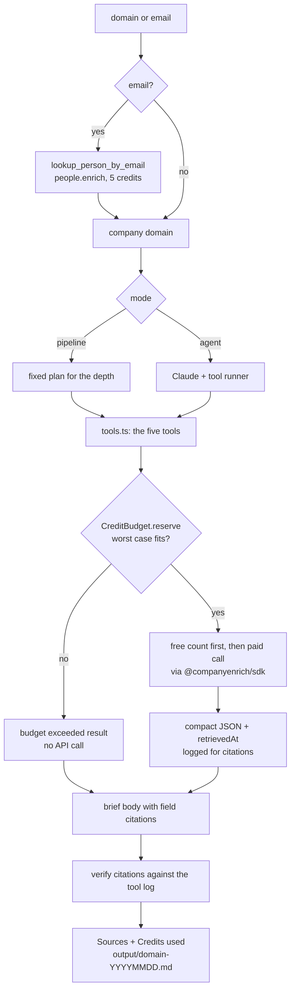

# Agent Account Brief

An AI agent that researches one B2B account using only CompanyEnrich data and writes a one-page brief in which every claim cites the API field it came from, without ever spending more than the credit budget you give it.

This is a reference implementation for AI agent builders: it shows how to give an agent live company and people data as tools, and how to keep that agent inside a hard credit budget. You pass a domain (`stripe.com`) or a work email; the app looks up the company, its funding, its workforce, the people worth talking to and similar companies, then writes a Markdown brief to `output/`. It has two modes that share the same five tools: an **agent** mode, where Claude decides which tools to call, and a deterministic **pipeline** mode that needs no LLM. Both write citations like `[company.financial.fundingStage]`, and the app checks every citation against its own tool log before it writes the Sources section. It demonstrates the [CompanyEnrich v2 API](https://docs.companyenrich.com) through the official `@companyenrich/sdk`: enrichment with paid expansions, workforce history, free counts before paid searches, lookalike search with scores, and reverse email lookup.

## Example output

Real output from `npm start -- vercel.com --depth full` (pipeline mode, run on 2026-11-11). People's names and LinkedIn URLs are replaced with placeholders here, and so are the titles and tenure of people below the executive level. Your own run writes them all to the file. Trimmed where marked.

Progress goes to stderr:

```text
Researching vercel.com (pipeline mode, full depth, cap 40 credits)
  enrich_company vercel.com +financial +technologies: reserved 3 credits
  get_workforce vercel.com: reserved 1 credit
  find_people vercel.com seniority=c-suite,founder,vp not=sales,engineering-technical,marketing limit=3 · 19 matched: reserved 6 credits
  find_people vercel.com seniority=vp,head,director department=sales limit=2 · 16 matched: reserved 4 credits
  find_people vercel.com seniority=vp,head,director department=engineering-technical limit=2 · 23 matched: reserved 4 credits
  find_people vercel.com seniority=vp,head,director department=marketing limit=2 · 13 matched: reserved 4 credits
  find_lookalikes vercel.com limit=3 · 2030 matched: reserved 15 credits
Saved output/vercel.com-20261111.md
```

The brief goes to stdout and to `output/vercel.com-20261111.md`:

```markdown
# Account brief: Vercel (vercel.com)

Generated 2026-11-11 by agent-account-brief: pipeline mode (rule-based), full depth, CompanyEnrich data only.

## Snapshot

| Field | Value | Source |
|---|---|---|
| Name | Vercel | [company.name] |
| Domain | vercel.com | [company.domain] |
| Industry | Media & Internet | [company.industry] |
| Size range | 501-1K employees | [company.employees] |
| Revenue range | $10M-$50M | [company.revenue] |
| Founded | 2015 | [company.foundedYear] |
| HQ | Walnut, California, United States | [company.location.city.name, company.location.state.name, company.location.country.name] |
| Type | Private | [company.type] |

Vercel provides developer infrastructure for building, deploying, scaling, and securing web applications and AI agents. (…) [company.description]

## Funding

- Latest stage: Series F [company.financial.fundingStage]
- Latest round date: 2025-09-30 [company.financial.fundingDate]
- Total disclosed funding: $863M [company.financial.totalFunding]

| Date [company.financial.fundingRounds.date] | Round [company.financial.fundingRounds.type] | Amount [company.financial.fundingRounds.amount] | Investors [company.financial.fundingRounds.investors] |
|---|---|---|---|
| 2025-09-30 | Series F | $300M | Accel, GIC |
| 2024-05-16 | Series E | $250M | Accel |
| 2021-11-23 | Series D | $150M | GGV Capital, Notable Capital |

The 3 most recent of 7 disclosed rounds [company.financial.fundingRoundsTotal].

## Team and growth

- Size range: 501-1K employees [company.employees]
- Observed headcount: 836 [workforce.observedEmployeeCount]. This counts people CompanyEnrich can see in its people data, not an official headcount.
- 12-month change: +6.6% (784 on 2025-12-01 to 836 on 2026-11-01) [workforce.change12m]

| Department | Headcount [workforce.departmentHeadcount] | Share [workforce.departmentShare] | 12-month change [workforce.departmentChange12m] |
|---|---:|---:|---:|
| Engineering | 324 | 38.8% | +5.9% |
| Sales | 165 | 19.7% | +1.2% |
| Marketing | 81 | 9.7% | +47.3% |
| HR | 54 | 6.5% | -3.6% |
| Finance | 42 | 5% | +16.7% |
| IT | 33 | 3.9% | +43.5% |

## People to talk to

### Executives (3 of 19 matching)

| Name | Title | Role | Seniority | Tenure | LinkedIn |
|---|---|---|---|---|---|
| <CEO> [people.name] | Chief Executive Officer [people.experiences.position] | c-suite / executive [people.experiences.department] | c-suite [people.experiences.seniority] | 6.6 years [people.tenureYears] | <LinkedIn URL> [people.socials.linkedinUrl] |
| <CTO> [people.name] | Chief Technology Officer [people.experiences.position] | c-suite / information-technology-executive [people.experiences.department] | c-suite [people.experiences.seniority] | 4.7 years [people.tenureYears] | <LinkedIn URL> [people.socials.linkedinUrl] |
| <Board member> [people.name] | Board Member [people.experiences.position] | c-suite / executive [people.experiences.department] | c-suite [people.experiences.seniority] | 9.9 years [people.tenureYears] | <LinkedIn URL> [people.socials.linkedinUrl] |

### Sales leaders (2 of 16 matching)

| Name | Title | Role | Seniority | Tenure | LinkedIn |
|---|---|---|---|---|---|
| <Sales VP> [people.name] | <title> [people.experiences.position] | sales [people.experiences.department] | vp [people.experiences.seniority] | <tenure> [people.tenureYears] | <LinkedIn URL> [people.socials.linkedinUrl] |
| <Sales director> [people.name] | <title> [people.experiences.position] | sales [people.experiences.department] | director [people.experiences.seniority] | <tenure> [people.tenureYears] | <LinkedIn URL> [people.socials.linkedinUrl] |

(… Engineering leaders and Marketing leaders, 2 each …)

## Lookalikes

| # | Company [lookalikes.name] | Domain [lookalikes.domain] | Industry [lookalikes.industry] | Size [lookalikes.employees] | Score [lookalikes.score] |
|---:|---|---|---|---|---:|
| 1 | Railway | railway.com | Media & Internet | 51-200 | 1.002 |
| 2 | SST | sst.dev | Software | 1-10 | 1.001 |
| 3 | GitHub | github.com | Software | 1K-5K | 0.996 |

Rows keep the order the API returned. Scores rank similarity; they are not probabilities.

## Observations and talking points

- Last round: Series F on 2025-09-30, 14 months ago [company.financial.fundingStage][company.financial.fundingDate]. Fresh funding usually comes with new budget and hiring.
- Engineering is 38.8% of observed headcount (324 of 836) [workforce.departmentHeadcount.engineeringTechnical][workforce.observedEmployeeCount].
- Observed headcount up 6.6% over 12 months (784 in 2025-12 to 836 in 2026-11) [workforce.change12m].
- Marketing is the fastest-growing function: 55 to 81 (+47.3%) [workforce.departmentChange12m.marketing].
- 1 of 9 leaders found started their current role within the last year [people.tenureYears]. New leaders often review tools and vendors early.
- Tracked technologies include Amazon SES, Gmail, Google Apps, Marketo, Salesforce, Sendgrid (6 of 13 shown) [company.technologies][company.technologiesTotal].
- Closest lookalike: Railway (railway.com, score 1.002) [lookalikes[0].name][lookalikes[0].score]. A customer story from a similar company is a natural opener.

## Sources

Every fact above cites a field of a CompanyEnrich tool result. Tool results are compact projections that keep the API field names.

| Field | Tool and endpoint | Retrieved (UTC) |
|---|---|---|
| `company.name` | enrich_company (`GET /v2/companies/enrich`) | 2026-11-11 07:05:15 |
| `workforce.change12m` (derived: oldest vs newest snapshot in workforce history) | get_workforce (`GET /v2/companies/workforce`) | 2026-11-11 07:05:15 |
| `lookalikes.score` (from the search response scores map) | find_lookalikes (`POST /v2/companies/search`) | 2026-11-11 07:05:20 |
(… one row per cited field …)

## Credits used

| # | Tool | Arguments | Estimated | Reserved |
|---:|---|---|---:|---:|
| 1 | enrich_company | vercel.com +financial +technologies | 3 | 3 |
| 2 | get_workforce | vercel.com | 1 | 1 |
| 3 | find_people | vercel.com seniority=c-suite,founder,vp not=sales,engineering-technical,marketing limit=3 · 19 matched | 6 | 6 |
| 4 | find_people | vercel.com seniority=vp,head,director department=sales limit=2 · 16 matched | 4 | 4 |
| 5 | find_people | vercel.com seniority=vp,head,director department=engineering-technical limit=2 · 23 matched | 4 | 4 |
| 6 | find_people | vercel.com seniority=vp,head,director department=marketing limit=2 · 13 matched | 4 | 4 |
| 7 | find_lookalikes | vercel.com limit=3 · 2030 matched | 15 | 15 |
| | **Total** | | **37** | **37** |

Reserved is the worst case held before each call; Estimated is what the response implies was billed. Cap: 40 credits (--max-credits), 3 left unreserved.

Balance from me(): 49,675 before, 49,638 after (37 used while this ran).
```

The estimate matched the balance change from `me()` exactly. The same run with `--max-credits 12 --dry-run` shows the guard at work, for free:

```text
Dry run for vercel.com at full depth: free endpoints only.
  enrich_company vercel.com +financial +technologies: reserved 3 credits
  get_workforce vercel.com: reserved 1 credit
  find_people vercel.com seniority=c-suite,founder,vp not=sales,engineering-technical,marketing limit=3 · 19 matched: reserved 6 credits
  find_people vercel.com seniority=vp,head,director department=sales limit=2 · 16 matched: refused, budget exceeded: this call needs 4 credits, 2 remaining
  ...
  find_lookalikes vercel.com limit=3 · 2032 matched: refused, budget exceeded: this call needs 15 credits, 2 remaining
...
Balance from me(): 49,635 before, 49,635 after (0 used while this ran).
```

## How it works

1. **Parse the input.** A domain is normalized (`https://www.Stripe.com/pricing` becomes `stripe.com`). An email is resolved first with `lookup_person_by_email` (5 credits), and the brief follows that person's current company.
2. **Check the key for free.** `me()` costs nothing, fails fast on a bad key, and records the starting balance.
3. **Research with five tools.** Both modes call the same functions in [`src/lib/tools.ts`](src/lib/tools.ts):
   - `enrich_company(domain, include_funding?, include_tech?)` calls `companies.enrich` with the `financial` and `technologies` expansions.
   - `get_workforce(domain)` calls `companies.workforce` and computes department shares and the 12-month change from `history`.
   - `find_people(domain, seniority[], department[], position[]?, limit<=5)` runs the free `people.count` and only then the paid `people.search`, sized to what matched.
   - `find_lookalikes(domain, limit<=5)` runs the free `companies.count` with `lookalike`, then `companies.search`, keeping the API's order and `scores`.
   - `lookup_person_by_email(email)` calls `people.enrich`.

   Every tool returns compact JSON: only the fields a brief needs, under their API names, plus a `retrievedAt` timestamp. That keeps the model's context small and makes citations point at real API fields.
4. **Reserve before every paid call.** Each tool asks a `CreditBudget` to hold the worst-case cost of the call before it is sent. If the hold would go over `--max-credits`, the API is never called and the tool returns `budget exceeded: this call needs N credits, M remaining`. In agent mode that text goes back to Claude as a tool error, so it can write the brief with what it has. Reservations are never released, so the sum of reservations is a hard ceiling on spend even if an estimate is wrong. Paid GETs (`companies.enrich`, `companies.workforce`) are sent once with `{ maxRetries: 0 }`: the SDK would otherwise retry them after a 5xx or a dropped connection, and every attempt may be billed. Only a 429, which is not billed, is retried. Requests time out after 30 seconds. If the run stops on an error, the CLI prints what it had already reserved.
5. **Write the brief.**
   - **pipeline** mode runs a fixed plan (below) and fills a template. Its observations are rules such as "the largest department's share of observed headcount", "headcount change over 12 months" and "leaders in seat for less than a year".
   - **agent** mode gives the tools to Claude (`claude-opus-5-5`, effort `medium`) through the SDK tool runner. The system prompt tells it to use only facts from tool results, cite the field path after each fact, write "not available" instead of guessing, and stay within the depth. Errors it can act on (nothing found, budget exceeded) go back to it as tool errors; anything else (a bad key, running out of credits) aborts the loop.
6. **Verify citations, then append Sources and Credits.** Each displayed value cites the field it was actually read from: for example a person's title cites `people.experiences.position`, or `people.position` when the role record is missing. Lists that a tool caps (30 technologies, 5 funding rounds) carry the real total too. The app parses every `[field.path]` in the brief and looks it up in the results it logged. Each cited field gets a row with the tool, endpoint and retrieval time; a citation that matches nothing is flagged as unverified. Then it adds the credit ledger and the before and after balance from `me()`.

The budget guard, which every paid call goes through:

```ts
const hold = ctx.budget.reserve('find_people', args, take * PRICES.personResult);
if (!hold.ok) return { status: 'error', error: hold.error }; // "budget exceeded: this call needs 6 credits, 2 remaining"
const page = await ctx.client.people.search({ filter, pageSize: take });
ctx.budget.settle(hold.entry, Math.max(page.items.length, 1) * PRICES.personResult);
```

| Depth | Plan (pipeline mode, and the plan the agent is told to follow) |
|---|---|
| `quick` | `enrich_company` with funding, `find_people` for 3 executives (c-suite, founder, vp) |
| `full` | `enrich_company` with funding and technologies, `get_workforce`, `find_people` for 3 executives plus 2 leaders (vp, head, director) each in sales, engineering and marketing, `find_lookalikes` for 3 |

At full depth the executive search excludes the sales, engineering and marketing departments, so no person is paid for twice.



## CompanyEnrich endpoints used

| SDK method | Endpoint | Why | Cost |
|---|---|---|---|
| `me()` | `GET /v2/me` | Check the key, and read the balance before and after | Free |
| `companies.enrich({ domain, expand })` | `GET /v2/companies/enrich` | Company profile, funding (`financial`) and technologies | 1 credit, +1 per expansion |
| `companies.workforce({ domain })` | `GET /v2/companies/workforce` | Observed headcount, departments, 12 months of history | 1 credit |
| `people.count({ filter })` | `POST /v2/people/search/count` | See how many people match before paying | Free |
| `people.search({ filter, pageSize })` | `POST /v2/people/search` | Leaders by seniority and department | 2 credits per person |
| `companies.autocomplete(domain)` | `GET /v2/companies/autocomplete` | Check a lookalike seed exists (and, in dry runs, the company) | Free |
| `companies.count({ lookalike })` | `POST /v2/companies/search/count` | Size the lookalike search before paying | Free |
| `companies.search({ lookalike, pageSize })` | `POST /v2/companies/search` | Similar companies with similarity scores | 5 credits per company |
| `people.enrich({ email })` | `POST /v2/people/enrich` | Resolve an email input to a person and company | 5 credits when found |

A lookup that finds nothing (404) is not billed. An empty paid search page still bills one result, which is why the tools count first.

## Quickstart

You need Node.js 22.12 or newer and a CompanyEnrich API key from the [dashboard](https://companyenrich.com/dashboard).

```bash
cd agent-account-brief
npm install
cp .env.example .env   # then set COMPANYENRICH_API_KEY in .env
npm start -- stripe.com --dry-run
npm start -- stripe.com
```

The dry run uses only free endpoints and prints what the real run would spend (8 credits for `stripe.com` at quick depth). The second command writes `output/stripe.com-<YYYYMMDD>.md`. To use agent mode, also set `ANTHROPIC_API_KEY` in `.env`.

Run the tests (no network, no keys):

```bash
npm test
npm run typecheck
```

## Configuration

| Variable | Required | Purpose |
|---|---|---|
| `COMPANYENRICH_API_KEY` | Yes | Your CompanyEnrich key. Read from the environment or from `.env`. |
| `ANTHROPIC_API_KEY` | No | Turns on agent mode. Without it the app runs in pipeline mode and says so in one line. |
| `ANTHROPIC_MODEL` | No | Claude model for agent mode. Default `claude-opus-5-5`. |

| Flag | Default | Description |
|---|---|---|
| `<domain or email>` | (required) | `stripe.com`, `https://www.stripe.com`, or `someone@company.com` |
| `--mode agent\|pipeline` | `agent` if `ANTHROPIC_API_KEY` is set, else `pipeline` | Who decides the tool calls: Claude, or the fixed plan |
| `--depth quick\|full` | `quick` | How much to research (see the plan table above) |
| `--max-credits <n>` | `40` | Hard cap on credits for the run |
| `--dry-run` | off | Free endpoints only; prints the plan's ledger and spends 0 credits |
| `--out <dir>` | `output` | Where to write the brief |

**Agent mode needs `ANTHROPIC_API_KEY`.** It uses `claude-opus-5-5` at effort `medium` through `client.beta.messages.toolRunner`, with the server-side refusal fallback (`fallbacks: "default"`) and a check of `stop_reason` before the brief is read. It was tested with a mocked model (a fake `fetch` that returns a `tool_use` turn and then a final text turn), not against the live Claude API. The live runs above are pipeline mode. A dry run always estimates the pipeline plan, because the agent picks its calls at run time; `--max-credits` caps both modes.

## Credits

| Step | Cost | Quick | Full |
|---|---|---|---|
| Lookup by email (only for email input) | 5 | +5 | +5 |
| Company profile | 1 | 1 | 1 |
| Funding (`financial` expansion) | 1 | 1 | 1 |
| Technologies expansion | 1 | - | 1 |
| Workforce | 1 | - | 1 |
| Executives (up to 3 people) | 2 per person | up to 6 | up to 6 |
| Sales, engineering, marketing leaders (up to 2 each) | 2 per person | - | up to 12 |
| Lookalikes (up to 3) | 5 per company | - | up to 15 |
| Counts, autocomplete, `me()` | Free | 0 | 0 |
| **Worst case for a domain** | | **8** | **37** |

The live runs for this README spent 8 credits each on `stripe.com` and `datadoghq.com` at quick depth and 37 on `vercel.com` at full depth. Fewer matches cost less: the free count sizes each paid search, and a department with no matches costs nothing.

To cap spend, pass `--max-credits` (default 40). Calls that do not fit are refused before they reach the API, noted in the brief, and listed in the ledger as refused. Run with `--dry-run` first to see the plan and its cost for free. Agent mode costs Claude tokens on top of the CompanyEnrich credits; those are billed by Anthropic and not counted here.

## Limitations

- Observed headcount counts the people profiles that list the company, so it can differ from official headcount. Department labels come from job titles.
- The 12-month change compares the oldest and newest monthly snapshots in the workforce window. It is a trend signal, not a precise growth rate.
- A company's latest funding event can be a secondary market sale rather than a priced round. The brief labels it as such.
- People results follow the API's ranking and can include board members and advisors. Check titles before outreach.
- Lookalike scores rank similarity and can exceed 1. They are not probabilities.
- The `me()` balance change covers the whole account, so another process using the same key at the same time shows up in it. The ledger's Estimated column is the per-run figure.
- Agent mode was tested only with a mocked Claude client. Its tool-calling choices on the live model may vary, but every call still goes through the same budget guard, and every citation is still checked.
- A dry run cannot resolve an email for free, so it assumes the email's domain is the company's.
- A paid request that times out or loses its connection is not retried, and its reservation stays in place, because it may already have been billed. The ledger shows its Estimated value as `-` (unknown).

## Ideas to extend it

- Batch mode: brief a list of accounts from a CSV with one shared budget, using `companies.enrichBatch` for the profiles.
- Add a `find_work_email` tool (`people.findEmail`, 10 credits per new email) behind an explicit confirm step.
- Expose the five tools as an MCP server so any agent framework can use them with the same budget guard.
- Keep briefs between runs and highlight what changed: new leaders, a new round, headcount moves.
- Let the agent spend leftover budget on one follow-up question, for example "who runs RevOps?", using `position` filters.
