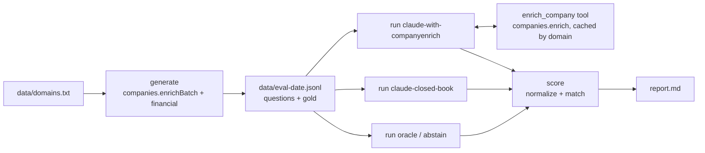

# Agent Hallucination Eval

Measure how often an LLM invents company facts, and how much grounding it with CompanyEnrich data helps.

This CLI builds a question set with gold answers from enriched companies ("How many employees does Spotify have?", "In what year was Maersk founded?"), asks a model each question twice, once closed-book and once with an `enrich_company` tool, and scores accuracy, confident wrong answers (hallucinations) and abstentions per field. It is for people building AI agents who want to measure whether their agent makes up firmographics. It shows how to turn CompanyEnrich records into an eval set, how to expose the API to Claude as a cached, budget-capped tool, and how to grade fuzzy answers like "10,000+ employees" or "$8.8B" fairly.

**No LLM results are included yet.** No Anthropic API key was available when this example was built, so the Claude adapters have only been tested against a mocked Anthropic API. The numbers below are from the two key-free baselines, which exist to prove the pipeline and the matchers work. See [Results](#results) for how to produce real model numbers.

## Example output

Real output from a run on 2026-11-11, using the 18 companies in `data/domains.txt`.

The free dry run checks every domain with autocomplete and reads the balance:

```text
$ npm start -- generate --dry-run
18 domains. Estimated cost: up to 36 credits (2 per company found).
Balance: 48724 credits. Dry run: 0 credits spent.
```

The paid run enriches the companies and writes the question set:

```text
$ npm start -- generate
18 domains. Estimated cost: up to 36 credits (2 per company found).
18 companies, 144 questions (employees 18, revenue 17, foundedYear 18, hqCountry 18, hqCity 13, industry 18, fundingStage 12, totalFunding 12, categories 18).
Wrote data/eval-2026-11-11.jsonl. Credits spent: 36.
```

Each line of the question set stores the question, the gold answer, where it came from and when:

```json
{"id":"maersk.com#foundedYear","domain":"maersk.com","company":"Maersk","field":"foundedYear","fieldPath":"foundedYear","answerType":"year","question":"In what year was Maersk (maersk.com) founded? Answer with a four-digit year.","gold":1904,"retrievedAt":"2026-11-11","sourceUpdatedAt":"2026-11-06T21:24:53.486487Z"}
```

This is what the `enrich_company` tool hands the model for `posthog.com` (a live lookup, 2 credits):

```json
{"found":true,"name":"PostHog","domain":"posthog.com","type":"private","foundedYear":2020,"employees":"51-200","revenue":"1m-10m","industry":"Software","industries":["Software","Media & Internet/Data Collection & Internet Portals"],"categories":["b2b","saas"],"headquarters":{"country":{"code":"US","name":"United States"},"state":"California","city":"San Francisco"},"financial":{"totalFundingUsd":182150000,"fundingStage":"series_e","fundingDate":"2025-09-29T00:00:00"},"updatedAt":"2026-11-10T00:39:44.950326Z"}
```

Scoring the two baseline runs:

```text
$ npm start -- score runs/*.jsonl
abstain-2026-11-11: accuracy 0.0%, partial 0.0%, hallucination 0.0%, abstention 100.0% (n=144, errors=0)
oracle-2026-11-11: accuracy 100.0%, partial 0.0%, hallucination 0.0%, abstention 0.0% (n=144, errors=0)
Wrote report.md.
```

## Results

**These are sanity checks, not model results.** `oracle` answers with the gold value and `abstain` always says "unknown". If the matchers are right, oracle scores 100% accuracy on every field and abstain scores 100% abstention with no hallucinations. Both hold on all 144 questions:

| Run | Questions | Accuracy | Partial | Hallucination | Abstention | Errors |
| --- | --- | --- | --- | --- | --- | --- |
| abstain-2026-11-11 | 144 | 0.0% | 0.0% | 0.0% | 100.0% | 0 |
| oracle-2026-11-11 | 144 | 100.0% | 0.0% | 0.0% | 0.0% | 0 |

No Claude results are included: nobody has run the Claude adapters against the real Anthropic API yet. To produce them, with both keys set:

```bash
npm start -- generate                                  # 36 credits; skip if you already have data/eval-<date>.jsonl
npm start -- run --model claude-closed-book            # Anthropic tokens only, no CompanyEnrich credits
npm start -- run --model claude-with-companyenrich     # up to 36 credits, one lookup per company
npm start -- run --model oracle
npm start -- run --model abstain
npm start -- score runs/*.jsonl                        # writes report.md
```

`report.md` then has an overall table, hallucination and accuracy by field side by side for every run, and a per-field table for each run. Before you publish a number, read the [Limitations](#limitations).

## How it works

1. **Generate.** `generate` reads `data/domains.txt`, enriches every domain with the `financial` expansion through `companies.enrichBatch` (50 per call), and fills one template per field. A question is skipped when its gold value is missing, a placeholder (a total funding under $1,000) or a stage that means "unknown" (`undisclosed`, `series_unknown`). Range, industry, stage and category questions list their allowed answers, so the model is asked in the same vocabulary it is graded in. The industry list comes from the free `industries.list()`. Each finished batch is saved to `data/eval-<date>.enrich.jsonl` before the next request, so if a run fails partway, running the same command again resumes without buying those companies twice.
2. **Run.** `run --model <adapter>` asks every question, four at a time, and appends one line per answer to `runs/<adapter>-<date>.jsonl`, with the question embedded so scoring needs nothing else.
   - `oracle` and `abstain` need no key.
   - `claude-closed-book` sends the question to `claude-opus-5-5` with no tools. The answer must be JSON (`{"answer": "...", "confidence": 0.8}`) through structured outputs, and the prompt says "unknown" is better than a guess.
   - `claude-with-companyenrich` is the same model and prompt plus one tool, `enrich_company`, run by the Anthropic SDK's tool runner. The tool calls `companies.enrich` with the `financial` expansion and returns a compact record. Results are cached by domain, so the nine questions about one company cost one lookup. At most four CompanyEnrich requests run at once across all questions, however many tool calls the model makes in parallel. Paid lookups are sent with `maxRetries: 0`, so each lookup is sent once; a failure that may still have been billed (5xx, timeout, lost connection) stays counted, and spending stops at `--max-credits`.
   - Both Claude adapters set `output_config.effort` explicitly, enable the server-side refusal fallback (`fallbacks: "default"`), and check `stop_reason` before reading the answer. A refusal, a cut-off response or invalid JSON is recorded as an error. A bad key or an empty balance stops the run instead of failing every question.
3. **Score.** `score` normalizes each answer for its type, grades it, and writes `report.md`. Each answer is exactly one of correct, partial, hallucinated (wrong and not "unknown") or abstained, so the four rates add up to 100%. Errors are counted but left out of the rates.



How each answer type is graded:

| Field | Answer type | Correct | Partial |
| --- | --- | --- | --- |
| employees | range | Same bucket. "1,001-5,000", "about 8,000" and "10,000+" are mapped to buckets; a range wider than one bucket ("1-9999") or a negative count is wrong. | Adjacent bucket |
| revenue | range | Same bucket. "$14 billion" or "$100M-$200M" are mapped to buckets; other currencies ("¥14B") are wrong. | Adjacent bucket |
| foundedYear | year | Same year | Off by one |
| hqCountry | country | Same ISO code. "USA", "United States" and "US" all match. | - |
| hqCity | city | Same name after case and accent folding ("Zürich" = "zurich") | - |
| industry | industry | Same top-level industry ("Media and Internet" = "Media & Internet") | - |
| fundingStage | stage | Same label after normalizing ("Series B" = "series_b") | - |
| totalFunding | money | Within 25% of the gold amount ("8.8e9" and "$8.8B" both work). A range counts only if both ends are within 25%, so "$0-$17.6B" is wrong. Negative amounts and other currencies are wrong. | - |
| categories | set | Same set | Any overlap |

## CompanyEnrich endpoints used

| SDK method | Endpoint | Why | Cost |
| --- | --- | --- | --- |
| `companies.enrichBatch({ domains, expand: ['financial'] })` | `POST /v2/companies/enrich/batch` | Gold answers for up to 50 domains per call | 1 credit per company found, plus 1 for `financial` |
| `industries.list()` | `GET /v2/industries` | The allowed answers for the industry question | Free |
| `companies.autocomplete(domain)` | `GET /v2/companies/autocomplete` | Dry run: flags domains CompanyEnrich does not know | Free |
| `me()` | `GET /v2/me` | Dry run balance, and a key check before a grounded run | Free |
| `companies.enrich({ domain, expand: ['financial'] })` | `GET /v2/companies/enrich` | The `enrich_company` tool | 2 credits per company found, a miss is free; cached by domain |

API reference: https://docs.companyenrich.com

## Quickstart

Requires Node.js 22.12 or newer. Get a CompanyEnrich key at https://companyenrich.com/dashboard.

```bash
cd agent-hallucination-eval && npm install
export COMPANYENRICH_API_KEY=your_key
npm start -- generate                  # 36 credits for the 18 shipped companies
npm start -- run --model oracle && npm start -- run --model abstain
npm start -- score runs/*.jsonl        # prints a summary and writes report.md
```

No key yet? `npm start -- run --model oracle --questions data/sample.jsonl` runs on the 9 committed questions in `data/sample.jsonl`, one per field.

To add Claude, set `ANTHROPIC_API_KEY` and follow the commands in [Results](#results). You can also put both keys in a `.env` file in this folder (see `.env.example`); the CLI loads it.

## Configuration

| Variable | Required | Purpose |
| --- | --- | --- |
| `COMPANYENRICH_API_KEY` | For `generate` and `claude-with-companyenrich` | CompanyEnrich API key |
| `ANTHROPIC_API_KEY` | For the two Claude adapters | Anthropic API key. Without it the Claude adapters exit with a one-line notice; the baselines still run. |
| `ANTHROPIC_MODEL` | No | The model to evaluate. Defaults to `claude-opus-5-5`. |

`generate` flags:

| Flag | Default | Purpose |
| --- | --- | --- |
| `--domains <file>` | `data/domains.txt` | One domain per line; `#` comments allowed |
| `--max-credits <n>` | `50` | Refuse to start when the estimate is higher |
| `--out <file>` | `data/eval-<date>.jsonl` | Where to write the question set. Paid results are saved next to it as `<name>.enrich.jsonl`. Checked before any paid call. |
| `--dry-run` | off | Free endpoints only: checks domains, prints the estimate and balance |

`run` flags:

| Flag | Default | Purpose |
| --- | --- | --- |
| `--model <adapter>` | required | `claude-closed-book`, `claude-with-companyenrich`, `oracle` or `abstain` |
| `--questions <file>` | newest `data/eval-<date>.jsonl`, else `data/sample.jsonl` | The question set |
| `--limit <n>` | all | Only the first n questions |
| `--effort <level>` | `medium` | Claude effort: `low`, `medium`, `high`, `xhigh` or `max` |
| `--max-credits <n>` | `50` | Spending cap for the `enrich_company` tool |
| `--out <file>` | `runs/<adapter>-<date>.jsonl` | Where to write the answers |
| `--dry-run` | off | Print the question count and estimate, call nothing |

`score` takes run files as arguments and `--out <file>` (default `report.md`). Each file becomes one run in the report, named after the file.

## Credits

| Step | Cost |
| --- | --- |
| `generate --dry-run` | 0 (autocomplete and `me()` are free) |
| `generate` | 2 per company found (enrichment + `financial`); 36 for the 18 shipped domains. Unknown domains cost nothing. |
| `run --model oracle` / `abstain` | 0 |
| `run --model claude-closed-book` | 0 credits (Anthropic tokens only) |
| `run --model claude-with-companyenrich` | 2 per company the model looks up, once per company thanks to the cache: at most 36 for the shipped set |
| `score` | 0 |

The default demo (generate plus both baselines) costs 36 credits. Adding the grounded Claude run costs up to 36 more. Every paid command checks its inputs and output path, prints its estimate, and refuses to start when the estimate is over `--max-credits`; `--dry-run` shows the estimate for free, and `--limit` shrinks a run. `generate` skips domains already saved in its `.enrich.jsonl` file, so a resumed or repeated run on the same `--out` only pays for what is missing. A grounded run reports credits for lookups that failed but may have been billed separately. Building this example used 84 credits in total, including two full `generate` runs.

## Limitations

- **The gold answers are CompanyEnrich's records.** The eval measures agreement with them, so a "hallucination" is a confident answer that disagrees with the record. Read the disagreements before you quote a hallucination rate.
- **The grounded adapter is advantaged by construction.** It reads the same records the gold answers came from, so its score is close to an upper bound for "how well does the model use the tool", not proof that the tool is right.
- **The set is small.** 144 questions over 18 well-known companies gives wide error bars, and well-known companies are the ones a model is most likely to remember. To test the long tail, add smaller companies to `data/domains.txt`.
- **Vocabulary and timing.** Funding stages use CompanyEnrich's labels (`post_ipo_equity`, `secondary_market`), and the question lists the labels seen in the set, which hints at the answer space. Facts like funding stage and headcount change; each question stores `retrievedAt` and the record's `sourceUpdatedAt`, but a model with older training data will disagree with fresh data.
- **Prompt choices move the numbers.** Both Claude adapters are told that "unknown" is better than a guess, and `--effort` changes how long the model thinks. Compare runs only when they used the same prompt and settings.
- **What was tested live.** `generate`, `generate --dry-run`, the baseline runs, `score`, and the `enrich_company` lookup (one company and one unknown domain) ran against the real CompanyEnrich API. The Claude adapters were tested only with a mocked Anthropic API (a fake `fetch`), because no Anthropic key was available. The refusal fallback can answer with a different model; each run line records the model that answered.

## Ideas to extend it

- Add a review column to the run file so a person can mark gold answers they disagree with, and score with and without them.
- Add adapters for other models or agent frameworks: an adapter is one function from a question to `{ answer, confidence }`.
- Plot calibration: bucket answers by self-reported confidence and compare with accuracy.
- Grow the set with lesser-known companies from a `companies.search` filter, for example 11-50 employee SaaS companies in one country.
- Run the eval on a schedule and track hallucination rate per model over time.
