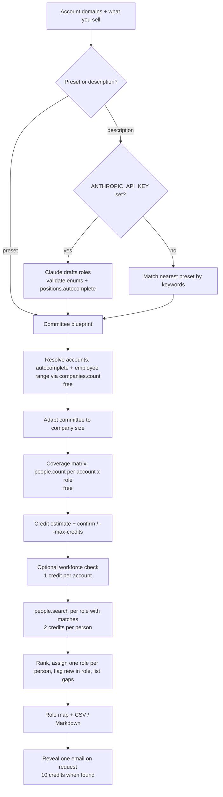

# Buying Committee Mapper

Give it target accounts and what you sell; it maps the people likely to be involved in the purchase, grouped by role, and shows which roles it could not fill.

Enterprise deals are rarely decided by one person. This app takes one or more account domains and a product category (or a free-text description), works out which committee roles to look for at each company's size, and shows for free how many people match each role before you spend anything. When you confirm, it fetches the best match for each role, flags people who are new in their role, marks the gaps, and highlights accounts where a deal would hang on a single contact. It is for sales teams, RevOps and people building sales tools. It shows company data (domain lookup, size, department headcount) and people data (counts, search, work email) from the [CompanyEnrich API](https://docs.companyenrich.com) working together. It is a Next.js web app with a CLI built on the same core library.

## Example output

Live run on 2026-11-11 with the developer tools preset. The coverage step costs 0 credits; `me()` confirmed the balance did not move.

```text
$ npm run cli -- --domains stripe.com,railway.com,resend.com --product devtools

Using the Developer tools and infrastructure preset.

Checking coverage for 3 account(s) (free people counts)...

  Account      Employees  Econ. buyer  Champion  Tech eval  Security  End users  Procurement
-------------  ---------  -----------  --------  ---------  --------  ---------  -----------
  stripe.com    over-10K            4        72         15        29         45           14
! railway.com     51-200            1         0          0         -          0            -
  resend.com       11-50            5         2          -         -          -            -

! = single-threaded: at most one role has anyone matching.
- = role not part of the committee at this company size.

stripe.com: 501+ employees: the economic buyer is pushed up to VP and C-level. Added a security review role: large companies review vendors before signing. Added a procurement and legal role: large contracts go through formal procurement.
railway.com: 51-500 employees: standard committee.
resend.com: 1-50 employees: founders and C-level usually both buy and evaluate, so the economic buyer and technical evaluator are merged into one founder/exec role. The champion and end-user lead are merged into one hands-on lead. No security review or procurement roles: at this size the founders handle both.

Mapping people costs up to 26 credits (13 people across 9 role searches = 26 credits).
Coverage only. Add --fetch to map people.

Credits used by this run (from /v2/me): 0.
```

Mapping the large and the small account (`--fetch --workforce`) spent exactly the estimated 26 credits. Here is the Stripe role map. People's names, LinkedIn URLs and ids are replaced with role placeholders, and each person's exact title and time in role are left out. Seniority is as returned.

```text
$ npm run cli -- --domains stripe.com,resend.com --product devtools --fetch --workforce

Mapping people costs up to 26 credits (12 people across 8 role searches = 24 credits; workforce check = 2).

== Stripe (stripe.com), over-10K employees
   501+ employees: the economic buyer is pushed up to VP and C-level.
   Added a security review role: large companies review vendors before signing.
   Added a procurement and legal role: large contracts go through formal procurement.
   Workforce check: 11250 people observed; empty roles were checked against department headcounts.

   Economic buyer (engineering leader)  [4 matching]
     - <VP Engineering> · vp · <LinkedIn URL>

   Champion (engineering manager)  [72 matching]
     - <Engineering Manager> · manager · <LinkedIn URL>
     - <Senior Engineering Manager> · manager · <LinkedIn URL>

   Technical evaluator (platform or DevOps engineer)  [15 matching]
     - <Platform Architect> · senior · <LinkedIn URL>
     - <Infrastructure Engineer> · senior · <LinkedIn URL>

   Security review  [29 matching]
     - <Head of Privacy> · head · <LinkedIn URL>

   End-user lead (tech lead)  [45 matching]
     - <Tech Lead> · senior · <LinkedIn URL>

   Procurement and legal  [14 matching]
     - <Head of Sourcing> · director · <LinkedIn URL>
     - <Procurement Manager> · manager · <LinkedIn URL>

Credits charged for people searches and workforce checks: 26.
Wrote output/committee-2026-11-11.md and output/committee-2026-11-11.csv
```

At Resend (11-50 employees) the same preset collapses into two roles: two people for "Founder or executive (buys and evaluates)" (the founder and CEO, and a go-to-market lead) and one for "Champion (hands-on lead)" (a senior engineer).

The single-threaded mid-size account shows what gaps look like (3 credits: 1 for the workforce check, 2 for one person):

```text
== Railway (railway.com), 51-200 employees  [single-threaded]
   Workforce check: 108 people observed; empty roles were checked against department headcounts.

   Economic buyer (engineering leader)  [1 matching]
     - <Head of Engineering> · head · <LinkedIn URL>

   Champion (engineering manager)  [0 matching]
     GAP: 28 engineering people observed, but none match this role's seniority or title filters.
     Next step: Start with the most hands-on manager in the team that feels the problem, or grow an end user into a champion.
```

Revealing one work email is a separate, explicit step, using the id the role map prints next to each person:

```text
$ npm run cli -- --reveal-email <person id> --domain resend.com
Email: <email> (certainty: very-high)

Credits used by this run (from /v2/me): 10.
```

The web app follows the same steps on one page: a coverage matrix with single-threaded accounts highlighted, a cost breakdown with a confirm button, role cards with gaps marked, a "Reveal email (10 credits)" button per person, and a CSV export.

## How it works

1. **Pick a committee blueprint.** Choose one of eight presets (security, devtools, data, sales tech, marketing tech, HR tech, finance tech, generic B2B SaaS). Each role is a set of v2 people filters (`department`, `seniority`, optional `position` phrases) plus a limit and a priority. Or describe what you sell: with `ANTHROPIC_API_KEY` set, Claude drafts the roles with structured output and every department and seniority is checked against the v2 enums, and every title phrase against `positions.autocomplete`. Anything invalid is dropped and reported. Without a key, the text is matched to the nearest preset by keywords.
2. **Resolve each account for free.** `companies.autocomplete` confirms the exact domain and returns the company name. The employee range comes from `companies.count` with an `employees` filter, searched in halves (2 to 4 free counts instead of a 1-credit enrich).
3. **Adapt the committee to company size.** 1-50 employees: founders and C-level both buy and evaluate, so roles are merged into a founder-led committee. 51-500: the preset as is. 501+: add security review and procurement/legal roles and raise the economic buyer to VP and C-level. The output explains each change.
4. **Coverage matrix (free).** One `people.count` per account and role. An account where at most one role has anyone is flagged as single-threaded. 20 accounts still cost 0 credits.
5. **Estimate and confirm.** Each role with matches costs `min(limit, count) x 2` credits; roles with 0 matches are skipped. The CLI enforces `--max-credits`. The UI shows the breakdown and asks you to confirm, and the server enforces it too: paid routes refuse any request without `"confirmed": true` before calling CompanyEnrich, and every request counts against a server-wide cap.
6. **Optional workforce check (1 credit per account).** For roles with no matches, `companies.workforce` shows whether the role's home department exists. If it does not, the role is pointed at the executive who likely covers it (for example "no IT and security team observed, so the CTO or CIO likely reviews security"); an end-user lead with no team is skipped. If the team exists, the gap says so.
7. **Fetch, rank and assign (paid).** `people.search` per role with `pageSize = limit`. If a paid call fails midway (out of credits, timeout), the run stops, keeps the people it already paid for, and says why. Candidates are ranked by seniority fit, then title phrase match, then tenure. Each person goes to the highest-priority role they match. People whose current role started in the last 90 days are flagged "new in role". Investors and board members are excluded by title, so the map stays on the people who run the company.
8. **Gaps and exports.** Roles with nobody get a reason and a suggested next step. The CLI writes `output/committee-<date>.md` and `.csv`; the web app exports CSV.
9. **Email reveal, one person at a time.** `people.findEmail` with the account domain, showing `certainty`. Never in bulk.



The core logic lives in `src/lib/` with no framework imports, so the CLI (`src/cli/`) and the Next.js route handlers (`src/app/api/`) are thin layers over it. The API key is read only on the server; the browser talks to `/api/*` and the paid step re-validates every filter it receives.

## CompanyEnrich endpoints used

| SDK method | Endpoint | Why | Cost |
| --- | --- | --- | --- |
| `companies.autocomplete` | `GET /v2/companies/autocomplete` | Confirm each domain, get the company name; domain suggestions in the UI | Free |
| `companies.count` | `POST /v2/companies/search/count` | Find the employee range by counting with an `employees` filter | Free |
| `people.count` | `POST /v2/people/search/count` | Coverage matrix: people per account and role | Free |
| `positions.autocomplete` | `GET /v2/positions/autocomplete` | Check title phrases in a Claude-drafted committee | Free |
| `me` | `GET /v2/me` | Credit balance before and after each CLI run; balance in the UI | Free |
| `companies.workforce` | `GET /v2/companies/workforce` | Optional: department headcounts to explain empty roles | 1 credit per account |
| `people.search` | `POST /v2/people/search` | Fetch people for each role that has matches | 2 credits per person returned |
| `people.findEmail` | `GET /v2/people/{id}/email` | One work email, on request, with certainty | 10 credits when a new email is found; repeat lookups free |

Calls go through the official [`@companyenrich/sdk`](https://www.npmjs.com/package/@companyenrich/sdk) with a 30-second timeout. One shared limiter keeps at most 4 requests in flight across all accounts, and rate-limited requests (HTTP 429) are retried, honouring `Retry-After`. Paid GETs (`companies.workforce`, `people.findEmail`) are never retried after a timeout or server error, because the first attempt may already have been billed; the credit ledger counts such a failure as spent.

## Quickstart

Requires Node.js 22.12 or newer and an API key from the [CompanyEnrich dashboard](https://companyenrich.com/dashboard).

```sh
cd buying-committee
npm ci
cp .env.example .env.local   # then set COMPANYENRICH_API_KEY in .env.local
npm run cli -- --domains stripe.com,railway.com,resend.com --product devtools
npm run dev                  # open http://localhost:3102
```

The CLI reads `.env.local` too; a variable set in your shell takes precedence. Add `--fetch` to the CLI command to map people (26 credits for these accounts at the time of writing).

## Configuration

| Variable | Required | Purpose |
| --- | --- | --- |
| `COMPANYENRICH_API_KEY` | Yes | CompanyEnrich API key. Read only on the server or by the CLI. |
| `ANTHROPIC_API_KEY` | No | Lets Claude draft a custom committee from a free-text description. Without it, descriptions are matched to the nearest preset by keywords and the app says so. |
| `ANTHROPIC_MODEL` | No | Claude model for drafting. Default `claude-opus-5-5`. |
| `MAP_MAX_CREDITS` | No | Web server only: total credits `/api/map` may spend since the server started. Default 300. |
| `REVEAL_MAX_CREDITS` | No | Web server only: total credits `/api/reveal` may spend since the server started. Default 50 (5 new emails). |

CLI flags (`npm run cli -- --help`):

| Flag | Default | Purpose |
| --- | --- | --- |
| `--domains <list>` | | Account domains, comma separated, up to 20 |
| `--product <value>` | `generic` | A preset id (`security`, `devtools`, `data`, `sales-tech`, `marketing-tech`, `hr-tech`, `finance-tech`, `generic`) or a description of what you sell |
| `--fetch` | off | Map people for roles with matches (paid) |
| `--workforce` | off | With `--fetch`: run the 1-credit workforce check per account first |
| `--max-credits <n>` | `40` | Spend cap. The run refuses to start if the searches plus workforce checks exceed it |
| `--dry-run` | off | Free calls only; prints what `--fetch` or `--reveal-email` would cost |
| `--reveal-email <id>` | | Find one person's work email; needs `--domain` |
| `--domain <domain>` | | The person's company domain, for `--reveal-email` |
| `--out <dir>` | `output` | Where `committee-<date>.md` and `.csv` are written |

Web UI controls: account domains (with company autocomplete), a category dropdown or a "Describe it" text box, and a workforce-check toggle. "Check coverage (free)" shows the matrix; "Map people (up to N credits)" spends at most the amount shown; each person has a "Reveal email (10 credits)" button; "Export CSV" downloads the committee including revealed emails. The paid routes (`/api/map`, `/api/reveal`) require `"confirmed": true` in the request body and refuse without calling CompanyEnrich otherwise. The server also re-validates every filter it receives (v2 enums, limits of 1-3 per role, at most 20 accounts and 500 credits per mapping request) and keeps the server-wide caps above, which reset when the server restarts.

## Credits

| Step | Cost |
| --- | --- |
| Resolve accounts (autocomplete, employee range) | 0 |
| Coverage matrix (`people.count` per role) | 0 |
| Claude committee validation (`positions.autocomplete`) | 0 CompanyEnrich credits (Anthropic usage applies) |
| Workforce check (optional) | 1 per account, plus up to 2 per role it relabels |
| People search | 2 per person: `min(limit, count)` per role, roles with 0 matches skipped |
| Email reveal | 10 when a new email is found; repeat lookups free |

Default demo: coverage for 3 accounts = 0 credits; `--fetch --workforce` for stripe.com and resend.com = 26 credits; one email reveal = 10. Total 36.

To cap spend, use `--dry-run` to see the cost first and `--max-credits` to bound a run. In the web app nothing is charged until you press the confirm button, which shows the maximum; the server also refuses unconfirmed requests and stops at `MAP_MAX_CREDITS` and `REVEAL_MAX_CREDITS`. Every paid call reserves its worst-case cost against the cap before it is made, so concurrent calls cannot overshoot. The CLI prints the change in your `/v2/me` balance at the end of each run; it covers the whole account, so other activity on the same key shows up there too.

## Limitations

- This is a map of likely roles, not an org chart: it does not show who reports to whom.
- Roles are inferred from title, department and seniority, not confirmed buying authority. A "VP Engineering" may not own the budget for your product, and a privacy lead filling the security review role is a guess about who reviews vendors.
- Flat teams show up as gaps: Railway has 28 engineers on record but no one at manager level.
- Each role fetches exactly `limit` people to keep costs predictable, so ranking only reorders what the API returned. It does not search wider for a better fit.
- Size bands use CompanyEnrich's employee range estimate. A 600-person company and Stripe get the same large-account committee.
- Workforce headcounts count observed profiles by department. People without a department are not counted in any of them.
- Investors and board members are excluded by title phrase only.
- The API allows about 300 requests per 40 seconds per key. 20 accounts take roughly 200 free calls; when the limit is hit the client waits and retries, so a large run can take a minute.
- Without `ANTHROPIC_API_KEY`, free-text descriptions only choose between the eight presets. The Claude path is covered by tests against a mocked Anthropic API; it has not been run against the live API.
- The server-wide caps are kept in memory per server process, so they reset on restart and are not shared between several server instances.

## Ideas to extend it

- Push the CSV into your CRM as contacts tagged by committee role, and track coverage per opportunity.
- Re-run the free coverage weekly and alert when a mapped person changes role or a gap fills (`currentPositionStartDate` filter).
- Map committees at lookalike accounts with `people.search` and `company: { lookalike: { domains } }` to plan outbound.
- Find warm paths with the `pastExperience` filter: people at the account who used to work at one of your customers.
- Score accounts by committee coverage to prioritise pipeline.
