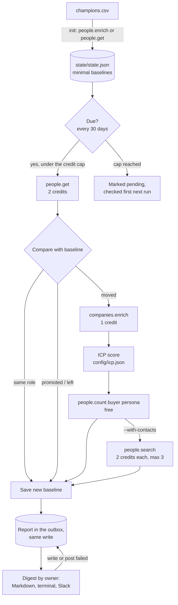

# Champion Tracker

A monthly job that tells account owners when a champion from a won deal changes company or gets promoted.

The people who championed your won deals are your warmest leads. When one of them moves to a new company, you have a friendly buyer at a fresh account. When one is promoted, they usually have a bigger budget where they already are. This TypeScript CLI keeps a small baseline for each champion, re-checks their profile on a schedule with the [CompanyEnrich API](https://docs.companyenrich.com), and writes a digest grouped by account owner (Markdown, terminal and optionally Slack). For each move it enriches the new company, scores it against your ICP and counts the other buyers there for free. It is for sales teams and RevOps, uses no LLM, and shows how to use people lookups by email and id, company enrichment, free people counts and tight credit control in a job that runs unattended.

## Example output

This is a real run against the live API, trimmed. Three real people were found with one `people.search` at HubSpot and tracked by `person_id`. A real first `check` reported "No changes" for all three, as expected. To show the alert flows end to end, two stored baselines were then edited in a temporary copy of the state: one champion was put back at an earlier employer, and one back in an earlier HubSpot role. Everything else below, including the HubSpot enrichment, ICP score, persona count and contacts, came from the API. Names, titles and LinkedIn URLs are replaced with placeholders, and the edited baseline values are generalized.

```text
$ npm start -- check --state state/simulated.json --check-every-days 0 --with-contacts
Using config/icp.example.json. Copy it to config/icp.json to describe your own ICP.
Tracking 3 champions; 3 due (--check-every-days 0 makes everyone due).
Plan: check 3 champions at 2 credits each (6 credits if nobody moved). Each move adds up to 7 for company enrichment plus up to 3 contacts.
Worst case 27 credits; cap 40 (--max-credits); balance 49,083.
  <Partnerships director A> (HubSpot platform partnership): no change
  <Sales director> (<Previous employer> sales platform (simulated)): moved to HubSpot
  <Partnerships director B> (HubSpot tech partner program): promoted

# Champion digest, 2026-11-11

Checked 3 of 3 due champions (3 tracked): 1 moved, 1 promoted, 0 left, 1 unchanged. Spent 13 credits.

## Owner: alex@example.com

### Moved: <Sales director> is now at HubSpot

- Deal: <Previous employer> sales platform (simulated) (<previous-employer domain>)
- Before: <earlier title> at <Previous employer>, since <earlier date>
- Now: <current title> at HubSpot (hubspot.com), since <start month>
- Company: United States, 5K-10K employees, over-1b revenue, Software
- ICP fit: 70/100, strong (employees 5K-10K: near; revenue over-1b: near; categories b2b, saas: match; country US: match)
- Buyer persona there: 152 other people match; 3 of them listed below
- Contact: <Partnerships director A>, <LinkedIn URL> (already one of your tracked champions)
- Contact: <Chief Sales Officer>, <LinkedIn URL>
- Contact: <Partnerships director B>, <LinkedIn URL> (already one of your tracked champions)
- Profile: <LinkedIn URL>

## Owner: morgan@example.com

### Promoted: <Partnerships director B> is now <new title> at HubSpot

- Deal: HubSpot tech partner program (hubspot.com)
- Before: <earlier HubSpot title>, since <earlier start month>
- Now: <new title> (director), since <start month>
- Profile: <LinkedIn URL>
```

The run spent 13 credits (people.get x3 = 6, companies.enrich x1 = 1, people.search x1 = 6), wrote `output/digest-2026-11-11.md` and posted the digest to Slack. The Slack post went to a local HTTP listener standing in for a Slack incoming webhook: no Slack workspace was available, so the Block Kit payload (8 blocks: header, summary, one section per owner and per alert) was checked there and in the unit tests, not in a real channel. Without `--with-contacts` the same move costs 1 credit on top of the profile fetches instead of 7.

## How it works

1. **`init`** reads your CSV. Rows with an `email` are resolved with `people.enrich` (5 credits when found, 0 when not); rows with a `person_id` use `people.get` (2 credits). It keeps a minimal baseline per champion in `state/state.json`: person id, company id, domain and name, position, seniority, position start date, any other current employers, and when they were last checked. Names, profile links and work histories are not stored, and emails are stored only as a SHA-256 hash so a re-run can recognise rows it already resolved.
2. The baseline is the champion's role at the `account_domain` you sold to. If they are no longer listed there, `init` says so and the first `check` reports the move.
3. **`check`** picks the champions that are due (every 30 days by default, with a 10% grace window so a job on the 1st of each month never skips February), oldest first, and fetches each profile with `people.get` (2 credits).
4. It compares the profile with the baseline:
   - **Moved**: a current role at a different company. If the old role is closed, the move is confirmed; if both are still listed as current, it is reported as a likely move, because people often add the new job before closing the old one. Advisory, board, mentor and volunteer roles, and second jobs the champion already had at the last check, are not treated as moves. The newest dated role wins when there are several.
   - **Promoted**: same company (matched by company id first, so a company that changed its domain is still the same employer), a new title, and either a higher seniority or a later position start date.
   - **Left, destination unknown**: no new employer. That covers no current role at all, and a main role that ended while only roles they already had remain, such as a side business they have run for years: that is not a new job, so nothing is enriched. The champion stays tracked, and the next check reports where they land. An empty work history is treated as a data gap, not a departure.
5. For each move it enriches the new company with `companies.enrich` (1 credit), scores it with `config/icp.json`, and runs a free `people.count` for your buyer persona there, excluding the champion. It shows the full `total`, and also the number your plan can fetch when that is lower. With `--with-contacts` it fetches up to 3 of those people with `people.search` (2 credits each) and flags any who are already your champions.
6. In one write it saves the new baselines and puts the report in an outbox in the state file. Then it prints the digest, writes `output/digest-<date>.md` (`-2`, `-3` for later runs the same day), and posts it to Slack as Block Kit when `SLACK_WEBHOOK_URL` is set and there is something to report. A report leaves the outbox only once it is written and posted; if either fails, the next run delivers it before doing anything else, so an alert is never lost after its baseline has moved on.



## CompanyEnrich endpoints used

| SDK method | Endpoint | Why | Cost |
| --- | --- | --- | --- |
| `people.enrich({ email })` | `POST /v2/people/enrich` | Resolve a champion's email to a person (`init`) | 5 credits when found, 0 when not |
| `people.get(id)` | `GET /v2/people/{personId}` | Resolve a `person_id` row (`init`) and re-check each due champion (`check`) | 2 credits |
| `companies.enrich({ domain })` | `GET /v2/companies/enrich` | Profile of the company a champion moved to | 1 credit, 0 when not found |
| `companies.get(id)` | `GET /v2/companies/{companyId}` | Same, when the new employer has an id but no domain | 1 credit |
| `people.count({ filter })` | `POST /v2/people/search/count` | Buyer-persona contacts at the new company | Free |
| `people.search({ filter, pageSize })` | `POST /v2/people/search` | Up to 3 of those contacts, only with `--with-contacts` | 2 credits per person |
| `me()` | `GET /v2/me` | Check the key before spending and show the balance | Free |

Paid GETs are sent with the SDK's retries turned off (`{ maxRetries: 0 }`), so a timeout or a 5xx can never bill the same lookup twice; only a rate limit, which is not billed, is retried. Full API reference: [docs.companyenrich.com](https://docs.companyenrich.com).

## Quickstart

Needs Node.js 22.12 or newer and an API key from the [CompanyEnrich dashboard](https://companyenrich.com/dashboard). From this folder:

```sh
npm ci
export COMPANYENRICH_API_KEY=your_key_here
cp examples/champions.example.csv champions.csv
npm start -- init champions.csv
npm start -- check --check-every-days 0 --dry-run
```

The example rows use `example.com` placeholder addresses, so `init` finds nobody and spends 0 credits. Replace them with your real champions in `champions.csv` (gitignored), run `init` again, then run `npm start -- check` whenever you like, or monthly with the GitHub Action below. Add `--dry-run` to any command to see its plan and cost without spending anything.

## Configuration

| Environment variable | Required | Purpose |
| --- | --- | --- |
| `COMPANYENRICH_API_KEY` | Yes | Your API key. Can also go in a `.env` file in this folder (see `.env.example`). |
| `SLACK_WEBHOOK_URL` | No | A Slack [incoming webhook](https://api.slack.com/messaging/webhooks). Digests with at least one alert or problem are posted there. |

| Flag | Command | Default | Purpose |
| --- | --- | --- | --- |
| `--max-credits <n>` | both | init 100, check 40 | Most credits one run may spend. Never exceeded. |
| `--dry-run` | both | off | Print the plan, estimated cost and balance. No paid calls, no files written. |
| `--check-every-days <n>` | check | 30 | Days between checks of the same champion. `0` makes everyone due now. |
| `--pending-only` | check | off | Check only champions an earlier run left pending (credit cap or early stop), whatever the interval. |
| `--with-contacts` | check | off | Fetch up to 3 buyer-persona contacts at each new company (2 credits each). |
| `--config <file>` | check | `config/icp.json`, else `config/icp.example.json` | ICP and buyer persona. |
| `--state <file>` | both | `state/state.json` | Where baselines are kept. |

**The CSV** needs `email` or `person_id` on each row (a row with both uses the cheaper `person_id`), plus `account_domain`, `owner` and optionally `deal_name`. `owner` can be a name, an email, or a Slack member id (`U...`), which gets @-mentioned. Lines starting with `#` are comments. Re-running `init` is safe: rows already tracked cost nothing, rows you deleted are removed from state, and a changed `account_domain` re-resolves that row. Each person is tracked once; a second row for the same person is skipped.

**`config/icp.json`** (copy `config/icp.example.json`) has two parts. `icp` holds up to four criteria, each with a `weight` and the values that `match`: `employees` and `revenue` bands (a band next to an accepted one earns half), `categories` (any one matches) and `country` (two-letter codes). Remove a criterion to ignore it. The score is the share of weight earned, 0 to 100: 70 and above is a strong fit, 40 to 69 partial. `buyerPersona` lists the `seniority` levels and optional `department` values (such as `sales` or `sales/revenue-operations`; a department includes its sub-departments) of the people who buy from you. The file is validated before any API call, including every seniority and department against the values the v2 API accepts (`src/lib/departments.ts`), and mistakes are reported with their path.

### Run it every month

`github-action.example.yml` runs `check` at 07:00 UTC on the 1st of every month. GitHub only runs workflows from `.github/workflows/`, so copy it to `.github/workflows/champion-tracker.yml` in your own private repository. Its first step checks with `gh api repos/$GITHUB_REPOSITORY` that the repository is private and stops the job, before anything is fetched, committed or uploaded, if it is not. Then run `init` locally, commit the state with `git add -f state/state.json`, and add the `COMPANYENRICH_API_KEY` (and optionally `SLACK_WEBHOOK_URL`) repository secrets. The job commits the updated state back after each run, even a failed one, so paid checks are never repeated, and keeps the digest as a workflow artifact for 14 days.

## Credits

| Step | Cost |
| --- | --- |
| `init`, per email row | 5 when the person is found, 0 when not |
| `init`, per `person_id` row | 2 |
| `check`, per due champion | 2 |
| Per move: enrich the new company | 1 (0 if not found) |
| Per move: buyer-persona count | Free |
| Per move with `--with-contacts` | Up to 6 (3 people at 2) |
| Dry runs, `me()`, counts | Free |

The quickstart spends 0 credits. The live run behind the example output spent 44 credits in total: 6 for the `people.search` that found three test people, 6 for `init`, 6 for the "no changes" `check`, and 13 each for two runs of the simulated move and promotion with `--with-contacts`.

As a guide, 100 champions checked monthly cost about 200 credits a month plus 1 per move. Each command has a `--max-credits` cap. Before each profile fetch, `check` also keeps enough credit back to research one move (1 credit, or 7 with `--with-contacts`), so a move found under the cap is always enriched and the cap is never passed. A paid call that times out is counted as spent, because it may have been billed. Champions that do not fit are marked pending: the digest gives a command that checks just those, whatever the interval, with the same `--config`, `--state` and `--with-contacts` (for example `npm start -- check --pending-only --max-credits 5`). Otherwise they go first on the next run. Profiles already checked are not bought again. A capped `init` works the same way and prints the `init` command that resolves only the remaining rows.

## Privacy

This tool processes personal data about people outside your company, so use it responsibly:

- **Only track people you have a business relationship with**, such as champions on deals you won, and have a lawful basis for it (in the EU and UK usually legitimate interest, documented in a short assessment). Mention this kind of processing in your privacy notice, and honour opt-out and deletion requests.
- **Keep only what you need.** State holds ids, titles and employer ids, with emails hashed. Delete a champion's row from the CSV and re-run `init` to remove them from state. Digests in `output/` name people: delete them once they have been read, and keep the Action's artifact retention short.
- **Keep the data private.** `champions.csv`, `state/` and `output/` are gitignored. A digest that could not be delivered waits in the state file, names included, until it is; delivered digests are removed from state. If you use the GitHub Action, the state is committed to that repository, so it must be private: the workflow refuses to run in a public one.

## Limitations

- Profile data follows what people publish. People often update their profile weeks after a move and leave the old role open. That is why moves with the old role still listed are marked "likely" and should be confirmed before outreach. The digest shows when each profile was last updated.
- Side roles are recognised by title keywords (advisor, board member, mentor, volunteer and similar). A new community membership or side project with another title can show up as a likely move.
- A promotion needs a new title. A seniority change without a title change, or a title edit without a new start date, is treated as a profile clean-up. Seniority follows the API's order (owner, founder, c-suite, partner, vp, head, director, manager, senior, entry, intern), so "Head of" ranks above "Director".
- Only an employer that was not already on the profile counts as a destination. A champion who goes full-time at a side business they already had is reported as left, because the data cannot tell that apart from keeping a side business after leaving.
- Promotions are only detected at the tracked company. After a likely move, the old company stops being watched for promotions.
- People search cannot exclude person ids. The champion is excluded from the persona count and contacts by exact name, so a namesake at the same company would also be excluded. Contacts may include people you already track; they are flagged.
- One deal per champion: if a person appears on several rows, only the first is tracked.
- `init` matches the champion to the account by exact domain. If the CSV has a different domain than CompanyEnrich (for example a regional domain), the first check reports a move; `init` warns about this so you can fix the row.
- Slack posting was tested with mocked `fetch` and a local HTTP listener, not a real workspace.

## Ideas to extend it

- Read champions straight from your CRM (closed-won opportunities and their contact roles) instead of a CSV, and write alerts back as tasks for the owner.
- Look up the champion's new work email with `people.findEmail(id, { domain })` (10 credits when found) for moves with a strong ICP fit.
- Find lookalikes of the new company with a `companies.search` `lookalike` query to widen the opportunity.
- Send each owner their own alerts as a Slack DM instead of one channel message.
- Check your top accounts' champions weekly and everyone else monthly by keeping two state files.
