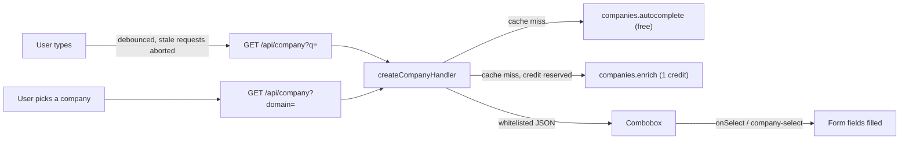

# Company Autocomplete

A drop-in company picker: suggest companies with logos as someone types, then fill in industry, size and country from one enrichment call.

This example is for SaaS builders who ask for a company on signup, onboarding or CRM forms. Every keystroke is answered by the free [CompanyEnrich](https://companyenrich.com) autocomplete endpoint; only the company the user actually picks is enriched, for 1 credit, and the result is cached. It ships as copy-paste source rather than an npm package: a framework-agnostic server handler, an accessible React combobox, a framework-free `<company-autocomplete>` web component, and a Next.js signup form that uses them. It shows how to keep the API key on the server, return a small whitelisted payload to the browser, and make paid calls hard to waste.

## Example output

Captured from the running demo with `curl`. Suggestions for `stri` (free, 10 results, first 4 shown):

```console
$ curl -s "http://localhost:3105/api/company?q=stri"
```

```json
{
  "items": [
    { "domain": "stripe.com", "name": "Stripe", "logoUrl": "https://api.companyenrich.com/companies/logo/0192577c-1d7a-715c-a5b7-1b9b530445e0" },
    { "domain": "stringee.com", "name": "Stringee", "logoUrl": "https://api.companyenrich.com/companies/logo/0192577c-4f93-7189-bdef-eb3424355da3" },
    { "domain": "strike.me", "name": "Strike", "logoUrl": "https://api.companyenrich.com/companies/logo/01925ca2-17e7-75cd-9a1d-0b05f93538fd" },
    { "domain": "stripe.dev", "name": "Stripe", "logoUrl": "https://api.companyenrich.com/companies/logo/0192577c-7f5f-7cbf-bca9-87c8b73b4c50" }
  ]
}
```

Picking Stripe enriches it (1 credit). This is the whole response; the browser never sees more than these fields:

```console
$ curl -s "http://localhost:3105/api/company?domain=stripe.com"
```

```json
{
  "company": {
    "id": "0192577c-1d7a-715c-a5b7-1b9b530445e0",
    "domain": "stripe.com",
    "name": "Stripe",
    "logoUrl": "https://api.companyenrich.com/companies/logo/0192577c-1d7a-715c-a5b7-1b9b530445e0",
    "industry": "Finance",
    "employees": "over-10K",
    "revenue": "over-1b",
    "foundedYear": 2010,
    "country": { "code": "US", "name": "United States" },
    "state": "California",
    "city": "San Francisco",
    "linkedinUrl": "https://www.linkedin.com/company/stripe"
  },
  "credits": 1,
  "cached": false
}
```

Pasting a URL for the same company afterwards is normalized to `stripe.com` and served from the cache:

```console
$ curl -s -D - -o /dev/null "http://localhost:3105/api/company?domain=https%3A%2F%2Fwww.stripe.com%2Fpricing" | grep x-cache
x-cache: hit
```

The body then says `"credits": 0, "cached": true`. Other live queries from the same run: `open ai` finds openai.com, `linea` finds linear.app, `hubsp` finds hubspot.com, and `https://www.notion.com/product` finds notion.com.

## How it works

1. The user types in the company field. After a 250 ms pause and at least 2 characters, the component asks `GET /api/company?q=<text>`. Older requests are aborted, and late answers to them are ignored.
2. The handler normalizes the text (`https://www.Stripe.com/pricing` becomes `stripe.com`, `jane@stripe.com` becomes `stripe.com`, `open ai` becomes `openai`), checks its cache, and otherwise calls the free `companies.autocomplete`. Only letters, digits, dots and hyphens reach the API. It returns only domain, name and logo.
3. The user picks a suggestion with the mouse or keyboard. If no suggestion matches a typed domain exactly, the list offers `Use <typed domain>`.
4. The component asks `GET /api/company?domain=<domain>`. The handler checks its cache. On a miss, it reserves one credit against the client's allowance and the overall daily budget, then calls `companies.enrich` (1 credit) with retries turned off, because a failed paid attempt may already have been billed. The reservation is handed back when the API says nothing was billed (404, invalid input, bad key, no credits, rate limited). Concurrent lookups of the same domain share that one call, and "not found" answers are cached too. Separately, every request of either kind counts toward a per-client throttle.
5. The handler copies a dozen whitelisted fields into the response. The component calls `onSelect` (React) or fires `company-select` (web component), and the form fills in what it wants. If the user typed or picked again while the lookup was in flight, the result is not applied, but it is not aborted either: the server bills it anyway, so it finishes, warms the cache, and its cost is still reported through `onCost` / `company-cost`.



What lives where (copy the folders you need; imports are relative, no path aliases):

| Path | What it is | Depends on |
| --- | --- | --- |
| `src/server/` | `createCompanyHandler`, LRU+TTL cache, rate limiter, client IP resolvers | `@companyenrich/sdk`, `src/shared/` |
| `src/shared/` | The JSON contract and input normalization | nothing |
| `src/client/` | Browser fetch client and the combobox controller (debounce, abort, keyboard) | `src/shared/` |
| `src/react/CompanyAutocomplete.tsx` | React view of the controller, Tailwind classes | React, `src/client/` |
| `src/web-component/company-autocomplete.ts` | Custom element view of the same controller | `src/client/` |
| `app/` | The Next.js demo: signup form and `app/api/company/route.ts` | all of the above |
| `examples/` | Express server with `vanilla.html`, and a Cloudflare Worker | `src/server/` |

The React component and the web component render the same `CompanyComboboxController`, so their behaviour cannot drift apart. The combobox follows the [WAI-ARIA combobox pattern](https://www.w3.org/WAI/ARIA/apg/patterns/combobox/): `role="combobox"` with `aria-expanded`, `aria-controls` and `aria-activedescendant`; a `role="listbox"` popup; Down/Up (wrapping), Home/End while an option is highlighted, Enter to pick, Escape to close and then to clear; and a polite live region announcing result counts and picks.

## CompanyEnrich endpoints used

| SDK method | Endpoint | Why | Cost |
| --- | --- | --- | --- |
| `companies.autocomplete(query)` | `GET /v2/companies/autocomplete` | Suggestions with logos while typing | Free |
| `companies.enrich({ domain })` | `GET /v2/companies/enrich` | Industry, size, country and more for the picked company | 1 credit when found; a 404 costs nothing |

Logos are public URLs on `api.companyenrich.com`, so the browser loads them directly without the key. Full reference: [docs.companyenrich.com](https://docs.companyenrich.com).

## Quickstart

Requires Node.js 22.12 or newer and an API key from the [dashboard](https://companyenrich.com/dashboard).

```sh
cd company-autocomplete
npm ci
cp .env.example .env.local   # then put your key after COMPANYENRICH_API_KEY=
npm run dev                  # http://localhost:3105
```

For the framework-free version (`examples/vanilla.html` with the web component, served by Express on the same port):

```sh
COMPANYENRICH_API_KEY=your_key npm run example:express   # http://localhost:3105
```

Checks that need no key and no network:

```sh
npm run typecheck && npm test && npm run build
```

## Use it in your app

### Next.js (App Router)

`app/api/company/route.ts`, as in this demo. Keep the handler at module scope so its cache and limits persist between requests:

```ts
import { forwardedFor, vercelClientIp, type ClientIpResolver } from '../../../src/server/client-ip';
import { createCompanyHandler } from '../../../src/server/handler';

// Rate limits need a client IP the visitor cannot forge. Vercel sets one. Behind
// reverse proxies you run, set TRUST_PROXY to how many of them append to
// X-Forwarded-For. Otherwise (for example `next start` exposed directly, which
// passes a client-sent X-Forwarded-For through) all visitors share one bucket.
function clientIpResolver(): ClientIpResolver | undefined {
  if (process.env.VERCEL) return vercelClientIp;
  const trustedProxies = Number(process.env.TRUST_PROXY);
  return Number.isInteger(trustedProxies) && trustedProxies > 0 ? forwardedFor(trustedProxies) : undefined;
}

const handler = createCompanyHandler({
  apiKey: process.env.COMPANYENRICH_API_KEY,
  cacheTtlMs: 24 * 60 * 60 * 1000,
  clientIp: clientIpResolver(),
});

export async function GET(request: Request): Promise<Response> {
  return handler(request);
}
```

Next.js 16 has no `request.ip`. We checked that a self-hosted `next start` passes a client-sent `X-Forwarded-For` through unchanged and fills it in from the socket only when the header is missing. That is why `X-Forwarded-For` is trusted only with `TRUST_PROXY`.

### React

```tsx
'use client';

import { CompanyAutocomplete, type CompanySelection } from './CompanyAutocomplete';

export function CompanyField() {
  return (
    <CompanyAutocomplete
      endpoint="/api/company"
      name="companyDomain"
      onSelect={(selection: CompanySelection) => {
        // selection.company is null when there is no data for the domain.
        console.log(selection.company?.industry, selection.company?.employees, selection.company?.country?.code);
        console.log(`${selection.credits} credit(s), cached: ${selection.cached}`);
      }}
      onClear={() => console.log('The user changed the company; drop the auto-filled values.')}
      classNames={{ input: 'my-input-class' }}
    />
  );
}
```

`name` adds a hidden input, so the picked domain submits with a plain `<form>`. Every Tailwind class is in `defaultClassNames` at the top of the file; override any key with `classNames`, or edit them in your copy.

### Web component

Build the element into one dependency-free file, then serve it with your page:

```sh
npm run build:wc   # writes dist/company-autocomplete.js
```

`dist/` is build output and is gitignored; `npm run example:express` rebuilds it before starting.

```html
<script type="module" src="/company-autocomplete.js"></script>

<form>
  <company-autocomplete endpoint="/api/company" name="companyDomain"></company-autocomplete>
  <input name="industry" />
</form>

<script type="module">
  const picker = document.querySelector('company-autocomplete');
  picker.addEventListener('company-select', (event) => {
    const { company } = event.detail; // same shape as the React onSelect argument
    document.querySelector('[name="industry"]').value = company?.industry ?? '';
  });
  picker.addEventListener('company-clear', () => {
    document.querySelector('[name="industry"]').value = '';
  });
</script>
```

The element renders into the light DOM with `ca-*` class names, so your page CSS styles it; `examples/vanilla.html` has a complete stylesheet. Attributes are read when the element connects: `endpoint`, `label`, `name`, `placeholder`, `min-chars`, `debounce-ms`.

### Express

From `examples/express-server.ts`, which is type-checked by `npm run typecheck` and was run live:

```ts
import express from 'express';
import { createCompanyHandler } from '../src/server/handler';

const handler = createCompanyHandler({ apiKey: process.env.COMPANYENRICH_API_KEY });
const app = express();

app.get('/api/company', async (req, res) => {
  // The handler only needs the URL. Client headers are not copied, and the IP
  // comes from Express (set `trust proxy` if you run behind a load balancer).
  const response = await handler(new Request(new URL(req.originalUrl, 'http://localhost')), { clientIp: req.ip });
  res.status(response.status);
  response.headers.forEach((value, name) => res.setHeader(name, value));
  res.send(await response.text());
});
```

### Cloudflare Worker

From `examples/cloudflare-worker.ts`, which is type-checked by `npm run typecheck`. Set `main = "examples/cloudflare-worker.ts"` in `wrangler.toml` and store the key with `npx wrangler secret put COMPANYENRICH_API_KEY`.

```ts
import { cloudflareClientIp } from '../src/server/client-ip';
import { createCompanyHandler, type CompanyHandler } from '../src/server/handler';

interface Env {
  COMPANYENRICH_API_KEY: string;
}

// Module scope lives as long as the isolate, so the cache is shared by the
// requests that isolate serves (not across isolates or regions).
let handler: CompanyHandler | undefined;

export default {
  async fetch(request: Request, env: Env): Promise<Response> {
    if (new URL(request.url).pathname !== '/api/company') {
      return new Response('Not found', { status: 404 });
    }
    // Cloudflare sets CF-Connecting-IP itself, so clients cannot forge it.
    handler ??= createCompanyHandler({ apiKey: env.COMPANYENRICH_API_KEY, clientIp: cloudflareClientIp });
    return handler(request);
  },
};
```

This was not deployed to Cloudflare. It was bundled with esbuild for a platform-neutral target (no Node built-ins needed), and the bundle's `fetch` export was run in Node: an earlier revision against the live API, and this one against a stubbed API, where the 11th fresh lookup from one `CF-Connecting-IP` got a 429 even though each request forged a different `X-Forwarded-For`.

## Configuration

| Environment variable | Required | Purpose |
| --- | --- | --- |
| `COMPANYENRICH_API_KEY` | Yes | Server-side key for the route handler. Without it, `/api/company` answers `503 not_configured` and logs one line. |
| `TRUST_PROXY` | No | Next.js demo only. Number of reverse proxies you run that append to `X-Forwarded-For` (for example `1` behind one nginx). Leave unset when the app is exposed directly. On Vercel the platform header is used instead. |
| `PORT` | No | Port for `npm run example:express`. Default 3105. |

`createCompanyHandler(options)`:

| Option | Default | Purpose |
| --- | --- | --- |
| `apiKey` | `COMPANYENRICH_API_KEY` | CompanyEnrich key |
| `cacheTtlMs` | 24 hours | How long suggestions and enrichments stay cached |
| `cacheMaxEntries` | 1,000 | Entries per cache before the least recently used is evicted |
| `clientIp` | none (one shared bucket) | Reads the client IP from a header your platform sets: `vercelClientIp`, `cloudflareClientIp` or `forwardedFor(trustedProxies)` from `src/server/client-ip.ts` |
| `throttle` | `{ limit: 120, windowMs: 60000 }` | Requests of any kind per client, cache hits and 404s included |
| `creditsPerClient` | `{ limit: 10, windowMs: 600000 }` | Credits one client may reserve for fresh enrichments |
| `creditBudget` | `{ limit: 500, windowMs: 86400000 }` | Credits all clients together may reserve: a hard cap per process |
| `onError` | one line on `console.error` | Receives unexpected upstream errors (bad key, out of credits, outages) and a once-per-window budget warning |
| `fetch`, `now` | global `fetch`, `Date.now` | Injection points for tests |

The handler's second argument, `{ clientIp }`, is for adapters that know the connection's address, such as Express's `req.ip`; it takes precedence over the `clientIp` option. With neither, every client shares one bucket. That is strict, but nobody can get round it by forging headers.

Responses:

| Request | Success | Errors (`{ error: { code, message } }`, message safe to show) |
| --- | --- | --- |
| `?q=<text>` | `{ items: [{ domain, name, logoUrl }] }`, empty under 2 characters | `400 invalid_request` over 100 characters, `429 rate_limited` (throttle) with `Retry-After` |
| `?domain=<domain, URL or email>` | `{ company, credits, cached }` | `400 invalid_request`, `404 not_found`, `429 rate_limited` (throttle or client credits) with `Retry-After`, `503 budget_exhausted` with `Retry-After` |
| Either, upstream failure | | `503 not_configured` (missing or rejected key), `503 unavailable` (out of credits), `429 rate_limited` (API busy), `502 upstream_error` |

Upstream error details and trace IDs go to `onError`, never to the browser. Responses carry `x-cache: hit|miss`.

React props: `endpoint`, `label`, `name`, `placeholder`, `minChars` (2), `debounceMs` (250), `onSelect`, `onClear`, `onCost`, `classNames`. Web component events: `company-select`, `company-clear`, `company-cost`.

`onCost` / `company-cost` receives `{ domain, credits, cached, superseded }` for every enrichment the server answers, including one the user moved past (`superseded: true`). Use it, not `onSelect`, for a spend ledger, as the demo's "What this cost" panel does. A lookup that fails with a server error or timeout reports nothing: neither the browser nor the handler can tell whether it was billed.

## Credits

| Step | Cost |
| --- | --- |
| Typing, any number of suggestions | Free |
| Picking a company the first time | 1 credit |
| Picking it again, within 24 hours on the same server or in the same browser tab | 0 (cached) |
| Picking a domain CompanyEnrich has no data for | 0 (the API returns 404; the balance did not change in our test) |

A normal signup costs 1 credit. The live verification for this README spent 3 credits: stripe.com and linear.app on the production build, then stripe.com once more on a fresh `npm run dev` process (its `me()` balance moved by exactly 1). Every repeated lookup was a cache hit.

Spend is capped on the server, not in the UI, so a `curl` loop against a public deployment is held to the same limits as the form:

- Each fresh enrichment reserves 1 credit against two limits: 10 per client per 10 minutes (`creditsPerClient`), and 500 per day across all clients in the process (`creditBudget`). Past the budget, `?domain=` answers `503 budget_exhausted`, `onError` is told once per window, and the form stays usable with manual entry.
- The reservation is handed back when the API says the lookup was not billed: 404 (unknown company), invalid input, bad key, no credits, or rate limited. A server error or timeout keeps it, since that attempt may have been billed.
- Paid enrichments are never retried, so one pick is never billed more than once.
- Cache hits and concurrent duplicates reserve nothing.
- Abuse is handled separately, by a throttle of 120 requests per client per minute (`throttle`). It counts every request, free or not, so floods of cache hits or unknown domains are throttled too, without using up the credit allowance.

Lower the limits to cap spend further, or move the `?domain=` call from pick time to form submission so only completed signups are enriched. There is no "confirm" prompt: the person filling in the form is not the one paying, each pick costs at most 1 credit, and the server-side caps bound the total.

## Limitations

- Autocomplete searches by domain: `stri` finds Stripe and `open ai` finds OpenAI (spaces are removed). The empty state tells people to type the company's website, and the `Use <typed domain>` option covers domains with no suggestion.
- The cache, the rate limits and the daily budget are in memory, per process. On serverless platforms and Workers each instance has its own copy, so the budget is per instance, and a restart resets it. Use Redis or a KV store for a shared cache, limit or budget.
- Rate limiting is only as good as the client IP, so no header is trusted by default. On Vercel, Cloudflare and Express the examples use the platform's or the connection's address. A self-hosted Next.js app behind your own proxies needs `TRUST_PROXY`. Without any of these, every visitor shares one bucket (120 requests a minute, 10 fresh enrichments per 10 minutes), which is safe but too strict for a busy production form.
- The handler sends no CORS headers. Serve it from the same origin as the form, or add the headers in your adapter.
- Field values are CompanyEnrich's: `industry` is its label (Stripe is "Finance"), `employees` is a range bucket, and any field can be null. Treat them as suggestions the user can edit, which the demo does.
- Companies that are not yet stored are enriched on demand, which can take a few seconds; the field shows "Looking up…" meanwhile. The SDK timeout is 30 s.
- What was tested how: the handler ran against the live API in Next.js and Express (via `curl`), and the Worker bundle ran in Node against the live API. The later changes to client-IP trust, the throttle and credit reservations were verified with unit tests and a stubbed API, not live. The React component and the web component are tested in jsdom, including a path through the real handler with a fake CompanyEnrich `fetch`; they were not driven in a real browser for this README.

## Ideas to extend it

- Pre-fill the company from the work email's domain, skipping free-mail domains such as gmail.com.
- Map the returned industry to your CRM's picklist, or to NAICS codes with the free `industries.list()`.
- Ask for paid expansions (`technologies`, `financial`) at submit time for accounts that convert.
- Swap the in-memory cache for Redis or Cloudflare KV so every instance shares it.
- Store `company.id` with the account so later lookups can use `companies.get(id)`.
