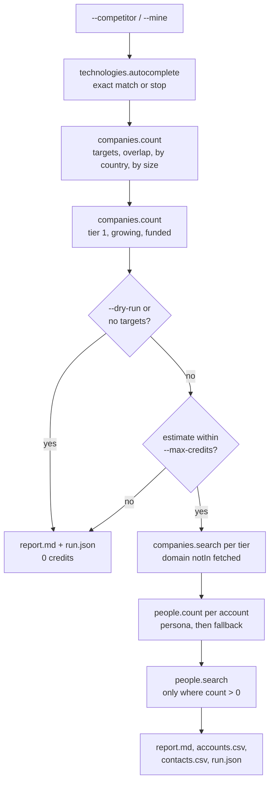

# Competitor Displacement

Find the companies that run a competitor's technology and not yours, size that market for free, rank accounts by why-now signals, and find the person who would own the switch.

This is a TypeScript CLI for the classic displacement play, built for sales teams, product marketing and agencies. You name a technology your prospects run today (`--competitor`) and, optionally, your own (`--mine`). The app checks both names against the API, counts the market and breaks it down by country and company size, splits it into three tiers by growth and recent funding, fetches the best accounts first, and finds one or more buyers at each account based on what kind of tool the competitor is. It shows how far the free endpoints of the [CompanyEnrich API](https://docs.companyenrich.com) go (autocomplete, company and people counts), how to combine `all` and `notIn` technology filters, how to page through tiers without paying for the same company twice (`domain: {notIn}`), and how to keep spend under a hard cap. There is no LLM in it.

## Example output

A real run from 2026-11-11 (20 credits). Vendor names are just the example inputs; swap in any pair.

```
$ npm start -- --competitor zendesk --mine intercom --country US --employees 51-200,201-500 --accounts 5 --contacts 1 --with-funding

1. Validating technologies (free autocomplete)
   competitor: zendesk, yours: intercom
2. Sizing the market (free counts)
   5,983 companies run zendesk and not intercom
3. Ranking by why-now signals (free counts)
   tier 1: 69, tier 2: 116, tier 3: 5,798
Buyer persona: customer-service ("zendesk" looks like support / helpdesk, keyword "zendesk")
Credit estimate (upper bound):
  accounts: 5 companies x 2 (tier 1: 5, tier 2: 0, tier 3: 0) ...   10
  contacts: up to 5 people x 2 ..................................   10
  already spent by this run .....................................    0
  total .........................................................   20  (cap 40)
4. Fetching accounts, tier 1 first (paid)
   tier 1: 5 companies (10 credits): replit.com, socket.dev, inkind.com, render.com, coder.com
5. Finding the buyer: Customer service and support (free counts, then paid search)
Credit estimate (upper bound):
  contacts: 5 people at 5 accounts x 2 ...   10
  already spent by this run ..............   10
  total ..................................   20  (cap 40)
   replit.com: 1 persona contact(s) (2 credits)
   socket.dev: 1 persona contact(s) (2 credits)
   render.com: 1 persona contact(s) (2 credits)
   inkind.com: 1 persona contact(s) (2 credits)
   coder.com: 1 persona contact(s) (2 credits)

Wrote report.md, accounts.csv, contacts.csv, run.json to output/20261111-074829-zendesk-not-intercom
20 credits charged by this run (balance 49,381 -> 49,361)
```

An excerpt of the `report.md` it wrote. People's names and LinkedIn URLs are replaced with role placeholders here; the real file has them.

```markdown
## Market size (free)

| Segment | Companies |
| --- | ---: |
| Run zendesk | 6,093 |
| Run zendesk and intercom | 110 |
| **Targets: zendesk, not intercom** | **5,983** |

## Why-now tiers (free)

| Tier | Definition | Companies | Share |
| --- | --- | ---: | ---: |
| 1 | Growing and recently funded: headcount +10% or more in 6 months, latest round in 2025 or later, $1M+ raised | 69 | 1.2% |
| 2 | Growing only: headcount +10% or more in 6 months, not in tier 1 | 116 | 1.9% |
| 3 | The rest of the market | 5,798 | 96.9% |

## Accounts

| # | Tier | Company | Domain | Employees | Industry | Latest round |
| --- | --- | --- | --- | --- | --- | --- |
| 1 | 1 | Replit | replit.com | 201-500 | Software | Corporate Round, 2026-05-28 |
| 2 | 1 | Socket | socket.dev | 51-200 | Software | Series C, $60M, 2026-05-20 |
| 3 | 1 | inKind | inkind.com | 51-200 | Finance | Debt Financing, $414M, 2026-08-10 |
| 4 | 1 | Render | render.com | 51-200 | Media & Internet | Series C, $100M, 2026-02-17 |
| 5 | 1 | Coder | coder.com | 51-200 | Software | Series C, $90M, 2026-04-01 |

## Contacts

| Company | Tier | Name | Seniority | Match | LinkedIn |
| --- | --- | --- | --- | --- | --- |
| Replit | 1 | <Head of Support> | director | persona | <linkedin url> |
| Socket | 1 | <Customer Success Manager> | manager | persona | <linkedin url> |
| inKind | 1 | <Customer Success Manager> | manager | persona | <linkedin url> |
| Render | 1 | <Support Manager> | manager | persona | <linkedin url> |
| Coder | 1 | <Customer Success Manager> | manager | persona | <linkedin url> |

## Credits

| Step | Call | Estimated | Charged |
| --- | --- | ---: | ---: |
| accounts | tier 1: 5 of 5 companies | 10 | 10 |
| contacts | replit.com: 1 of 1 people | 2 | 2 |
| ... | | | |

Charged by this run: **20** credits (cap 40). Balance before and after: 49,381 -> 49,361.
```

The full report also has the breakdown by country and employee range, each account's why-now signals, and the persona and fallback filters that were used. Without filters, the same pair gives 86,792 targets in the free dry run, with tier 1 at 283 companies.

## How it works

1. **Validate the technologies (free).** `technologies.autocomplete` must return an exact, case-insensitive match for `--competitor` and `--mine`. Otherwise the run stops and prints the closest suggestions, so a typo never turns into an empty market.
2. **Size the market (free).** `companies.count` with `technologies: {all: [competitor], notIn: [mine]}` plus your country, size and category filters. Further counts give the competitor's install base, the overlap with your technology, and a breakdown by country and by employee range (4 counts in flight at a time). Sizes use `total`, because `count` is capped at the plan's search limit (100,000).
3. **Tier by why-now signals (free).** Tier 1 is growing (`workforceGrowth` overall, 6 months, at least +10%) and recently funded (`fundingYear` from last year, `fundingAmount` at least $1M). Tier 2 is growing only. Tier 3 is the rest. Tier sizes come from counts: tier 2 = growing - tier 1, tier 3 = targets - growing.
4. **Fetch accounts (paid).** `companies.search` fills `--accounts` from tier 1, then tier 2, then tier 3. Every search after the first adds `domain: {notIn: [already fetched]}`, which keeps the tiers disjoint and means no company is billed twice in a run. `--exclude` adds domains bought in earlier runs to the same rule. A tier with a zero count is never searched, so no empty page is billed. `--with-funding` adds the `financial` expansion so the report can show each account's latest round.
5. **Find the buyer.** A small keyword lookup maps the competitor to a buyer persona (see below), or `--persona` sets it. For each account, a free `people.count` checks the persona; if nobody matches, it checks the persona's broader fallback. Then `people.search` fetches up to `--contacts` people per account, only where the count was above zero.
6. **Write the outputs.** `output/<run-id>/report.md`, `accounts.csv`, `contacts.csv` and `run.json` (inputs, filters, counts and the credits ledger). The summary prints the balance before and after.

Before each paid step the app prints a credit estimate. If the estimate would take the run past `--max-credits`, it stops before spending and still writes the free part of the report. `--dry-run` runs steps 1 to 3 for real and only prints the estimate for the rest.

All input (flags, the `--exclude` file, a writable `--out` folder) is checked before the first paid call. Accounts and contacts are added to the run as each page arrives. If a paid call fails part way, no new paid calls start, the ones already in flight finish, and the report, CSVs and ledger of everything bought so far are written before the error is shown. The closing balance is read last and is optional: if that call fails, the files are already saved.

### Working through a market over several runs

Running the same command twice buys the same companies and people again, and lowering `--accounts` only returns fewer of the same top accounts; it does not page further into the market. Pass a previous run's `accounts.csv` (or any file with one domain per line) to `--exclude` to skip what you already bought:

```sh
npm start -- --competitor zendesk --mine intercom --country US --exclude output/<previous-run>/accounts.csv
```

Excluded companies are left out of every count and search, so the market size and tiers show what is left. The list plus `--accounts` must fit your plan's limit on terms in one filter (1,000 on the plan used here); the run checks this before spending.



### Buyer personas

The lookup checks the competitor's technology name for whole-word keywords, in this order, and the first match wins (`src/lib/personas.ts`):

| Kind of tool | Example keywords | Persona | Who it targets |
| --- | --- | --- | --- |
| Support / helpdesk | zendesk, freshdesk, intercom, service cloud | `customer-service` | Customer service and success, manager and up |
| Marketing automation | marketo, pardot, account engagement, klaviyo | `marketing-operations` | Marketing operations and demand generation |
| Data warehouse / ETL | snowflake, bigquery, databricks, fivetran, dbt | `data-engineering` | Engineering or IT with "data" in the title |
| Observability / APM | datadog, new relic, sentry, grafana | `engineering-devops` | DevOps, technology operations, infrastructure |
| Security | okta, auth0, crowdstrike, 1password | `information-security` | Information security |
| CRM | salesforce, hubspot, pipedrive, crm | `revenue-operations` | Revenue and sales operations |
| Anything else | | `technology-leadership` | IT and engineering leadership |

Each persona has a fallback one level broader (for example, sales leadership when an account has no one in revenue operations). The report marks every contact as `persona` or `fallback`.

## CompanyEnrich endpoints used

| SDK method | Endpoint | Why | Cost |
| --- | --- | --- | --- |
| `me()` | `GET /v2/me` | Balance before and after; checks the key before anything else | Free |
| `technologies.autocomplete(query)` | `GET /v2/technologies/autocomplete` | Validate `--competitor` and `--mine`, suggest close matches | Free |
| `companies.count({ filter })` | `POST /v2/companies/search/count` | Market size, overlap, country and size breakdowns, tier sizes | Free |
| `people.count({ filter, company })` | `POST /v2/people/search/count` | Persona reach in the market, people available per account | Free |
| `companies.search({ filter, pageSize, expand })` | `POST /v2/companies/search` | Fetch accounts tier by tier | 1 credit per company, +1 with `financial`; an empty page bills 1 |
| `people.search({ filter, pageSize })` | `POST /v2/people/search` | Fetch contacts per account | 2 credits per person; an empty page bills 2 (skipped when the count is 0) |

A run with `--mine` and no country or size filter makes 24 free company counts and 1 free people count; each fetched account adds one or two free people counts.

## Quickstart

Requires Node 22.12 or newer and an API key from the [CompanyEnrich dashboard](https://companyenrich.com/dashboard). From the repository root:

```sh
cd competitor-displacement
npm ci
export COMPANYENRICH_API_KEY=your-key
npm start -- --competitor zendesk --mine intercom --dry-run
npm start -- --competitor zendesk --mine intercom --country US --employees 51-200,201-500 --accounts 5 --contacts 1 --with-funding
```

The dry run is free. The last command spends at most 20 credits. Technology names with spaces need quotes, for example `--competitor "new relic"`.

`npm test` runs the test suite offline against a fake API, and `npm run typecheck` runs the TypeScript compiler.

## Configuration

| Environment variable | Required | Purpose |
| --- | --- | --- |
| `COMPANYENRICH_API_KEY` | Yes | Your API key. Export it, or copy `.env.example` to `.env` (a shell variable wins over the file). |

| Flag | Default | Description |
| --- | --- | --- |
| `--competitor <tech>` | required | The technology your prospects run today, as the API names it (checked with autocomplete). |
| `--mine <tech>` | none | Your technology. Companies already running it are excluded with `notIn`. |
| `--country <codes>` | all | Comma-separated ISO codes, e.g. `US,GB`. Also sets the rows of the country breakdown. |
| `--employees <ranges>` | all | Comma-separated: `1-10`, `11-50`, `51-200`, `201-500`, `501-1K`, `1K-5K`, `5K-10K`, `over-10K`. |
| `--categories <names>` | all | Comma-separated, matches any of: `b2b`, `b2c`, `b2g`, `e-commerce`, `media`, `service-provider`, `mobile`, `saas`, `local-business`. |
| `--accounts <n>` | 10 | Accounts to fetch, 1 to 100. |
| `--contacts <n>` | 1 | Contacts per account, 0 to 10. `0` skips the people step. |
| `--persona <name>` | from the lookup | `revenue-operations`, `marketing-operations`, `data-engineering`, `engineering-devops`, `information-security`, `customer-service` or `technology-leadership`. |
| `--with-funding` | off | Adds the `financial` expansion to show each account's latest round (+1 credit per account). |
| `--max-credits <n>` | 40 | Stop before any paid step that would take the run past this. |
| `--exclude <file>` | none | Domains to skip, one per line, or a CSV with a `domain` column such as a previous `accounts.csv`. |
| `--dry-run` | off | Free steps only: market size, tiers and a cost estimate. |
| `--out <dir>` | `output` | Where run folders are written. |

## Credits

| Step | Cost | Default run (10 accounts, 1 contact) |
| --- | --- | --- |
| 1. Validate technologies | Free | 0 |
| 2. Size the market | Free | 0 |
| 3. Tier sizes | Free | 0 |
| 4. Accounts | 1 credit per company, 2 with `--with-funding` | 10 (20 with `--with-funding`) |
| 5. Contacts | 2 credits per person, only at accounts where the free count found someone | up to 20 |
| **Total** | | **up to 30** (40 with `--with-funding`) |

The Quickstart run above (5 accounts, 1 contact, `--with-funding`) cost exactly 20 credits. To control spend:

- Run `--dry-run` first. It shows the market, the tiers and the estimate for 0 credits.
- `--max-credits` is a hard cap: the run stops before any paid step whose estimate would pass it. The estimate is an upper bound, and the accounts step never spends more than its estimate, even if a search returns fewer results than its count.
- Lower `--accounts` or `--contacts`, or drop `--with-funding`.
- Use `--exclude` with earlier `accounts.csv` files so a new run never pays for the same company twice.

The balance shown before and after is the account's whole balance, so it also moves if someone else uses the same key at the same time. The per-call ledger in `report.md` and `run.json` is this run's own spend.

## Limitations

- **Technology data comes from what is detectable on a company's website.** Tools that leave no public footprint (most data warehouses, many CRMs) cannot be detected, so "does not run yours" means "yours was not detected". Check the list against your CRM before outreach.
- **The funding signal is a filter.** It uses `fundingYear` and `fundingAmount`. Read a company's funding details before you mention a round in outreach.
- **Tier sizes are differences of counts.** Tiers are made disjoint when accounts are fetched, by excluding domains already fetched. If the index changes between the count and the search, an account can be labelled with a lower tier than it deserves.
- **The persona lookup is a short keyword list.** Some tools fit more than one buyer (HubSpot is mapped to CRM, though it is also marketing automation). Use `--persona` when you know better.
- **Departments are inferred from job titles.** Read the title before you reach out.
- **Identical runs buy the same data again.** The app keeps no state between runs, so the same command pays again for the same companies and the same people, and a smaller `--accounts` returns the top of the same list rather than the next accounts. Use `--exclude` with the previous `accounts.csv`: excluded companies are not searched, so their people are not bought again either. People search cannot exclude individual person IDs.
- **A failed paid call may or may not have been billed.** The ledger records only calls that returned results; if the API fails a call part way, check the balance on the dashboard.
- **The persona reach number** in the report covers people at the first 1,000 matching companies, because that is how people queries with a company filter work.
- **No email addresses.** Contacts come with title, seniority, department and LinkedIn URL only.
- Everything in this README was run live against the API. The tests use a fake API through the SDK's injected `fetch`.

## Ideas to extend it

- Keep a state file that collects every run's domains automatically, instead of passing `--exclude` by hand.
- Find work emails for tier 1 contacts with `people.findEmail` (10 credits per new email found), behind its own cap.
- Add the `workforce` expansion to show each account's actual growth and the size of the buyer's team (for example, support headcount for a helpdesk tool).
- Use department growth as a sharper signal, for example `workforceGrowth` with `department: 'sales'` when the competitor is a CRM.
- Push `accounts.csv` and `contacts.csv` into your CRM or sequencing tool.
