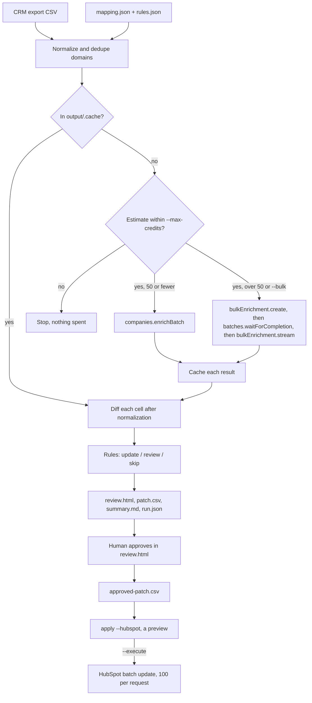

# CRM Enrichment Diff

See exactly what company enrichment would change in your CRM before anything is written.

This CLI reads a CRM companies export (shaped like a HubSpot export), enriches each unique domain with [CompanyEnrich](https://companyenrich.com), and compares every cell after smart normalization: 120 employees matches `51-200`, `USA` matches `United States`, `linkedin.com/company/x` matches `https://www.linkedin.com/company/x/`. Rules decide which fields may be overwritten. You get a self-contained HTML page where a person approves changes and exports an approved patch, and an optional write-back to HubSpot. It is for RevOps and data teams who do not want an enrichment tool silently overwriting curated CRM data. It is also the reference example for the async bulk enrichment API (`companies.bulkEnrichment` with `batches.waitForCompletion` and `stream`), alongside the synchronous `companies.enrichBatch`.

## Example output

Real output from `examples/crm-export.csv`: 15 rows for real public companies with deliberately stale, missing and inconsistent values (one of them a duplicate), plus one made-up row with no domain. The Record IDs are made up.

The first run of this file enriched the 14 unique domains with one `companies.enrichBatch` request for 14 credits. Below is a later run of the same file, which read all 14 domains from the cache, made no API call and spent 0 credits:

```text
$ npm start -- diff examples/crm-export.csv
Read 16 rows from examples/crm-export.csv: 14 unique domains, 1 domain shared by several records, 1 row without a usable domain
Cache: 14 of 14 domains already enriched in output/.cache
Nothing to enrich: every domain is cached. Estimated cost: 0 credits.

Diff: 165 cells across 15 enriched records
  fill 64 · conflict 27 · same 70 · api-missing 4
Proposed: update 63 · review 13 · skip 15

Wrote output/20261111-194602/
  review.html  open in a browser to approve or reject changes, then export the approved patch
  patch.csv    63 proposed updates
  summary.md   counts by change type and field
  run.json     run ledger: credits, cache use and enrichment statuses
```

The generated `summary.md`:

```markdown
# Enrichment diff 20261111-194602

- Input: `examples/crm-export.csv`, 16 rows, 14 unique domains
- Enrichment: all 14 domains read from the cache, no API call
- Records: 15 found, 1 no-domain
- Credits used: 0 (estimate was up to 0, cap 60)

## Changes by type

| Change | Cells | Meaning |
| --- | ---: | --- |
| fill | 64 | CRM is empty, the API has a value |
| conflict | 27 | both have a value and they differ |
| same | 70 | equal after normalization |
| api-missing | 4 | the API has no value |

## Proposed actions

| Action | Cells | Meaning |
| --- | ---: | --- |
| update | 63 | proposed in patch.csv |
| review | 13 | needs a human decision in review.html |
| skip | 15 | protected or not writable |
| none | 74 | nothing to change |

## By field

| Field | fill | conflict | same | api-missing | update | review | skip |
| --- | ---: | ---: | ---: | ---: | ---: | ---: | ---: |
| Company name | 0 | 0 | 15 | 0 | 0 | 0 | 0 |
| Company Domain Name | 1 | 0 | 14 | 0 | 0 | 0 | 1 |
| Website URL | 13 | 1 | 1 | 0 | 14 | 0 | 0 |
| Industry | 2 | 12 | 1 | 0 | 0 | 0 | 14 |
| Number of Employees | 7 | 5 | 3 | 0 | 7 | 5 | 0 |
| Annual Revenue | 12 | 0 | 3 | 0 | 12 | 0 | 0 |
| Country/Region | 1 | 1 | 13 | 0 | 1 | 1 | 0 |
| City | 3 | 3 | 7 | 2 | 3 | 3 | 0 |
| Year Founded | 3 | 2 | 10 | 0 | 3 | 2 | 0 |
| LinkedIn Company Page | 9 | 1 | 3 | 2 | 10 | 0 | 0 |
| Description | 13 | 2 | 0 | 0 | 13 | 2 | 0 |

## Records that need attention

- 18234500101 Shopify (shopify.com): same domain as 18234500115
- 18234500115 Shopify Inc. (shopify.com): same domain as 18234500101
- 18234500116 Acme Holdings (old import) (no domain): no usable domain or website in the CRM row
```

Some of the cells behind those numbers, as they appear in `review.html`:

| Company | Field | CRM value | CompanyEnrich value | Change | Action | Will write |
| --- | --- | --- | --- | --- | --- | --- |
| Twilio | Number of Employees | 120 | 5K-10K | conflict | review | 5001 |
| Twilio | LinkedIn Company Page | http://linkedin.com/company/twilio | https://www.linkedin.com/company/twilio-inc- | conflict | update | https://www.linkedin.com/company/twilio-inc- |
| Atlassian | Number of Employees | 4000 | over-10K | conflict | review | 10001 |
| Shopify | Number of Employees | 10000 | over-10K | conflict | review | 10001 |
| Atlassian | Country/Region | AU | United States | conflict | review | United States |
| Siemens | Country/Region | DE | Germany | same | none | |
| Snowflake | Annual Revenue | $1.2B | over-1b | same | none | |
| HubSpot Inc. | Country/Region | United States of America | United States | same | none | |
| Datadog | Annual Revenue | (empty) | over-1b | fill | update | 1000000000 |
| Spotify | Industry | Music | Media & Internet | conflict | skip (protected) | |
| GitLab | Company Domain Name | (empty) | gitlab.com | fill | skip (protected) | |

The review rows show why conflicts default to a human decision. Atlassian's move to the US is real news for a stale CRM, and a range such as `5K-10K` cannot confirm or replace an exact headcount on its own.

The bulk path on a 3-row CSV (`--bulk` forces it for small inputs):

```text
$ npm start -- diff examples/crm-export-small.csv --bulk
Read 3 rows from examples/crm-export-small.csv: 3 unique domains
Cache: 0 of 3 domains already enriched in output/.cache
Plan: enrich 3 domains with companies.bulkEnrichment (async job). Estimated cost: up to 3 credits (1 per company found, misses are free). Cap: 60.
  bulk job e70630e3-cb6e-4bcf-870f-0a3d329af93e started. If this run is interrupted, collect it without paying again:
    npm start -- diff examples/crm-export-small.csv --batch e70630e3-cb6e-4bcf-870f-0a3d329af93e --mapping mapping.example.json --rules rules.example.json --out output
  bulk job running: 0/3 done
  bulk job completed: 3/3 done
Enriched 3 domains. Credits used: 3.
```

## How it works

1. **Read and dedupe.** Parse the CSV, take each row's domain from `Company Domain Name` or, failing that, `Website URL` (`https://www.gitlab.com/company/` becomes `gitlab.com`), and keep each domain once. Records that share a domain are flagged as likely duplicates.
2. **Validate before spending.** The mapping, rules, CSV columns, `--max-credits` and the output folder are all checked before the first paid call.
3. **Plan and cap.** Domains already in `output/.cache/` are free. The rest are the estimate (1 credit per company found, at most one per domain). The run stops if the estimate is above `--max-credits`. `--dry-run` stops here and only calls the free `me()`.
4. **Enrich.** Up to 50 domains go to `companies.enrichBatch` in one request. More than 50 (or `--bulk`) start an async `companies.bulkEnrichment` job: the CLI polls it with `batches.waitForCompletion`, then streams the NDJSON results with `bulkEnrichment.stream`. Every result is cached as it arrives, so a failure halfway keeps what was already paid for.
5. **Diff each cell.** Each mapped column is compared with a CompanyEnrich field path using a normalizer, and the cell is classified as `fill`, `conflict`, `same` or `api-missing`.
6. **Apply the rules.** `rules.json` turns each change into `update`, `review` or `skip`.
7. **Write the outputs** to `output/<run-id>/`: `review.html`, `patch.csv`, `summary.md` and `run.json`.
8. **Approve and apply.** A person approves or rejects cells in `review.html` and exports an approved patch, then `apply --hubspot` previews it and, with `--execute`, sends HubSpot batch updates.



### Normalizers

| Normalizer | Same when | Example match |
| --- | --- | --- |
| `employees` | the CRM count or range falls inside the API range | `120` and `51-200`, `10,001+` and `over-10K` |
| `revenue` | the CRM amount or range falls inside the API range | `2000000000` and `over-1b`, `$25M` and `10m-50m` |
| `country` | both resolve to the same ISO code (names come from the runtime's ICU data, plus common aliases) | `USA`, `U.S.`, `US`, `United States of America` |
| `url` | equal after dropping protocol, `www.`, query string and trailing slash | `linkedin.com/company/shopify` and `https://www.linkedin.com/company/shopify/` |
| `domain` | equal after domain normalization | `https://www.atlassian.com/` and `atlassian.com` |
| `companyName` | equal after case, punctuation and legal suffixes | `HubSpot Inc.` and `HubSpot` |
| `year` | the four-digit year matches | `2008.0` and `2008` |
| `text` | equal ignoring case, accents, punctuation and `&` vs `and` | `Zürich` and `zurich` |

Range bounds follow the v2 enums exactly. Employee ranges are whole-number buckets that do not overlap (`501-1K` ends at 1,000, `1K-5K` starts at 1,001, `over-10K` starts at 10,001), so a CRM count of exactly 10,000 is a conflict with `over-10K`. Revenue ranges share their boundaries, except that `under-1m` excludes 1M and `over-1b` excludes 1B.

Empty values depend on the field. Empty cells, `-`, `--`, `N/A`, `#N/A` and `null` are empty everywhere. `NA`, `none` and `unknown` are empty only in number fields (employees, revenue, year), because `NA` is a real country code (Namibia).

A CRM value the normalizer cannot read (for example `lots` employees) is a conflict with a note for the reviewer.

### Rules

`rules.example.json` lists CRM columns under three policies. Columns that are not listed default to `review`.

| Change | `neverOverwrite` | `fillOnlyIfEmpty` | `trustApi` | not listed |
| --- | --- | --- | --- | --- |
| fill (CRM empty) | skip (protected) | update | update | review |
| conflict | skip (protected) | review | update | review |

`same` and `api-missing` never change anything. `update` cells go into `patch.csv` and start approved in `review.html`. `review` cells start unapproved. Protected cells cannot be approved.

The example protects `Company name`, `Company Domain Name` (HubSpot deduplicates companies on domain) and `Industry` (a HubSpot dropdown, see Limitations). It trusts the API for `Website URL` and `LinkedIn Company Page`. Everything else only fills empty cells.

### The review page

`review.html` is one file with the data, styles and script inlined. It needs no server and loads nothing from the network. You can filter by change type, field, action and company, and approve or reject per cell, per record, or everything visible (filter by a field, then "Approve visible"). "Export approved patch" builds the CSV in the browser and downloads it. The export has the same columns as `patch.csv`, so with no changes it is byte-for-byte the same file. Approvals are kept in the browser's localStorage per run, so you can close the page and come back.

Both `patch.csv` and the exported patch are safe to open in a spreadsheet. A cell that starts with `=`, `+`, `-`, `@`, a tab or a carriage return gets a leading `'` so Excel or Sheets cannot run it as a formula (the OWASP advice for CSV injection), and `apply` removes the `'` again so HubSpot receives the raw value. Plain numbers such as `-5` are left alone because they cannot be formulas.

### Bulk jobs and webhooks

The v2 bulk request (`POST /v2/companies/enrich/bulk`) accepts `domains`, `expand` and `waitForEnrichment`, and the CLI polls the job until it finishes. The job runs on the server whether or not the CLI is still waiting. When a job starts, the CLI prints a `--batch <id>` command. Running it collects the finished job into the cache: downloading results is free and nothing is re-bought. Every record is cached as it streams in. If a run or a `--batch` collection fails partway (a timeout or a dropped connection), the records already received stay cached, and `run.json` records `status: "failed"`, the credits the job has charged so far (from the free `batches.get`), and the same resume command.

## CompanyEnrich endpoints used

| SDK method | Endpoint | Why | Cost |
| --- | --- | --- | --- |
| `companies.enrichBatch({ domains, waitForEnrichment: false })` | `POST /v2/companies/enrich/batch` | Up to 50 domains in one synchronous request | 1 credit per unique company found; `not-found`, `invalid-domain` and `pending` are free |
| `companies.bulkEnrichment.create({ domains, waitForEnrichment: true })` | `POST /v2/companies/enrich/bulk` | More than 50 domains, or `--bulk` | 1 credit per company found (the normal enrichment price); returns 402 up front if your balance cannot cover every domain |
| `batches.waitForCompletion(id)` | polls `GET /v2/batches/{id}` | Wait for the bulk job and show progress | Free |
| `companies.bulkEnrichment.stream(id)` | `GET /v2/companies/enrich/bulk/{id}/results?format=ndjson` | Stream bulk results one record at a time | Free |
| `batches.get(id)` | `GET /v2/batches/{id}` | Credits charged so far, for the failure ledger | Free |
| `me()` | `GET /v2/me` | Balance before and after a run, and in `--dry-run` | Free |

Both paid calls are POSTs, which the SDK does not repeat after an ambiguous failure, so one run cannot be billed twice. API reference: https://docs.companyenrich.com

## Quickstart

Requires Node.js 22.12 or newer and a CompanyEnrich API key from https://companyenrich.com/dashboard.

```sh
cd crm-enrichment-diff
npm ci
export COMPANYENRICH_API_KEY=your_api_key
npm start -- diff examples/crm-export.csv --dry-run
npm start -- diff examples/crm-export.csv
```

Then open `output/<run-id>/review.html` in a browser, approve what you want, and click "Export approved patch". To preview the HubSpot write-back (no token needed):

```sh
npm start -- apply output/<run-id>/patch.csv --hubspot
```

Run the tests (no network, no keys) with `npm test` and type-check with `npm run typecheck`.

## Configuration

| Environment variable | Required | Purpose |
| --- | --- | --- |
| `COMPANYENRICH_API_KEY` | For `diff`, unless every domain is cached. A `--dry-run` without it still prints the plan | CompanyEnrich API key |
| `HUBSPOT_TOKEN` | Only for `apply --hubspot --execute` | HubSpot private app token with the `crm.objects.companies.write` scope |

`diff <crm-export.csv>` flags:

| Flag | Default | Purpose |
| --- | --- | --- |
| `--mapping <file>` | `mapping.example.json` | CRM column to CompanyEnrich field path, normalizer and HubSpot property |
| `--rules <file>` | `rules.example.json` | `neverOverwrite`, `fillOnlyIfEmpty` and `trustApi` column lists |
| `--max-credits <n>` | `60` | Stop before spending if the estimate is higher |
| `--dry-run` | off | Print the plan and balance; no paid calls, no files written |
| `--bulk` | off | Use the async bulk job even for 50 domains or fewer |
| `--batch <id>` | none | Collect an existing bulk job into the cache first (free), then diff |
| `--out <dir>` | `output` | Where run folders and the `.cache/` folder go |

`apply <patch.csv> --hubspot` flags: `--execute` sends the updates (without it, apply only prints what it would send), `--mapping` (default `mapping.example.json`) maps field paths to HubSpot property names, and `--out` (default `output`) is where `apply-<time>.json` is written.

### Mapping file

```json
{
  "recordIdColumn": "Record ID",
  "nameColumn": "Company name",
  "domainColumns": ["Company Domain Name", "Website URL"],
  "fields": [
    { "column": "Country/Region", "path": "location.country.name", "normalizer": "country", "hubspotProperty": "country" },
    { "column": "Number of Employees", "path": "employees", "normalizer": "employees", "hubspotProperty": "numberofemployees", "writeAs": "lower-bound" }
  ]
}
```

`path` is a dot path into the [company object](https://docs.companyenrich.com), for example `socials.linkedinUrl` or `location.city.name`. `writeAs` controls how a range is written: `label` (the default) writes `51-200`, while `lower-bound` writes `51` (or `10001` for `over-10K`) for number properties. HubSpot's `numberofemployees` and `annualrevenue` are numbers, so the example writes lower bounds. A lower bound never overstates a company's size, so segments such as "at least 1,000 employees" stay correct. A range with no lower bound (`under-1m`) is not written and shows as `skip`.

## Credits

| Step | Credits |
| --- | --- |
| `diff examples/crm-export.csv` (14 unique domains, all found) | 14 |
| Running the same diff again (all cached) | 0 |
| `diff examples/crm-export-small.csv --bulk` | 3 |
| `--dry-run` | 0 |
| `--batch <id>` collection, status polls, result downloads, `me()` | 0 |
| `apply --hubspot` | 0 CompanyEnrich credits |

The default demo costs 14 credits. The estimate is the number of uncached unique domains, because you pay only for companies found. `--max-credits` (default 60) refuses to start a run whose estimate is higher. `run.json` records the estimate, the credits used and your balance before and after. Credits used comes from the bulk job's own `creditsCharged`, or for the synchronous batch from the number of unique companies found. The balance difference can be larger if other jobs share your API key.

## Limitations

- **Ranges, not exact numbers.** CompanyEnrich returns employee and revenue ranges. A CRM count inside the range counts as the same, but a range cannot confirm an exact number. Writing a lower bound (for example 1,000,000,000 for `over-1b`) loses precision, which is why the example rules only fill empty cells and send conflicts to review.
- **Fields can be defined differently.** Founding year, for example, can be the year a company was founded or the year it launched. Use `trustApi` only for fields you are happy to overwrite without review.
- **HubSpot write-back was not run against a real HubSpot portal.** Its request shape, chunking into 100 records, 207 partial errors, 429 retries and 401 handling are tested with a mocked `fetch` only. The preview mode was run on real patches.
- **HubSpot's Industry is a dropdown** with fixed options that do not match CompanyEnrich industry names. The example rules never write it. If you move it to another policy, HubSpot will reject values that are not among its options. Map it to a custom text property if you want CompanyEnrich's industry in HubSpot.
- **The cache does not expire.** Delete `output/.cache/` (or one domain's file) to fetch fresh data. Pending and failed lookups are never cached.
- **New companies can come back `pending`.** The synchronous batch does not wait for on-demand enrichment of companies CompanyEnrich has not stored yet. They are fetched in the background, and a later run picks them up at no extra cost.
- **Domains are not reduced to the registrable domain.** `about.gitlab.com` stays `about.gitlab.com`. Clean such values, or put the main domain in the domain column.
- **Descriptions almost always conflict,** because free text rarely matches word for word. The example only fills empty descriptions.
- **Duplicate records are diffed and patched separately.** The summary flags them, but merging them is up to you.
- **One bulk job takes at most 10,000 domains.** Split larger exports.

## Ideas to extend it

- Add a Salesforce write-back using the Composite API with the same approved patch.
- Request `expand: ['financial']` (+1 credit per company) to diff funding stage and stock symbol.
- Run it on a schedule and show only changes since the last approved patch.
- Map CompanyEnrich industries to your HubSpot Industry dropdown options with a lookup table.
- Write the approved changes back into the CSV for import tools that do not use the HubSpot API.
