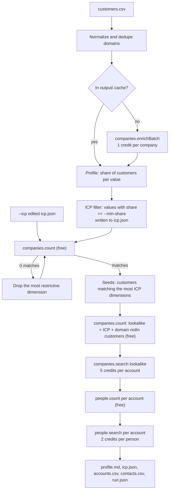

# Customers to Pipeline

Give it a CSV of your current customers and get back an ICP filter, a free market size, lookalike accounts that are not customers yet, and the right people to contact at each one.

This is a TypeScript command-line tool for sales, RevOps and agency teams. It enriches your customer list, works out what those customers have in common, and turns that into a CompanyEnrich search filter you can read and edit. It then counts the matching market for free, finds lookalikes of your best-fitting customers that pass the filter, and finds people in a chosen role at the top matches. The output is a profile report plus CSV files ready for a CRM or a sequencer. There is no LLM involved: every step is a documented rule, so every result can be explained. It shows how to combine batch enrichment, free counts, lookalike search with filters and `notIn` exclusions, and people search in one cost-capped workflow on the [CompanyEnrich v2 API](https://docs.companyenrich.com).

## Example output

A real run on [`examples/customers.csv`](examples/customers.csv), 12 developer-tools companies, with default flags:

```text
$ npm start -- examples/customers.csv
1. Customers: 12 unique domains in examples/customers.csv (1 duplicate removed)
   Skipped row 15: "n/a" is not a domain
2. Enrichment: 0 cached, 12 to enrich
Credit estimate (upper bound):
  enrich: 12 customers x 1 .....   12
  lookalikes: 5 accounts x 5 ...   25
  contacts: 5 people x 2 .......   10
  already spent this run .......    0
  total ........................   47  (cap 60)
   Enriched 12 (12 credits)
3. Profile: 12 customers
4. ICP (values shared by at least 30% of customers):
   industry: Software, Business Services/Custom Software & IT Services, Media & Internet/Data Collection & Internet Portals
   categories: b2b, saas
   employees: 201-500
   revenue: 10m-50m
   country: US
   foundedYear: 2010s
5. Market: 334 companies match the ICP (free count)
6. Lookalikes: 50 candidates similar to 10 seed customers (free count)
Credit estimate (upper bound):
  lookalikes: 5 accounts x 5 ...   25
  contacts: 5 people x 2 .......   10
  already spent this run .......   12
  total ........................   47  (cap 60)
   1. honeycomb.io (Honeycomb) score 0.992, matches: industry, categories, employees, revenue, country, foundedYear
   2. wandb.ai (Weights & Biases) score 0.992, matches: industry, categories, employees, revenue, country, foundedYear
   3. bubble.io (Bubble) score 0.991, matches: industry, categories, employees, revenue, country, foundedYear
   4. kissflow.com (Kissflow) score 0.987, matches: industry, categories, employees, revenue, country, foundedYear
   5. mend.io (Mend.io) score 0.987, matches: industry, categories, employees, revenue, country, foundedYear
7. Contacts: 23 sales-leader matches across 5 accounts (free count)
Credit estimate (upper bound):
  contacts: 5 people x 2 ...   10
  already spent this run ...   37
  total ....................   47  (cap 60)
   Found 5 contacts

Wrote profile.md, icp.json, accounts.csv, contacts.csv, run.json to output/2026-11-11T05-25-04
47 credits charged by this run (balance 49,957 -> 49,910)
```

Running the same command again reads all 12 companies from the local cache, so it costs 35 credits instead of 47. `--dry-run` costs nothing.

`profile.md` (trimmed):

| Dimension | ICP values | Search filter |
| --- | --- | --- |
| industry | Software, Business Services/Custom Software & IT Services, Media & Internet/Data Collection & Internet Portals | `naicsCodes: ["5112","5132","334614","5415","41911","519","5182"]` |
| categories | b2b, saas | `categories: {"in":["b2b","saas"]}` |
| employees | 201-500 | `employees: ["201-500"]` |
| revenue | 10m-50m | `revenue: ["10m-50m"]` |
| country | US | `country: ["US"]` |
| foundedYear | 2010s | `foundedYear: {"min":2010,"max":2019}` |

**334** companies match the ICP (free count; 334 before plan limits).

| Employees | Customers | Share | In ICP |
| --- | ---: | ---: | --- |
| 51-200 | 2 | 17% |  |
| 201-500 | 5 | 42% | yes |
| 501-1K | 2 | 17% |  |
| 1K-5K | 3 | 25% |  |

`accounts.csv`:

```csv
rank,domain,name,score,industry,employees,country,matched_icp_dimensions
1,honeycomb.io,Honeycomb,0.992,Software,201-500,US,industry; categories; employees; revenue; country; foundedYear
2,wandb.ai,Weights & Biases,0.992,Software,201-500,US,industry; categories; employees; revenue; country; foundedYear
3,bubble.io,Bubble,0.991,Software,201-500,US,industry; categories; employees; revenue; country; foundedYear
4,kissflow.com,Kissflow,0.987,Software,201-500,US,industry; categories; employees; revenue; country; foundedYear
5,mend.io,Mend.io,0.987,Software,201-500,US,industry; categories; employees; revenue; country; foundedYear
```

`contacts.csv` (names and LinkedIn URLs replaced with placeholders, and titles generalized to the role):

| account | name | title | seniority | department | linkedin_url |
| --- | --- | --- | --- | --- | --- |
| honeycomb.io | `<name>` | `<Sales director>` | director | | `<linkedin url>` |
| wandb.ai | `<name>` | `<RevOps director>` | director | sales/revenue-operations | `<linkedin url>` |
| bubble.io | `<name>` | `<Head of Sales>` | head | sales | `<linkedin url>` |
| kissflow.com | `<name>` | `<GTM lead>` | head | sales/revenue-operations | `<linkedin url>` |
| mend.io | `<name>` | `<Sales director>` | director | sales | `<linkedin url>` |

## How it works

1. **Read the customers.** The CSV's `domain` column (or its first column) is normalized: protocol, `www.`, paths, ports and email prefixes are stripped and everything is lowercased. Duplicates are removed and invalid rows are reported.
2. **Enrich.** Domains that are not in `output/.cache/` are enriched with `companies.enrichBatch`, 50 per request, and every company found is cached by domain. Domains that are not found are reported.
3. **Profile.** For each dimension (industry, categories, employees, revenue, country, founded decade and, with `--with-tech`, technologies) the share of customers holding each value goes into `profile.md`.
4. **Build the ICP filter.** A value joins the ICP when at least `--min-share` of customers hold it. Industries become NAICS codes (looked up for free with `industries.list`), categories and technologies use `{in: [...]}` so any of them matches, employee and revenue ranges are filled in between the smallest and largest common range, and founded decades become a `foundedYear: {min, max}` range. A dimension with no common value is left out. The rules live in [`src/lib/icp.ts`](src/lib/icp.ts) and the filter is written to `icp.json`, which you can edit and pass back with `--icp`.
5. **Size the market for free** with `companies.count`. If nothing matches, the app counts each dimension on its own (also free), drops the one that matches the fewest companies, and repeats until the count is above zero. Every dropped dimension is recorded.
6. **Find lookalikes.** The (up to) 10 customers that match the most ICP dimensions become seeds. A free count of `lookalike: {domains: seeds}` plus `filter: {...icp, domain: {notIn: customers}}` comes first, and the paid search only runs when it is above zero. Accounts keep the API's order and scores, and `matched_icp_dimensions` lists the ICP dimensions each account's own data matches.
7. **Find people.** A free `people.count` per account for the persona (seniority, department and, for sales leaders, title phrases) decides how many people to take from each account, one per account per pass in rank order. Then `people.search` runs once per account with that page size.
8. **Write the results** to `output/<run-id>/` and print the credits charged and the balance before and after from `me()`.

All input is checked before the first paid call: the CSV, the flags, and an `--icp` file. Its field names are checked locally, so a typo like `industry` fails before anything is spent, and its values are checked with a free count. Before every paid step the app prints the estimate for every step still to run and stops if what it has spent plus that estimate would pass `--max-credits`.



Each run writes:

| File | Contents |
| --- | --- |
| `profile.md` | ICP table, market size, relaxed dimensions, and a distribution table per dimension |
| `icp.json` | The search filter (edit `filter` and re-run with `--icp`), plus the industries behind its NAICS codes |
| `accounts.csv` | rank, domain, name, score, industry, employees, country, matched_icp_dimensions |
| `contacts.csv` | account, name, title, seniority, department, linkedin_url |
| `run.json` | Inputs, ICP before and after relaxation, every count, seeds, and the credit ledger with estimate and charge per call |

## CompanyEnrich endpoints used

| SDK method | Endpoint | Why | Cost |
| --- | --- | --- | --- |
| `me()` | `GET /v2/me` | Balance before and after the run | Free |
| `industries.list()` | `GET /v2/industries` | Map industry names to NAICS codes for the filter | Free |
| `companies.enrichBatch()` | `POST /v2/companies/enrich/batch` | Enrich up to 50 customers per request | 1 credit per company found, +1 with `--with-tech` |
| `companies.count()` | `POST /v2/companies/search/count` | Market size, relaxation, lookalike pool | Free |
| `companies.search()` | `POST /v2/companies/search` | Lookalikes inside the ICP, customers excluded | 5 credits per account returned |
| `people.count()` | `POST /v2/people/search/count` | Persona matches per account | Free |
| `people.search()` | `POST /v2/people/search` | People at each account | 2 credits per person returned |

All calls go through the official [`@companyenrich/sdk`](https://www.npmjs.com/package/@companyenrich/sdk).

## Quickstart

Requires Node.js 22.12 or newer and an API key from your [CompanyEnrich dashboard](https://companyenrich.com/dashboard).

```sh
cd customers-to-pipeline
npm ci
export COMPANYENRICH_API_KEY=your-api-key
npm start -- examples/customers.csv --dry-run
npm start -- examples/customers.csv
```

The dry run spends nothing and prints what the real run would cost. The second command spends up to 47 credits. To use your own customers, pass any CSV with a `domain` column, or with domains in the first column. `npm test` and `npm run typecheck` run without a key or network access.

## Configuration

| Environment variable | Required | Purpose |
| --- | --- | --- |
| `COMPANYENRICH_API_KEY` | Yes | Your API key from the [dashboard](https://companyenrich.com/dashboard). The app reads it from the environment and does not load `.env` files, so `export` it (`.env.example` lists it for tools that do). |

| Flag | Default | Description |
| --- | --- | --- |
| `<customers.csv>` | | The customer list: a `domain` column, or domains in the first column |
| `--accounts <n>` | `5` | Lookalike accounts to fetch (1-100), 5 credits each |
| `--contacts <n>` | `5` | People to fetch across those accounts (0-100), 2 credits each |
| `--persona <name>` | `sales-leader` | `sales-leader`, `eng-leader`, `marketing-leader`, `founder` or `finance-leader` (defined in [`src/lib/people.ts`](src/lib/people.ts)) |
| `--with-tech` | off | Adds the technologies expansion to enrichment (+1 credit per customer) and technologies to the ICP |
| `--icp <file>` | | Reuse an edited `icp.json` and skip profiling |
| `--min-share <0-1>` | `0.3` | Share of customers a value needs to join the ICP |
| `--max-credits <n>` | `60` | Stop before any paid step that would take the run past this many credits |
| `--dry-run` | off | Spend nothing: run the free counts when cached enrichment or `--icp` is available, otherwise print the estimate |
| `--out <dir>` | `output` | Output folder; the enrichment cache lives in `<dir>/.cache/` |

To tune the ICP by hand, edit the `filter` in a run's `icp.json` (for example widen `employees` or add countries) and run:

```sh
npm start -- examples/customers.csv --icp output/<run-id>/icp.json --dry-run
```

The dry run shows the new market size and lookalike pool for free. Drop `--dry-run` to fetch accounts and contacts. Filter fields are documented at [docs.companyenrich.com](https://docs.companyenrich.com).

## Credits

| Step | Cost | Default demo |
| --- | --- | --- |
| Read the CSV, `me()`, `industries.list()` | Free | 0 |
| Enrich customers | 1 per company found (+1 with `--with-tech`); cached companies are free | 12 |
| Profile and ICP | Local | 0 |
| Market size and relaxation | Free counts | 0 |
| Lookalike pool | Free count | 0 |
| Lookalike search | 5 per account (`--accounts`) | 25 |
| Persona counts | Free counts | 0 |
| People search | 2 per person (`--contacts`) | 10 |
| **Total** | | **47** on the first run, 35 on a re-run, 0 with `--dry-run` |

How spend is capped:

- `--max-credits` (default 60) is checked before every paid step against what the run has already spent plus the estimate for every remaining step. The run stops before spending if the total is above the cap.
- Paid searches run only after a free count, and are skipped when the count is zero. A paid page with no results would still bill one result.
- Page sizes match what you asked for: `--accounts` for the lookalike search and the per-account allocation for each people search.
- Every paid call is a POST, which the SDK does not retry after an ambiguous failure, so one estimate is never billed twice. If a run fails partway, `run.json`, the cache and `contacts.csv` keep what was already paid for.
- `run.json` records the estimate and the charge of every paid call. The balance change printed at the end comes from `me()` and includes anything else that used the same key during the run.

## Limitations

- **Small samples.** With 12 customers one company is 8% of the profile, and 30% is a rule of thumb. With only a few customers almost every value passes the threshold. Raise `--min-share` or edit `icp.json` when the ICP looks too broad or too narrow.
- **Industries are broad.** Companies list several industries, so a devtools list also makes "Business Services/Custom Software & IT Services" and "Media & Internet/Data Collection & Internet Portals" common. The filter uses those industries' NAICS codes.
- **The "why" column mostly confirms the filter.** Every account passed the ICP filter, so `matched_icp_dimensions` is usually all of them. It is more telling after a dimension was relaxed or with an edited `--icp`. Technologies are not checked for accounts, because that would cost an extra credit per account.
- **Scores are relative.** Lookalike scores rank results; they are not probabilities. The API's order is kept.
- **Personas are heuristics.** Titles are free text, and departments are inferred from them. The sales-leader persona uses title phrases to keep out customer success and account management leads; adjust `src/lib/people.ts` for your market.
- **No emails.** Contacts come with LinkedIn URLs only. Work emails cost 10 credits each through `people.findEmail`.
- **The cache never expires.** Delete `output/.cache/` to refresh company data. Domains that were not found are asked for again on each run, which is free.
- **Counts can move.** Counts and searches run seconds apart on live data, so a search can return slightly fewer results than its count.

## Ideas to extend it

- Weight the profile by customer value: read an ARR or plan column and count each customer by revenue instead of once.
- Add work emails for the contacts with `people.findEmail` (10 credits per email found) before exporting to a sequencer.
- Keep a list of accounts already exported and add them to the `domain.notIn` exclusion, so a weekly run only returns new accounts.
- Build a second account source with semantic search (`semantic: {query}`) from your customers' descriptions, and compare it with the lookalikes.
- Push `accounts.csv` and `contacts.csv` straight into HubSpot or Salesforce, and exclude the accounts already in the CRM.
