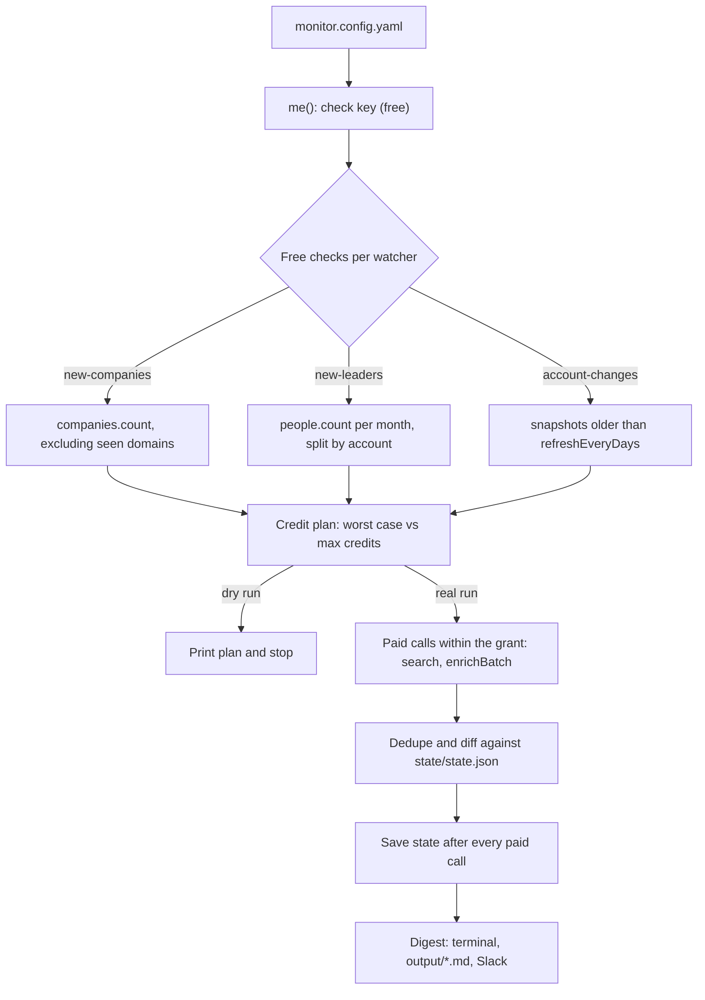

# GTM Signal Monitor

A scheduled job that watches CompanyEnrich data for go-to-market signals and posts a digest to Slack or a Markdown file.

It runs three kinds of watchers from a YAML file. One finds companies that newly match a search, such as recently funded US B2B SaaS. One finds senior people who just started a role at accounts you care about. One reports changes at those accounts: size, revenue, HQ, funding, tech stack and headcount. It is built for sales, RevOps and growth teams, and for developers building their own signal pipelines. It shows a scheduled polling pattern: free counts come first, paid fetches stay small, local state handles deduplication and diffs, and every run has a hard credit cap. There is no LLM in the loop.

## Example output

These are real runs from 2026-11-11 with the shipped `monitor.config.example.yaml`. People's names, exact titles, start months and profile links are replaced with placeholders, and one company row is trimmed.

A dry run makes only free calls and prints what a real run would spend:

```text
$ npm start -- --dry-run
CompanyEnrich balance: <n> credits left.
Checking watchers with free counts...
Credit plan (worst case, cap 50):
  funded-saas             660 new matches -> 5 companies x 2 = 10 credits
  target-account-leaders  3 new people at 2 accounts since 2026-10-01 -> 3 people x 2 = 6 credits
  target-account-changes  5 of 5 accounts due for a refresh -> 5 accounts x 4 = 20 credits
  Total: up to 36 credits.
Dry run: only free calls were made. State and output files were not changed.
```

The first real run spent exactly the planned 36 credits (checked with `me()` before and after) and wrote `output/digest-2026-11-11.md`:

```markdown
# GTM signals: 2026-11-11

8 new signals from 3 watchers. Credits used: 36 (cap 50).

## US B2B SaaS that raised money this year (`funded-saas`)

- **WorkOS**: Series C on 2026-03-02 · $195M raised in total · Software · 51-200 employees · San Francisco, US ([workos.com](https://workos.com))
- **Socket**: Series C on 2026-05-20 · $124.6M raised in total · Software · 51-200 employees · Wilmington, US ([socket.dev](https://socket.dev))
- **Linear**: Secondary market on 2026-08-26 · $233.2M raised in total · Software · 51-200 employees · San Francisco, US ([linear.app](https://linear.app))
- **HiddenLayer**: Series B on 2026-09-02 · $156.2M raised in total · Software · 51-200 employees · Austin, US ([hiddenlayer.com](https://hiddenlayer.com))

_655 more matches will be picked up on later runs._

## New leaders at target accounts (`target-account-leaders`)

- **<SVP Marketing>**: <title> at Figma (figma.com), started <month> ([LinkedIn](<profile URL>))
- **<Marketing director>**: <title> at Datadog (datadoghq.com), started <month> ([LinkedIn](<profile URL>))
- **<Product director>**: <title> at Figma (figma.com), started <month> ([LinkedIn](<profile URL>))

## Changes at target accounts (`target-account-changes`)

No new signals.

_Baseline recorded for 5 accounts. Changes show up from the next refresh._
```

Running again straight away, the free checks show nothing new for the leaders and accounts watchers. The company watcher keeps working through its backlog of existing matches, five per run:

```text
Credit plan (worst case, cap 50):
  funded-saas             655 new matches -> 5 companies x 2 = 10 credits
  target-account-leaders  no new people since 2026-10-01 (3 already reported) -> nothing to fetch
  target-account-changes  all 5 accounts are fresh; next refresh 2026-11-18 -> nothing to fetch
  Total: up to 10 credits.
```

With a narrow company query (4 matches, `maxResultsPerRun: 3`), the first run fetched 3 companies. The second run fetched the 1 left over for 2 credits, with no duplicates. The third run made only free calls:

```markdown
No new signals from 3 watchers. Credits used: 0 (cap 50).
```

This is what a change looks like once an account has a stored snapshot. To show it without waiting a week, we aged the stored `linear.app` snapshot and edited a few of its values, then re-ran that one watcher (4 credits). The "before" values are our edits. The "after" values are live data.

```markdown
- **Linear**: 7 changes since 2026-11-03 ([linear.app](https://linear.app))
  - Employees: 11-50 → 51-200
  - Latest funding: Series B (2025-06-10) → Secondary market (2026-08-26)
  - Total funding: $134.2M → $233.2M
  - Technologies added: Gmail
  - Technologies removed: Intercom
  - Observed headcount: 130 → 152 (+16.9%)
  - Engineering headcount: 40 → 51 (+27.5%)
```

The Slack post carries the same content as Block Kit blocks: a header, a summary line, and one section per watcher with its notes underneath.

## How it works

1. **Load the config.** `monitor.config.yaml` is validated (with clear errors for bad YAML or bad fields), and `me()` checks the API key for free.
2. **Free checks.** Each watcher works out what it would buy:
   - `new-companies` calls `companies.count` with your query plus `domain: {notIn: [...]}` listing the domains it has already reported. If the count is 0, it stops here.
   - `new-leaders` calls `people.count` once per calendar month in its window. The filter is your domains, seniority and department, plus `currentPositionStartDate: {after: <month start>, before: <month end>}`. If a month's count is higher than the people already reported for it, the account list is split in half and each half is counted again, until each slice is one account in one month with new people. A quiet month costs one call.
   - `account-changes` makes no call. It picks the accounts whose stored snapshot is older than `refreshEveryDays`.
3. **Credit plan.** Each watcher's worst case is units × credits per unit. Credits are granted in config order until `--max-credits` is used up. What does not fit waits for the next run. `--dry-run` prints the plan and stops here.
4. **Paid calls, within the grant.** `companies.search` with `pageSize` = the grant. `people.search` once per account-and-month slice, reading the whole slice and following the cursor past 100 results. `companies.enrichBatch` (50 domains per call) with the expansions the watcher asks for.
5. **Deduplicate and diff.** New domains and `personId:position` keys are added to `state/state.json`. Account snapshots are compared field by field. The first run of `account-changes` only records a baseline and says so in the digest. State and the credits spent are saved after every paid page or batch. If a call fails part way, what was already bought is kept, and the digest shows the error next to the real spend.
6. **Digest.** It is printed, written to `output/digest-<YYYY-MM-DD>.md` (a second run on the same day appends), and posted to Slack when `SLACK_WEBHOOK_URL` is set.



A few details worth knowing:

- **Seen companies.** The most recent 2,500 reported domains go into the `notIn` rule, so the free count only sees new companies. Older ones (state keeps up to 20,000 per watcher) are filtered out locally if they come back, so they never reach the digest, but they are billed.
- **Month windows for people.** Position start dates have month precision. At eight large software companies, `after: 2026-10-01` matched 4 senior people and `after: 2026-10-02` matched 0. People often add a new role to their profile weeks after they start: on 2026-11-11 none of those companies had a November start yet. So the window starts on the first day of the month `lookbackDays` before the last complete run, and dedupe absorbs the overlap. Slicing by month also catches promotions: someone reported in October who becomes CRO in November is a new person in November's count.
- **Carry-over never re-buys a page.** People search cannot skip people by id, and search cursors expire 24 hours after the first page, so a weekly job cannot resume a half-read result list. The watcher therefore buys each account-and-month slice whole, or leaves it untouched. A run cut short by `maxResultsPerRun` or the credit cap lists the slices it left, keeps the window where it was, and the next run's counts find exactly those slices again. The cost of this is that a slice with a new person also re-fetches the people already reported in that same account and month, and dedupe drops them.

## CompanyEnrich endpoints used

| SDK method | Endpoint | Why | Cost |
| --- | --- | --- | --- |
| `me()` | `GET /v2/me` | Check the key, show the balance | Free |
| `companies.count()` | `POST /v2/companies/search/count` | Is anything new for `new-companies`? | Free |
| `companies.search()` | `POST /v2/companies/search` | Fetch the new companies | 1 credit per company (2 with `semantic`), +1 per expansion |
| `people.count()` | `POST /v2/people/search/count` | New people per month, narrowed to single accounts | Free |
| `people.search()` | `POST /v2/people/search` | Fetch them | 2 credits per person |
| `companies.enrichBatch()` | `POST /v2/companies/enrich/batch` | Re-enrich watched accounts for diffs | 1 credit per company found, +1 per expansion |

All calls go through the official [`@companyenrich/sdk`](https://www.npmjs.com/package/@companyenrich/sdk). API reference: https://docs.companyenrich.com

## Quickstart

Requires Node.js 22.12 or newer and an API key from https://companyenrich.com/dashboard. From this folder:

```sh
npm install
cp monitor.config.example.yaml monitor.config.yaml
export COMPANYENRICH_API_KEY="your-api-key"
npm start -- --dry-run
npm start
```

The dry run is free. The first real run with the example config costs 36 credits. `npm test` runs the test suite without network access or keys.

## Configuration

### Environment variables

Set them in your shell or in a `.env` file in this folder (see `.env.example`). Values already set in the environment take precedence over `.env`.

| Name | Required | Purpose |
| --- | --- | --- |
| `COMPANYENRICH_API_KEY` | Yes | Your API key, from https://companyenrich.com/dashboard |
| `SLACK_WEBHOOK_URL` | No | A Slack [incoming webhook](https://api.slack.com/messaging/webhooks). When set, each digest is also posted there. |

### CLI flags

| Flag | Default | What it does |
| --- | --- | --- |
| `--watcher <id>` | all | Run only this watcher. Repeat the flag for several. |
| `--dry-run` | off | Free calls only. Prints the credit plan and changes no state or output. |
| `--max-credits <n>` | `50` | The most one run may spend. Watchers that do not fit are deferred to the next run. |
| `--config <file>` | `monitor.config.yaml` | Config file to use. |
| `--reset-state` | off | Forget what the selected watchers have seen (all of them, or those given with `--watcher`) and start over. |
| `-h`, `--help` | | Show usage. |

### Watchers

Every watcher has an `id` (lowercase, it keys the saved state), a `type` and an optional `title` for the digest.

| Type | Field | Default | Notes |
| --- | --- | --- | --- |
| `new-companies` | `query.filter` | | Any [v2 company search filter](https://docs.companyenrich.com). Field names, and the keys inside rules such as `{in, notIn, all}`, `{min, max}` and `workforceGrowth`, are checked at load time, so a typo fails before any call. A `domain` rule you set (for example `notIn` your customers) is kept. |
| | `query.semantic` | | `{query, autoFilter, weight}`. 2 credits per result instead of 1. Set `filter`, `semantic` or both. |
| | `expand` | `[]` | Any of `financial`, `keywords`, `naicsCodes`, `technologies`, `workforce`; +1 credit each per company. `financial` puts the funding stage, date and total in the digest. |
| | `maxResultsPerRun` | `10` | 1 to 100. |
| `new-leaders` | `domains` | | Accounts to watch, up to 2,500. |
| | `seniority` | all | `owner`, `founder`, `c-suite`, `partner`, `vp`, `head`, `director`, `manager`, `senior`, `entry`, `intern`. |
| | `department` | all | For example `sales` or `engineering-technical/data-science`. A department includes its sub-departments. |
| | `lookbackDays` | `30` | How far back the first run looks, and the overlap kept on later runs. |
| | `maxResultsPerRun` | `10` | About how many new people to fetch per run, 1 to 100. Slices are bought whole, so one account with more new people in a month than this is still read in full. |
| `account-changes` | `domains` | | Accounts to watch, up to 500. |
| | `expand` | all three | `financial` (funding diffs), `technologies` (tech stack diffs), `workforce` (headcount diffs); +1 credit each per account. |
| | `refreshEveryDays` | `7` | Each account is re-enriched at most this often. `0` refreshes on every run. |
| | `headcountChangePct` | `10` | The smallest observed headcount change to report, in percent. Department changes also need at least 3 people. |

Check any config change for free with `npm start -- --dry-run`. The counts tell you how many companies or people a filter matches, and a filter the API rejects is reported for that watcher while the others still run.

## Run it on a schedule

### GitHub Actions

GitHub only runs workflows from the root of a repository, so the workflow goes in your own repository:

1. Put this folder in a **private** repository, at the root.
2. Commit your `monitor.config.yaml`. It holds no secrets, only your queries and account lists, so remove it from `.gitignore`.
3. Copy `github-action.example.yml` to `.github/workflows/gtm-signal-monitor.yml`. If the app lives in a subfolder, change the three paths noted at the top of the file.
4. Add the repository secrets `COMPANYENRICH_API_KEY` and, optionally, `SLACK_WEBHOOK_URL` (Settings > Secrets and variables > Actions).
5. Start it once from the Actions tab with `--dry-run` in the "args" box, then let the weekly schedule (Mondays 07:00 UTC) take over.

The workflow runs `npm ci` and `npm start`, then commits `state/state.json` back to the repository. Without saved state, every run would report the same companies and people again. It also uploads `output/` as a build artifact for 30 days, and a concurrency group stops two runs from racing on the state file.

Why commit the state instead of caching it:

| Approach | Pros | Cons |
| --- | --- | --- |
| Commit `state/state.json` (used here) | Durable, visible in history, easy to inspect or roll back | One commit per run. The state contains company domains and CompanyEnrich person ids, so the repository must be private. Branch protection must let `github-actions[bot]` push. |
| `actions/cache` | No commits | Caches unused for 7 days are evicted, which is close to a weekly schedule. Cache keys are immutable, so you need a unique key per run and `restore-keys`. Losing the cache means re-reporting everything. |

### Plain cron

The CLI reads `.env` from its folder, so put the key there and add a crontab line (`crontab -e`). Use the full path to `npm` (`which npm`), because cron runs with a minimal `PATH`:

```cron
0 7 * * 1 cd /path/to/gtm-signal-monitor && mkdir -p output && /usr/local/bin/npm start >> output/cron.log 2>&1
```

The exit code is 1 when a watcher or the Slack post failed, so cron's mail or your log checks can catch it.

## Credits

| Step | Cost |
| --- | --- |
| `me()`, company and people counts | Free |
| `new-companies` | Per company fetched: 1 credit (filter) or 2 (semantic), +1 per expansion. At most `maxResultsPerRun`. |
| `new-leaders` | 2 credits per person in each account-and-month slice that has new people, including people already reported in that slice |
| `account-changes` | 1 credit per account found, +1 per expansion, at most once per `refreshEveryDays`. Unknown domains are free. |
| Search that comes back empty | One result's price. Only possible if the data changes between the count and the search. |

**Example config:** the first run costs 36 credits (5 companies × 2, 3 people × 2, 5 accounts × 4). Weekly after that, budget about 30 to 40: up to 10 for companies while the backlog of existing matches lasts, 2 per new leader, and 20 for the account refresh.

**Measured during development:** dry runs 0 credits. First run of the example config 36. Narrow config: first run 24, second 2, third 0. Resume check with `--max-credits 2` against ten accounts: the first run bought one single-person slice (2 credits). The second bought nothing, because every remaining slice was 2 people. It did not buy the first slice again. All figures were checked against `me()` before and after.

**Capping spend:** `--max-credits` (default 50) is a hard ceiling per run, because each watcher reserves its worst case before any paid call. Lower `maxResultsPerRun`, drop expansions, or raise `refreshEveryDays` to cut the steady-state cost. `--dry-run` always shows the plan first.

## Limitations

- **Polling, not push.** Signals are as fresh as your schedule. Job changes appear once people update their profiles, and carry the start month only.
- **"New" means new to you.** The first runs of `new-companies` work through every company that already matches (660 for the example query), `maxResultsPerRun` at a time. After that, only companies that newly match appear. Narrow the query if you want only fresh matches sooner.
- **Count-based change detection for people.** If someone leaves a watched account and someone else joins it with a start in the same month, that slice's count does not change and the new person is missed until the count moves. A person whose profile lands in the data after their start month has left the window is missed too; raise `lookbackDays` to widen the overlap.
- **Slices are all or nothing.** An account with more new people in one month than a run can afford (`--max-credits`) is skipped, with nothing bought, until you raise the cap. The plan shows it as deferred.
- **Re-billed duplicates.** A slice with a new person also re-fetches the people already reported in it, and company `notIn` holds only the 2,500 most recent domains. Both can bill for results that dedupe then drops.
- **Observed data.** Observed headcount counts profiles in the dataset, not official employee numbers, and technology changes reflect what was detected at each refresh.
- **account-changes costs credits on every refresh,** because it re-enriches each due account. `refreshEveryDays` sets how often.
- **One state file, one writer.** Do not run two copies at once against the same `state/state.json`.

## Ideas to extend it

- Add a `lookalike` mode to `new-companies` (`lookalike: {domains: [your best customers]}`, 5 credits per result).
- Look up work emails for new leaders with `people.findEmail` (10 credits per new email), behind its own cap.
- Send signals to your CRM as tasks or account notes instead of, or as well as, Slack.
- Use the `companies.workforce` history to report headcount trends over several months instead of point-to-point changes.
- Post each watcher to its own Slack channel, and skip the post when there are no signals.
