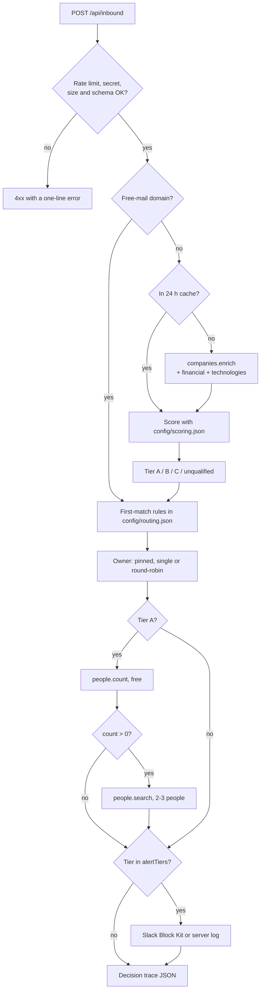

# Inbound Lead Router

Turn every signup or form fill into an enriched, scored and routed lead in about a second, with a Slack alert to the right owner.

Post an email address to a webhook and the app looks up the company behind it, scores it against your ICP with weights you can read, assigns a tier, routes it with first-match rules to a team and an owner, finds two or three relevant people at tier A accounts, and alerts the owner in Slack. The response is a full decision trace: every score factor with its points, every routing rule with the conditions that passed or failed. It is built for SaaS products and RevOps teams that want company intelligence inside their signup flow, and it shows how to use the [CompanyEnrich API](https://docs.companyenrich.com) through the official `@companyenrich/sdk`: enrichment with paid expansions, batch enrichment, free people counts before paid people searches, and cost control with caching, caps and confirm steps. It also has a rules playground for tuning weights and a CLI for scoring a CSV of existing leads.

## Example output

Real output from a live run on 2026-11-11, trimmed, with the `credits` field names updated to the current response format. People's names are replaced with role placeholders, and one headline is shortened to the title.

```bash
curl -X POST http://localhost:3103/api/inbound \
  -H 'content-type: application/json' \
  -d '{"email":"demo@vercel.com","name":"Demo Lead","source":"website-signup"}'
```

```jsonc
{
  "id": "b8dd1329",
  "lead": { "email": "demo@vercel.com", "name": "Demo Lead", "source": "website-signup", "domain": "vercel.com" },
  "status": "scored",
  "decision": {
    "tier": "A",
    "score": 92.5,
    "maxScore": 100,
    "team": "enterprise-na",
    "teamLabel": "Enterprise, North America",
    "owner": "Jordan",
    "summary": "Tier A (92.5/100) -> Enterprise, North America, owner Jordan"
  },
  "company": {
    "name": "Vercel", "domain": "vercel.com", "industry": "Media & Internet",
    "employees": "501-1K", "revenue": "10m-50m", "categories": ["b2b", "saas"],
    "country": { "code": "US", "name": "United States" }, "state": { "code": "CA", "name": "California" },
    "foundedYear": 2015,
    "funding": { "stage": "series_f", "date": "2025-09-30T00:00:00", "totalUsd": 863000000 },
    "technologies": ["Amazon SES", "Marketo", "Salesforce", "Next-Js", "React", "Sentry" /* 13 in total */]
  },
  "people": [
    { "name": "<CEO>", "position": "CEO at Vercel", "seniority": "c-suite", "department": "c-suite/executive" },
    { "name": "<CTO>", "position": "CTO at Vercel", "seniority": "c-suite", "department": "c-suite/executive" }
    // third person trimmed
  ],
  "credits": { "spent": 9, "uncertain": 0, "enrich": 3, "people": 6, "remainingToday": 241 },
  "trace": {
    "freeMail": { "isFreeMail": false, "matched": null },
    "enrichment": { "status": "found", "source": "api", "expand": ["financial", "technologies"], "credits": 3, "cachedAt": null },
    "score": {
      "total": 92.5,
      "max": 100,
      "factors": [
        { "dimension": "employees", "label": "Company size", "value": "501-1K", "match": 1, "weight": 25, "points": 25, "reason": "501-1K is listed at 1" },
        { "dimension": "categories", "label": "Business model", "value": "b2b, saas", "match": 1, "weight": 15, "points": 15, "reason": "Best category is saas (1)" },
        { "dimension": "funding", "label": "Funding stage and recency", "value": "Series F, 13 months ago", "match": 0.7, "weight": 15, "points": 10.5, "reason": "Series F is listed at 0.7; within 24 months" },
        { "dimension": "technologies", "label": "Tech stack", "value": "Marketo, Salesforce", "match": 0.8, "weight": 15, "points": 12, "reason": "Marketo 0.3 + Salesforce 0.5" }
        // revenue 15/15, country 10/10, foundedYear 5/5 trimmed
      ]
    },
    "tier": { "tier": "A", "reason": "92.5 >= 70, the tier A minimum" },
    "routing": {
      "firedRule": "Tier A enterprise in North America",
      "rules": [
        {
          "name": "Tier A enterprise in North America", "team": "enterprise-na", "outcome": "fired",
          "checks": [
            { "field": "tier", "expected": "A", "actual": "A", "pass": true },
            { "field": "country", "expected": "one of US, CA", "actual": "US", "pass": true },
            { "field": "employees", "expected": "at least 501-1K", "actual": "501-1K", "pass": true }
          ]
        },
        { "name": "Mid-market US West", "team": "us-west", "outcome": "shadowed" /* checks trimmed */ },
        { "name": "Mid-market US East and Central", "team": "us-east", "outcome": "shadowed" },
        {
          "name": "EMEA", "team": "emea", "outcome": "no-match",
          "checks": [
            { "field": "tier", "expected": "one of A, B", "actual": "A", "pass": true },
            { "field": "country", "expected": "one of GB, IE, DE, FR, NL, SE, DK, ES, IT", "actual": "US", "pass": false }
          ]
        },
        { "name": "Other qualified leads", "team": "inside-sales", "outcome": "shadowed" }
      ],
      "reason": "Rule \"Tier A enterprise in North America\" matched first"
    },
    "assignment": { "team": "enterprise-na", "owner": { "name": "Jordan" }, "method": "round-robin", "reason": "Round-robin slot 1 of 2" },
    "people": { "status": "found", "matching": 33, "source": "api", "credits": 6 /* people listed above */ },
    "alert": { "channel": "slack", "delivered": true, "status": 200, "error": null }
  },
  "timings": { "totalMs": 1088, "enrichMs": 498, "peopleMs": 564, "alertMs": 22 }
}
```

The same lead again a minute later cost 0 credits and took 11 ms: the company came from the 24-hour cache, the people from the people cache, and the account stayed with Jordan (`"method": "sticky"`). In the same session, `demo@walmart.com` scored 36.5 (tier C, routed to Inside sales for 3 credits), `demo@gmail.com` was skipped as free-mail for 0 credits, and an unknown domain came back `not-found` for 0 credits.

The Slack alert for that lead, as received by a local HTTP listener standing in for Slack (Block Kit blocks rendered as text):

```text
header   Tier A lead: Vercel
section  *demo@vercel.com* (Demo Lead) signed up via website-signup.
         score *92.5 / 100*, routed to *Enterprise, North America*, owner *Jordan*.
         _Rule "Tier A enterprise in North America" matched first_
section  *Account*  Company: Vercel | Industry: Media & Internet | Employees: 501-1K
                    Revenue: 10m-50m | HQ: Walnut, CA, US | Funding: Series F (2025-09) $863M total
section  *Why this score*
         • Company size: 25 / 25 (501-1K)
         • Annual revenue: 15 / 15 (10m-50m)
         • Business model: 15 / 15 (b2b, saas)
         • Headquarters: 10 / 10 (US)
         • Company age: 5 / 5 (2015)
         • Funding stage and recency: 10.5 / 15 (Series F, 13 months ago)
         • Tech stack: 12 / 15 (Marketo, Salesforce)
section  *People to contact at Vercel*
         • <CEO>, CEO at Vercel
         • <CTO>, CTO at Vercel
         • ...
context  Trace b8dd1329 · 9 credits · 1066 ms
```

Scoring a CSV of existing leads (`examples/leads.csv`), with vercel.com and walmart.com already cached by the webhook runs above:

```text
$ npm run score -- examples/leads.csv
6 leads in examples/leads.csv (email column "email")
  free-mail, skipped:       1
  invalid email, skipped:   1
  cached in the last 24 h:  2 (free)
  to enrich:                2 domains x 3 credits (enrich + financial + technologies) = up to 6 credits

Enriching 2 domains with companies.enrichBatch...
Spent 6 credits (estimate was up to 6).

  demo@vercel.com                   92.5  A                   -> enterprise-na
  demo@gmail.com                          free-mail           -> nurture
  demo@linear.app                     58  B                   -> us-west
  demo@walmart.com                  36.5  C                   -> inside-sales
  demo@posthog.com                  65.5  B                   -> us-west
  not-an-email                            invalid-email       -> nurture

Tiers: A: 1, B: 2, C: 1, unqualified: 0
Wrote output/scored-2026-11-11.csv
```

In the rules playground, `vercel.com, stripe.com, datadoghq.com, notion.so, demo@gmail.com` was estimated at up to 9 credits (vercel.com was cached), refused when confirmed with `maxCredits: 3`, and then cost exactly 9: Vercel 92.5 (A), Notion 74 (A), Datadog 57.5 (B), Stripe 45 (C). Raising the tier A minimum to 90 in the page moved Notion to tier B and re-routed it to Mid-market US West, with no API call.

## How it works

1. **Webhook.** `POST /api/inbound` takes `{ email, name?, source? }`. It checks the `x-webhook-secret` header (required in production), applies the rate limit, reads at most 8 KB of JSON and validates it before anything else runs.
2. **Free-mail check.** The email domain (and its parent domains) is checked against a bundled list of 267 consumer and disposable providers. A match is never enriched.
3. **Enrich.** `companies.enrich` with the expansions the scoring config needs (`financial` for funding, `technologies` for the tech stack). Answers, including misses, are cached on disk for 24 hours, so a repeat signup is free.
4. **Score.** Each dimension in `config/scoring.json` earns `weight x match` points, where `match` is between 0 and 1 and comes from a readable table (for example `"201-500": 1`). Every factor reports its value, points and reason.
5. **Tier.** The highest tier whose minimum the score reaches: A, B, C, or unqualified.
6. **Route.** Rules in `config/routing.json` are checked in order on tier, country, state and employee range; the first rule whose conditions all pass picks the team. Every rule is evaluated so the trace shows which ones matched and why. No match falls through to the fallback team.
7. **Assign.** Within the team, an owner is pinned by the rule, is the team's single owner, or is picked round-robin. Round-robin accounts are sticky: the same company keeps its owner. State lives in `state/round-robin.json`.
8. **People (tier A only).** A free `people.count` for the rule's persona at the company's domain; if it is above zero, `people.search` for up to 3 people, never more than the count found.
9. **Alert.** If the tier is in `alertTiers`, a Slack Block Kit message goes to `SLACK_WEBHOOK_URL`, or to the server log when it is not set.
10. **Respond** with the decision and the full trace, including credits spent and timings.



The core is framework-free TypeScript in `src/lib/`; the Next.js routes in `src/app/api/` and the CLI in `src/cli/` are thin wrappers.

| Path | What it does |
| --- | --- |
| `src/lib/pipeline.ts` | The inbound pipeline, step by step |
| `src/lib/score.ts`, `tier.ts`, `route.ts`, `evaluate.ts` | Pure scoring, tiering and routing, shared by the server, the CLI and the playground page |
| `src/lib/enrich.ts`, `batch.ts`, `people.ts` | CompanyEnrich calls with caching and cost accounting |
| `src/lib/webhook.ts`, `playground.ts`, `http.ts` | Request handling: auth, limits, validation, confirm checks |
| `src/lib/slack.ts` | Block Kit message and delivery |
| `src/lib/assign.ts`, `cache.ts`, `credits.ts` | Round-robin state, the 24-hour cache, the daily credit cap |
| `config/scoring.json`, `config/routing.json` | Your ICP and your routing rules |

## CompanyEnrich endpoints used

| SDK method | Endpoint | Why | Cost |
| --- | --- | --- | --- |
| `companies.enrich({ domain, expand })` | `GET /v2/companies/enrich` | Look up the lead's company | 1 credit when found, plus 1 per expansion (`financial`, `technologies`); 0 when not found |
| `companies.enrichBatch({ domains, expand })` | `POST /v2/companies/enrich/batch` | Playground and CSV scoring, up to 50 domains per call | Same, per unique company found |
| `people.count({ filter })` | `POST /v2/people/search/count` | Check that the persona exists before paying | Free |
| `people.search({ filter, pageSize })` | `POST /v2/people/search` | 2-3 people at tier A accounts | 2 credits per person returned |

`companies.enrich` is a paid GET, so it is called with `{ maxRetries: 0 }`: the SDK would otherwise retry it after a 5xx or a dropped connection, and the first attempt may already have been billed. The app retries only on `429`, which is never billed. The client is built with `timeoutMs: 30_000`.

## Quickstart

Needs Node 22.12+ and an API key from [your CompanyEnrich dashboard](https://companyenrich.com/dashboard).

```bash
cd inbound-lead-router
npm install
echo "COMPANYENRICH_API_KEY=your-api-key" > .env.local
npm run dev
```

Open http://localhost:3103 for the signup demo and http://localhost:3103/playground for the rules playground. From another terminal, send a lead to the webhook and score the sample CSV without spending anything:

```bash
curl -X POST http://localhost:3103/api/inbound -H 'content-type: application/json' -d '{"email":"demo@vercel.com","source":"website-signup"}'
npm run score -- examples/leads.csv --dry-run
```

For production, add `INBOUND_WEBHOOK_SECRET=<a long random string>` to `.env.local`, then `npm run build && npm start` serves the same app on port 3103. Without a secret, production refuses webhook and playground requests with a `503`, because a webhook has no human to confirm what it spends.

## Configuration

| Variable | Required | Purpose |
| --- | --- | --- |
| `COMPANYENRICH_API_KEY` | Yes, for enrichment | Your API key. Free-mail leads and cached companies work without it. |
| `INBOUND_WEBHOOK_SECRET` | In production | `/api/inbound` and `/api/playground` require the header `x-webhook-secret: <value>` (compared in constant time). The demo and playground pages then show a field for it. In production (`npm start`) both routes answer `503` until it is set. |
| `ALLOW_UNAUTHENTICATED_WEBHOOK` | No | Set to `1` to run a production build without a secret, for a local demo only. |
| `MAX_CREDITS_PER_LEAD` | No | The most one webhook lead may spend, checked before each paid call. Default 10 (a new tier A lead needs up to 9). |
| `SLACK_WEBHOOK_URL` | No | A Slack incoming webhook. Without it, alerts are written to the server log. |
| `DAILY_CREDIT_CAP` | No | Credits the webhook and playground may spend per UTC day, per server process, across all clients. Default 250. |
| `RATE_LIMIT_PER_MINUTE` | No | Requests per minute on the API routes: for all clients together, or per client IP with `TRUST_PROXY=1`. Default 60. |
| `TRUST_PROXY` | No | Set to `1` only behind a proxy that appends the client address to `X-Forwarded-For`; the rate limit then counts per right-most address. |
| `STATE_DIR` | No | Where `company-cache.json` and `round-robin.json` live. Default `./state`. |

Both the web app and the CLI read `.env.local`; variables already set in the shell take precedence.

**`config/scoring.json`** holds tier minimums and one block per dimension: `employees`, `revenue`, `categories`, `country`, `foundedYear`, `funding` (stage and recency) and `technologies`. Each has a `weight` and a match table; `other` is used for values you did not list and `unknown` for missing data. Setting a weight to 0 also stops paying for that dimension's expansion, so `funding: 0` and `technologies: 0` bring enrichment down to 1 credit per company. The file is read on every request, so edits apply to the next lead without a restart.

**`config/routing.json`** holds teams (members, `roundRobin`, optional `slackUserId` per member for @-mentions), ordered `rules` with `when` conditions (`tier`, `country`, `state` by code or name, `employees` with `min`/`max`), an optional `owner` and `persona` per rule, the `fallback` team, `alertTiers`, and the default people `persona` and `pageSize` (1-5). Unknown teams or owners are rejected with the field name.

**Webhook responses.** `200` with the trace; `400` invalid JSON or lead; `401` missing or wrong secret; `413` body over 8 KB; `415` not JSON; `429` rate limited (with `Retry-After`); `500` invalid config file; `502` CompanyEnrich error, in one line, with `uncertainCredits` when the failed call may still have been billed; `503` no secret configured in production.

**Credits in the trace.** `credits.spent` is confirmed spend. `credits.uncertain` is what a call that failed with a 5xx or timeout may still have used; it stays counted against the daily cap.

**Signup demo** (`/`): a form that posts to the real webhook and renders the trace with score bars, the rule list, the people found and the alert outcome.

**Rules playground** (`/playground`): paste up to 20 domains, emails or URLs. "Estimate cost" is free and shows what is cached, skipped and to be enriched. "Run for up to N credits" sends `confirm: true` with `maxCredits: N`; the server re-prices the plan and refuses (`409`) if it would cost more than you confirmed, or (`402`) if it would pass the daily cap. Weight sliders and tier minimums re-score in the browser for free; "Export scoring.json" downloads the edited config. People are not looked up in the playground.

**CLI** (`npm run score -- <file.csv> [options]`): reads the column named `email` (or the first column containing "email"), skips free-mail and invalid addresses, uses the shared cache, and writes the input columns plus `domain, status, company, industry, employees, country, score, tier, route_rule, team, owner, factors, enriched_from`.

| Flag | Default | Purpose |
| --- | --- | --- |
| `--dry-run` | off | Plan and price without any API call |
| `--max-credits <n>` | 100 | Upper bound on spend; rows beyond it are marked `skipped-max-credits` |
| `--out <file>` | `output/scored-<date>.csv` | Output path |
| `--scoring <file>`, `--routing <file>` | `config/*.json` | Alternative configs, such as a playground export |

The CLI does not advance round-robin state, look up people or send alerts; round-robin teams show `round-robin` as the owner.

## Credits

| Step | Cost |
| --- | --- |
| Free-mail check, validation, scoring, routing, alerts | 0 |
| Enrich a new company (enrich + `financial` + `technologies`) | 3 credits when found, 0 when not found |
| Same company again within 24 hours (webhook, playground or CLI) | 0 |
| People count at a tier A account | 0 |
| People search at a tier A account (default `pageSize` 3) | 2 per person, up to 6, never more people than the free count found; skipped when the count is 0 |
| Same tier A account again within 24 hours (same server process) | 0 |
| Playground estimate / CLI `--dry-run` | 0 |
| Playground run | 3 per company found, at most 20 domains (60 credits) |
| CLI run | 3 per company found, capped by `--max-credits` |

A new tier A lead costs up to 9 credits, any other new company 3, and free-mail or repeat leads 0. The quickstart curl costs up to 9 credits; scoring `examples/leads.csv` from an empty cache costs up to 12 (4 company domains). The whole live verification for this README spent 39 credits through the app.

Spend is capped at several levels: production refuses unauthenticated webhook and playground requests; `MAX_CREDITS_PER_LEAD` (default 10) is checked before each paid call for a lead; `DAILY_CREDIT_CAP` stops enrichment and people searches on the webhook and playground once reached (leads are still routed, with status `over-budget`); the playground needs a server-checked confirm; the CLI has `--max-credits` and `--dry-run`; and the rate limit bounds request volume. Each paid call reserves its worst case against the daily cap before it is sent, so concurrent requests cannot overshoot it, then settles to the real cost. A call that certainly cost nothing (a 404, a rejected request) releases its reservation; a 5xx or timeout keeps it, since it may have been billed. Reservations belong to the UTC day they were made, so a release after midnight cannot free the new day's credits. Simultaneous signups from one company share a single in-flight enrichment and people lookup, so six at once cost the same as one, and every CompanyEnrich request in the process (webhook, playground, CLI chunks) goes through one limiter of 4 concurrent calls.

## Limitations

- The rate limiter, the daily credit ledger, the in-flight lookups and the people cache are in memory, per server process, and reset on restart. Run one instance, or move them to a shared store such as Redis.
- Any client can write `X-Forwarded-For`, so by default the rate limit is one bucket shared by all clients: a flood from one sender also slows everyone else. Behind a proxy you control, `TRUST_PROXY=1` counts per address. Without such a proxy, do not set it: `next start` does not append the socket address, so the header stays client-controlled. The daily credit cap never depends on the client.
- The shared secret is a plain header compared in constant time, not an HMAC signature of the body, and has no replay protection.
- The company cache is a JSON file rewritten on each new entry. That suits a single server with modest volume, not thousands of signups a minute.
- Companies the API has not stored yet are enriched on demand, which can take several seconds (an unknown domain took 4.6 s in testing). Stored companies came back in about 0.5 s.
- An email domain is not always the employer: agencies, subsidiaries, personal domains and free-mail providers missing from the bundled list will be mis-scored or enriched for nothing.
- Employee and revenue values are ranges and estimates. Funding covers disclosed rounds only, and a company with none scores the `unknown` match. Technologies are detected from public signals, so a missing tool is weak evidence.
- People search returns people with a current role at the domain, which can include board members and investors. The app shows the role that matched at the account, not their headline role elsewhere.
- Slack delivery was tested against a local HTTP listener that recorded the payload, and with unit tests, not against a real Slack workspace. No Slack workspace was available.
- Scores are a ranking aid, not a probability, and the default weights and routing rules are examples to replace with your own.

## Ideas to extend it

- Write the decision (tier, score, owner, top factors) to your CRM as lead fields instead of, or as well as, Slack.
- Sign webhook requests with an HMAC of the body and a timestamp, and reject replays.
- Add the `workforce` expansion and score department growth, such as a sales team that grew 20% in a year.
- Find a work email for the top tier A contact with `people.findEmail` (10 credits when found), behind its own cap.
- Calibrate the weights: score last quarter's signups with the CLI, compare tiers with what closed, and adjust in the playground.
