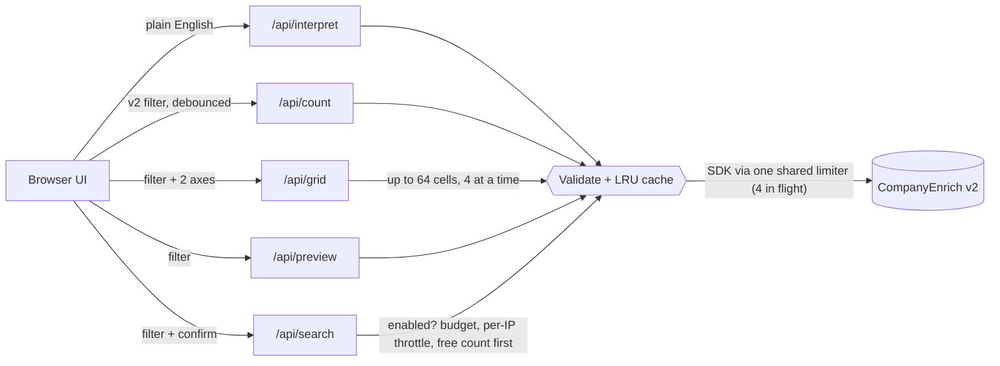

# Market Explorer

Size a B2B market for free: describe it in plain English or build filters by hand, and get exact company counts, a segment heatmap and sample companies.

Market Explorer is a Next.js app for founders, sales and RevOps teams, and SaaS builders who want to answer "how many companies are in this market, and where are they?" before spending anything. Almost everything runs on CompanyEnrich's free endpoints: the semantic count turns your description into filters (no LLM in this app), the count endpoint gives exact numbers as you edit, a grid of free counts becomes a heatmap, and the free preview shows real companies. It also shows how to embed a market search in your own product: every filter control maps 1:1 to the v2 `CompanySearchFilter`, and the export panel gives you the same query as JSON, SDK code or curl.

## Example output

Captured from a live run against the API on 2026-11-11 (counts change as the dataset updates).

**Describe a market.** "Series A fintech companies in Germany using Stripe" → **42** companies as a semantic search. The API's interpretation, shown as chips:

```text
Inferred filters (applied):  Country: Germany   Funding round: Series A
```

"B2B SaaS companies in the US with 50-200 employees founded after 2018" → **7,844** companies:

```text
Inferred filters (applied):  Country: United States   Employees: 51-200   Founded: 2019 or later
Ranking hints (rank higher, do not filter):  Category: B2B, SaaS
```

Clicking **Use as filters** with "Also turn category and revenue hints into filters" ticked fills the builder, and the live filter count becomes **5,418** (cost to fetch: first 10 = 10 credits, all 5,418 = 5,418 credits).

**Live count with technologies `{all, notIn}`.** `POST /api/count`:

```json
{ "filter": { "country": ["US"], "categories": ["saas"], "technologies": { "all": ["stripe", "hubspot"], "notIn": ["salesforce"] } } }
```

```json
{ "count": 551, "total": 551 }
```

With no filters at all the count is capped by the plan: `{ "count": 100000, "total": 25353769 }`, so the UI shows the total market and notes that the plan can fetch the first 100,000.

**Segment heatmap.** SaaS companies, rows = country, columns = employees, 16 free counts in 0.7 seconds:

| Country \ Employees | 11-50 | 51-200 | 201-500 | 501-1K |
| --- | ---: | ---: | ---: | ---: |
| United States | 46,124 | 9,151 | 2,489 | 3,663 |
| United Kingdom | 7,959 | 1,490 | 366 | 109 |
| Germany | 6,441 | 1,027 | 325 | 106 |
| France | 4,925 | 913 | 207 | 54 |

**Sample companies.** Free preview for German SaaS companies with 51-200 employees: 25 of 1,027 returned, starting with Nextcloud (Software), AnyDesk (Software), Qdrant (Software), Cloudimage (Media & Internet), UXCam (Software). The paid path with `pageSize: 3` returned nextcloud.com, anydesk.com and qdrant.tech for 3 credits, after a free count confirmed 1,027 matches.

**Credits.** All free flows above (interpret, counts, the grid, preview, autocomplete) used 0 credits, checked with `me()` before and after. The paid sample (run with `ENABLE_PAID_SEARCH=true`) used 3.

## How it works

1. **Describe.** `/api/interpret` calls the free `companies.count({ semantic: { query } })`. The response includes `interpretation.filter` (filters the API inferred and applied) and `interpretation.boost` (ranking hints). The UI shows both as chips, and **Use as filters** converts the inferred filter into builder state.
2. **Build.** The builder edits a plain `FilterState`. `toApiFilter` in `src/lib/filter.ts` turns it into a v2 filter: arrays mean "any of", `{ all, in, notIn }` covers technologies and keywords, "match any" categories become `{ in: [...] }`, and industries become `naicsCodes` (v2 has no industry field).
3. **Count.** 400 ms after you stop editing, `/api/count` runs one free count. The server validates the filter against the allowed enums, then caches the result in an LRU cache for 10 minutes.
4. **Heatmap.** You pick two dimensions (up to 8 values each). `/api/grid` builds one filter per cell, where the cell's segment replaces any filter on the same field, and runs the free counts 4 at a time. Clicking a cell applies that segment to your filters, so the live count matches the cell.
5. **Sample.** If `me().capabilities.previews` is true, `/api/preview` returns up to 25 companies for free. If the plan has no previews, the UI offers a paid search behind a confirm step (when the server allows paid search). The server reserves the cost from a daily budget, checks the free count first, and skips the paid call when nothing matches.
6. **Export.** The same filter as JSON, as `@companyenrich/sdk` code (`count` and `search`, with the filter typed as the SDK's `CompanySearchFilter` so it compiles as is; a test type-checks it with `tsc`), or as curl against `/v2/companies/search/count`.



Code layout: `src/lib/` holds all logic with no React (filter conversion, grid generation, cost math, snippets, cache, validation, the spend guards in `spend.ts`, the shared upstream limiter in `upstream.ts`, and the route handler logic in `handlers.ts`). `src/app/api/*/route.ts` are one-line wrappers. `src/components/` is the UI.

## CompanyEnrich endpoints used

| SDK method | Endpoint | Why | Cost |
| --- | --- | --- | --- |
| `companies.count({ semantic })` | `POST /v2/companies/search/count` | Interpret a plain-English description | Free |
| `companies.count({ filter })` | `POST /v2/companies/search/count` | Live count and every heatmap cell | Free |
| `companies.preview({ filter })` | `POST /v2/companies/search/preview` | Up to 25 sample companies | Free on plans with previews |
| `companies.search({ filter, pageSize })` | `POST /v2/companies/search` | Paid sample when previews are unavailable (max 10) | 1 credit per company |
| `me()` | `GET /v2/me` | Check `capabilities.previews` (only that flag reaches the browser) | Free |
| `technologies.autocomplete(q)` | `GET /v2/technologies/autocomplete` | Technology suggestions | Free |
| `keywords.autocomplete(q)` | `GET /v2/keywords/autocomplete` | Keyword suggestions | Free |
| `geo.searchCountries / searchStates / searchCities` | `POST /v2/geo/countries`, `/states`, `/cities` | Location suggestions | Free |
| `geo.regions()` | `GET /v2/geo/regions` | Region list | Free |
| `industries.list()` | `GET /v2/industries` | Industry → NAICS codes | Free |

API reference: https://docs.companyenrich.com

## Quickstart

Requires Node.js 22.12 or newer and an API key from https://companyenrich.com/dashboard.

```sh
cd market-explorer
npm install
cp .env.example .env.local   # then paste your key after COMPANYENRICH_API_KEY=
npm run dev
```

Open http://localhost:3101. To run without a `.env.local` file, pass the key inline: `COMPANYENRICH_API_KEY=your-key npm run dev`. The app starts free-only; to allow the paid sample search locally, also set `ENABLE_PAID_SEARCH=true`.

Production build and checks:

```sh
npm run build && npm start -- -p 3101
npm run typecheck && npm test   # no network or key needed
```

## Configuration

| Variable | Required | Purpose |
| --- | --- | --- |
| `COMPANYENRICH_API_KEY` | Yes | Your API key. Read only by the route handlers; never sent to the browser. |
| `ENABLE_PAID_SEARCH` | No (default `false`) | Only `true` turns on `/api/search`, the one paid route. Leave it unset or `false` on any public deployment. |
| `SEARCH_MAX_CREDITS_PER_DAY` | No (default `50`) | Process-wide cap on paid-search credits per UTC day. Each request reserves its worst case (its page size) before calling the API and is refunded what was not billed. `0` blocks all paid searches. |
| `SEARCH_MAX_PER_IP_PER_HOUR` | No (default `5`) | Paid searches per client per rolling hour. Without `TRUST_PROXY` (and off Vercel) all clients share one bucket, so this is a server-wide hourly limit. |
| `TRUST_PROXY` | No (default off) | Set to `1` only when your own reverse proxy appends the client address to `X-Forwarded-For`. The limit then counts per address using the right-most hop, which clients cannot forge. On Vercel (`VERCEL=1`, set by the platform) the app uses `x-vercel-forwarded-for` instead. |

**Safest default for a public deployment:** leave `ENABLE_PAID_SEARCH` unset (or `false`). The app then calls only free endpoints and no visitor can spend your credits. If you do enable it, keep `SEARCH_MAX_CREDITS_PER_DAY` small: it is the hard cap. Forwarding headers are ignored by default because any client can set them; a test checks that a new `X-Forwarded-For` on every request cannot reset the limit.

UI controls:

| Control | v2 field | Notes |
| --- | --- | --- |
| Describe a market | `semantic.query` (count only) | Shows `interpretation.filter` and `interpretation.boost`; "Use as filters" copies them |
| Country, region, state, city | `country`, `region`, `state`, `city` | Autocomplete from the free geo endpoints; matches any |
| Industry | `naicsCodes` | Each industry adds its NAICS prefixes from `industries.list()` |
| Employees, revenue, type | `employees`, `revenue`, `type` | Matches any selected value |
| Category + match all/any | `categories` | Array = all, `{ in }` = any |
| Technologies, keywords | `technologies`, `keywords` | "All of" → `all`, "any of" → `in`, "none of" → `notIn` |
| Founded, last funding year | `foundedYear`, `fundingYear` | Inclusive `{ min, max }` |
| Funding round, funding amount | `fundingRounds`, `fundingAmount` | Amount entered in USD millions |
| Headcount growth | `workforceGrowth` | Period, department, minimum percent (sent as a ratio, 20% → 0.2) |
| Heatmap rows/columns | grid of counts | Country, employees, revenue, category, funding round, founded-year buckets; up to 8 × 8 |
| Sample size (paid) | `pageSize` | 3, 5 or 10, after a confirm |

Server-side limits: filters are validated against the API's enums and list sizes, and unknown fields are rejected. Every request to CompanyEnrich, from every route, goes through one process-wide limiter (4 in flight, 100 waiting, then `503 busy`), so a grid of 64 cells or many visitors at once never exceed 4 upstream requests. Grids are capped at 8 × 8. Paid search must be enabled, requires `confirm: true` with `pageSize` at most 10 and no cursor, and is subject to the daily budget and per-address throttle above.

In the UI, the paid sample is always built from the filter on screen: any filter change closes an open confirmation and clears old results, and late responses from superseded requests are dropped.

## Credits

| Step | Endpoint | Cost |
| --- | --- | --- |
| Interpret a description | semantic count | 0 |
| Live count | count | 0 |
| Heatmap (up to 64 cells) | count × cells | 0 |
| Sample companies, plan with previews | preview | 0 |
| Sample companies, paid fallback (off by default) | search | 1 per company (3 to 10), or 0 if the free count is 0 |
| Autocomplete, regions, industries, capabilities | reference endpoints | 0 |

The default demo (describe, build, heatmap, preview) costs **0 credits**, and with the default configuration the app cannot spend credits at all. The only paid action is the sample search: it is off unless `ENABLE_PAID_SEARCH=true`, shows its cost and waits for a click, and is capped on the server at 10 credits per request, `SEARCH_MAX_CREDITS_PER_DAY` per day (default 50) and `SEARCH_MAX_PER_IP_PER_HOUR` requests per address (default 5).

Reference prices shown in the UI: filter search 1 credit per result, semantic search 2, lookalike 5, each paid expansion +1, and an empty paid result still bills one result. See https://docs.companyenrich.com for current pricing.

## Limitations

- **Semantic counts are not market sizes.** With a description, `count` and `total` refer to the vector-search candidate pool. Treat the semantic number as a starting point and use the filter count for sizing.
- **Interpretation is partial.** In "Series A fintech companies in Germany using Stripe", only Germany and Series A became filters; "fintech" and "Stripe" only affect ranking. Add them as a keyword and a technology to filter on them.
- **States and cities come back as ids.** The interpretation returns `state`/`city` ids without names, so the builder labels them `State #4845` until you replace them with an autocomplete pick.
- **Plan caps.** `count` is capped at your plan's search limit (100,000 here). The UI and heatmap show `total`, and say how many your plan can fetch.
- **Employee and revenue values are ranges.** Counts by size or revenue count companies in each range, not exact figures.
- **Heatmap segments replace filters.** A row or column on "Employees" overrides your employee filter for that grid. Categories overlap, so category rows do not add up to the total.
- **Preview fields are minimal.** Previews return name, logo and industry only; domains need the paid search.

## Ideas to extend it

- Save and share markets as URLs (encode `FilterState` in the query string).
- Add lookalike mode: seed domains → `lookalike` count and a 5-credit-per-result cost estimate.
- Export the full list with `companies.searchExport` after a count-based cost confirmation.
- Add people counts per cell with the free `people.count({ company: { filter } })` to size buying committees.
- Track a market over time by storing daily counts per segment.
