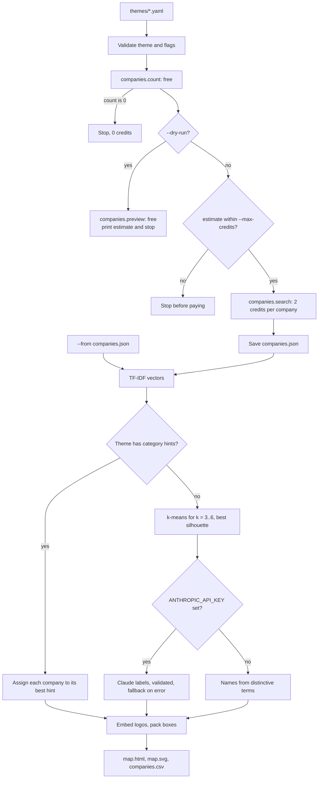

# Market Map Generator

Turn a theme like "AI agents for finance teams" into an investor-style market map: logos grouped into labelled categories, as a self-contained HTML page and an SVG.

Themes are small YAML files, so you can publish a fresh map the day something launches without writing code. It is for founders, marketers, investors and anyone writing about a market. Under the hood it shows how to use the [CompanyEnrich API](https://docs.companyenrich.com) cost-safely: a free count and preview before spending, one semantic search sized to the map, and public logo URLs embedded at no cost. Grouping is deterministic (TF-IDF and k-means, written out in plain TypeScript); Claude is optional and only renames the clusters.

## Example output

This map comes from a live run on 2026-11-11 (`npm start -- themes/ai-agents-for-finance.yaml --companies 20`, 40 credits). The committed [`docs/example-map.svg`](docs/example-map.svg) is the unedited `map.svg` that the current code renders from that run's saved `companies.json` with `--from`; the groups and names are the same as in the live run's output below. No Anthropic key was set, so the category names are the deterministic, term-based ones.



The terminal output of that run:

```text
Theme: AI agents for finance teams
Semantic query: "AI agents that automate accounting, accounts payable, financial close and FP&A work for finance teams"
Free count: 54,000 companies in the candidate pool
API interpretation: boosts categories b2b
Estimate: 20 companies x 2 credits = up to 40 credits (--max-credits 100)
Fetched the top 20 companies by relevance (40 credits)
Grouping: k-means, 5 clusters by best silhouette (k=3 -> 2: 0.093, k=4 -> 3: 0.076, k=5 -> 4: 0.104, k=6 -> 5: 0.112)
Claude naming: off (set ANTHROPIC_API_KEY to enable); using term-based names
  Matching & Bank Reconciliation (8): FullSeam, Cloudsquid, LayerNext, Mrava AI, Lumera, Carapace, Numos, FINA AI
  Document & Process (4): Zalos, Profluo, Aviron, Yesautomate
  Agentic & Invoice Processing (3): Hyperbots, Auditoria, AppZen
  Journal Entries (3): Ledge, Safebooks AI, Optimus
  Deploys & Reporting (2): FF9 AI Agents Deployment, Ayuta.ai
Logos: 20 embedded, 0 shown as initials

Wrote:
  output/ai-agents-for-finance-2026-11-11/map.html
  output/ai-agents-for-finance-2026-11-11/map.svg
  output/ai-agents-for-finance-2026-11-11/companies.csv
  output/ai-agents-for-finance-2026-11-11/companies.json
Credits spent: 40
```

The second theme uses category hints instead of clustering. A live 12-company run (24 credits), re-rendered for free with `--from` after tuning the hint keywords:

```text
Theme: Carbon accounting software
Loaded 12 companies from output/carbon-accounting-2026-11-11/companies.json, fetched 2026-11-11 (0 credits)
Grouping: by the theme's category hints; no companies for: ESG reporting and compliance
Category names: from the theme hints
  Carbon footprint measurement (4): CarbonAnalytics, Ecocharting, Kabaun, Climatise
  Supply chain emissions (3): StepChange, Arbor, TrackZero
  Decarbonization and net zero (4): Emerald Power, GreenFeet, Atmoz, CarbonSense Technologies
  Energy and buildings (1): Faradai
Logos: 12 embedded, 0 shown as initials
```

`--dry-run` costs nothing and shows what a run would buy:

```text
Theme: AI agents for finance teams
Semantic query: "AI agents that automate accounting, accounts payable, financial close and FP&A work for finance teams"
Free count: 54,000 companies in the candidate pool
API interpretation: boosts categories b2b
Estimate: 20 companies x 2 credits = up to 40 credits (--max-credits 100)
Top matches (free preview, first 12 of 25): FullSeam, Hyperbots, Auditoria, Cloudsquid, Ledge, LayerNext, Zalos, Profluo, Mrava AI, AppZen, Lumera, FF9 AI Agents Deployment
Dry run: 0 credits spent.
```

Each run writes four files to `output/<theme>-<date>/`:

| File | What it is |
| --- | --- |
| `map.html` | One self-contained page: no scripts, no external requests, logos embedded, light and dark mode, responsive down to phone width, linked logos with the description on hover, and a table view of every company. |
| `map.svg` | The same map as a single SVG for slides, posts and READMEs. Logos are embedded, so it also renders inside an `` tag. |
| `companies.csv` | One row per company: category, name, domain, website, description, industry, employees, founded year, country, keywords, logo URL. |
| `companies.json` | The raw search results. Pass it to `--from` to re-render after editing the theme, at no cost. |

## How it works

1. **Load the theme** ([`src/lib/theme.ts`](src/lib/theme.ts)). The YAML is validated with zod before any API call: title, semantic query, optional `filter`, company count and optional category hints. Filter field names are checked against the SDK's v2 filter type, so a typo fails before anything is spent.
2. **Free count** ([`src/lib/companyenrich.ts`](src/lib/companyenrich.ts)). `companies.count` runs the same query and returns the size of the semantic candidate pool plus the API's `interpretation` (filters and ranking boosts it inferred from your words). This also validates the theme's `filter` for free. A count of 0 stops the run.
3. **Estimate and guard** ([`src/lib/credits.ts`](src/lib/credits.ts)). The estimate is companies x 2 credits (+1 with `--with-keywords`). If it is over `--max-credits` the run stops before paying. `--dry-run` stops here and adds a free preview of the top 25 names.
4. **Paid search** ([`src/lib/storage.ts`](src/lib/storage.ts)). Before paying, the app checks that every output file can be written. Then one `companies.search` call with `pageSize` set to the map size. The results are saved to `companies.json` straight away (temp file, then rename). If that write still fails, they go to the system temp folder, or as a last resort are printed, so paid data is never lost.
5. **Group deterministically** ([`src/lib/categorize.ts`](src/lib/categorize.ts)). Each company becomes a TF-IDF vector ([`src/lib/tfidf.ts`](src/lib/tfidf.ts)) built from its description and keywords, with its industries and categories added as half-weight tags. Then:
   - with category hints, each company goes to the hint with the highest cosine similarity, and companies that match none go to "Other";
   - without hints, spherical k-means ([`src/lib/cluster.ts`](src/lib/cluster.ts)) runs for k = 3 to 6, single-company clusters join their nearest neighbour, and the result with the best silhouette score wins. Each cluster is named by its most distinctive terms ([`src/lib/naming.ts`](src/lib/naming.ts)).
6. **Optional Claude naming** ([`src/lib/claude.ts`](src/lib/claude.ts)). With `ANTHROPIC_API_KEY` set, Claude gets each cluster's members and draft name and returns a short label and one-line description per cluster as structured output. The labels are validated (one per cluster, unique, short, not "Other"); on any error or refusal the term-based names stay.
7. **Render** ([`src/lib/render/`](src/lib/render), [`src/lib/layout.ts`](src/lib/layout.ts)). Logos are downloaded from their public `logoUrl` (streamed, at most 150 KB each) and embedded as data URIs that are only ever used as image sources, so SVG logos cannot run scripts. A missing logo shows initials. Category boxes are bin-packed into one, two or three columns, whichever gives the shortest map.



## CompanyEnrich endpoints used

| SDK method | Endpoint | Why | Cost |
| --- | --- | --- | --- |
| `companies.count` | `POST /v2/companies/search/count` | Candidate pool size, the API's interpretation of the query, free validation of the filter | Free |
| `companies.preview` | `POST /v2/companies/search/preview` | `--dry-run` only: the top 25 names, so you can check the query before paying | Free on plans with previews; skipped on 402/403 |
| `companies.search` | `POST /v2/companies/search` | The companies on the map (`semantic` + optional `filter`, `expand: ['keywords']` with `--with-keywords`) | 2 credits per company, +1 per company for keywords. An empty result bills 2 |
| none (plain `fetch`) | `GET https://api.companyenrich.com/companies/logo/{id}` (the `logoUrl` field) | Logos, embedded so the files are self-contained | Free. The URLs are public: no API key is sent, and a missing logo returns 404 |

The SDK client is built with `timeoutMs: 30_000`. The paid search is a POST, which the SDK does not retry after a timeout or server error, so a flaky connection cannot bill the same search twice.

## Quickstart

Requires Node.js 22.12+ and a CompanyEnrich API key from your [dashboard](https://companyenrich.com/dashboard). From the repository root:

```bash
cd market-map-generator
npm ci
export COMPANYENRICH_API_KEY=your-key-here
npm start -- themes/ai-agents-for-finance.yaml --dry-run
npm start -- themes/ai-agents-for-finance.yaml
```

The first `npm start` is free. The second spends about 40 credits and prints the paths it wrote; open `map.html` in a browser.

To change the categories without paying again, edit the theme and re-render from the saved results (no API key needed):

```bash
npm start -- themes/ai-agents-for-finance.yaml --from "$(ls -d output/ai-agents-for-finance-*/ | tail -n 1)companies.json"
```

## Configuration

| Variable | Required | Purpose |
| --- | --- | --- |
| `COMPANYENRICH_API_KEY` | Yes, except with `--from` | Your CompanyEnrich API key |
| `ANTHROPIC_API_KEY` | No | Turns on Claude naming of automatic clusters. Without it the app prints a one-line notice and uses term-based names |
| `ANTHROPIC_MODEL` | No | Claude model for naming. Default `claude-opus-5-5` |

`.env.example` lists them. The CLI reads the real environment; export the variables in your shell.

| Flag | Default | Meaning |
| --- | --- | --- |
| `<theme.yaml>` | (required) | The theme file |
| `--companies <n>` | the theme's `companies`, or 20 | Companies to fetch, 1 to 100 |
| `--with-keywords` | off | Also fetch each company's keywords for sharper clusters (+1 credit per company) |
| `--max-credits <n>` | 100 | Stop before a search that could cost more than this |
| `--dry-run` | off | Free: count, interpretation, preview and estimate only |
| `--out <dir>` | `output` | Where to write `<theme>-<date>/` |
| `--from <file>` | none | Re-render from a `companies.json` saved by an earlier run of the same theme. Free |

A theme file:

```yaml
title: Carbon accounting software          # shown on the map; its words are never used in cluster names
semantic: carbon accounting, emissions measurement and ESG reporting software for companies
companies: 24                              # optional, default 20, max 100
filter:                                    # optional, any v2 company search filter
  foundedYear:
    min: 2015
categories:                                # optional; without it the categories come from clustering
  - name: Supply chain emissions
    keywords: [supply chain, supplier, value chain, life cycle assessment]
  - name: Decarbonization and net zero
    keywords: [decarbonization, net zero, carbon credits, offsets]
```

Filter fields and values are listed in the [API docs](https://docs.companyenrich.com). Unknown keys are rejected, so a typo like `companys:` fails instead of being ignored. This matters most inside `filter`: the API ignores fields it does not know, so `industry: Software` would quietly search the unfiltered pool and bill for it. The app stops with `filter.industry: not a v2 company search filter field; use naicsCodes (NAICS codes listed by the free industries.list() endpoint) or categories`. Filter values are checked by the API on the free count call.

## Credits

| Step | Cost |
| --- | --- |
| Validate the theme and flags | 0 |
| `companies.count` (pool size, interpretation) | 0 |
| `companies.preview` (`--dry-run` only) | 0 |
| `companies.search` | 2 credits per company |
| `--with-keywords` | +1 credit per company |
| Logos | 0 |
| Clustering, rendering, `--from` re-renders | 0 |
| Claude naming | No CompanyEnrich credits; normal Anthropic API usage |

The default demo (20 companies) costs **40 credits**; with `--with-keywords` it costs 60. To cap spend, pass `--max-credits`: the run stops before the search if companies x price is over the cap, and suggests a `--companies` value that fits. `--dry-run` and `--from` never spend credits.

While building this example, live runs spent 104 credits in total, each checked against `me()` before and after: two 20-company runs of the finance theme (40 each) and one 12-company run of the carbon theme (24). The dry runs of both themes spent 0.

## Limitations

- **The map is a sample, not the market.** For semantic queries `companies.count` reports the vector search candidate pool (54,000 here), not the number of matching companies. The map shows the top N companies by relevance, and its subtitle says so.
- **Term-based names are rough.** Company descriptions in a narrow market use the same words, so TF-IDF clusters overlap and the names from distinctive terms can read awkwardly ("Deploys & Reporting" above). Category hints or Claude naming fix this; the silhouette scores (around 0.1) rank the k values but do not prove a strong structure exists.
- **Hint matching is lexical.** It matches words and two-word phrases, not meaning. Synonyms are missed, numbers are ignored ("Scope 3" is just "scope"), and a hint can end up empty, as "ESG reporting and compliance" did in the carbon run.
- **Logos come from the API.** A failed or missing logo shows initials. Twenty embedded logos make an SVG of about 220 KB.
- **SVG text is truncated, not wrapped.** SVG has no text measurement, so long names and descriptions are cut with "…" using an estimated character width, and each label is clipped to its tile or box so wide letters cannot spill over. The HTML page uses real CSS layout and wraps long text.
- **One page of results.** A map holds at most 100 companies (the search's `pageSize` limit).
- **What was tested live and what was mocked.** The CompanyEnrich calls (count, preview, search, logo downloads, bad key and bad filter errors) were run against the live API. No Anthropic key was available, so Claude naming was tested only with a mocked Anthropic client (a fake `fetch`), including refusal, malformed output and API errors; the fallback to term-based names is the path every live run above used.

## Ideas to extend it

- Add a `lookalike: [domains]` theme option to map a known company's competitors (5 credits per company).
- Request the `financial` expansion and order each box by total funding, or badge the funding stage.
- Compare two `companies.json` files from different dates to highlight new entrants on the map.
- Suggest hint keywords with the free `keywords.autocomplete` endpoint.
- Render a PNG for social posts with a headless browser.
