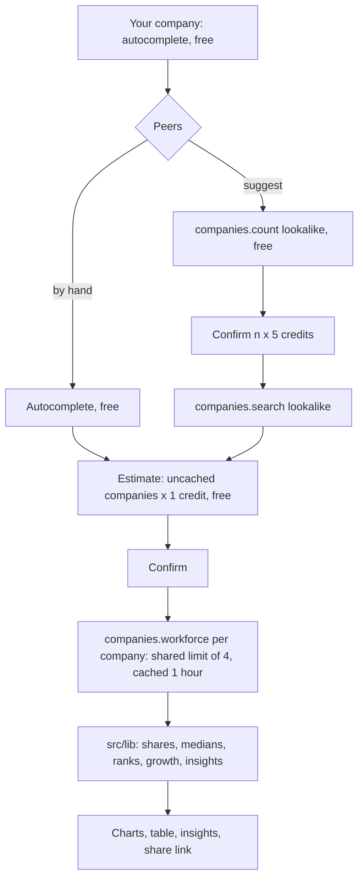

# Peer benchmark

Compare a company's team shape and 12-month growth with its peers, department by department.

Pick a company, then pick up to 8 peers by hand or let lookalike search suggest them. The app pulls observed workforce data for every company and tells you things like "the engineering team is 1.4× the peer median share" or "engineering grew 22% since Dec 2025 vs a peer median of -4%". It is for founders sizing their next hires, investors sanity-checking a portfolio company, RevOps comparing sales capacity, and recruiters looking for teams that are growing. It shows what structured workforce data can do that scraping job boards or LinkedIn pages cannot: department headcounts for any company, with monthly history, in one call each. There is no LLM: every sentence is computed.

## Example output

A real run on 11 Nov 2026: PostHog against four hand-picked product-analytics peers (5 credits).

Insights, exactly as the app printed them:

- PostHog has 179 observed employees, more than 2 of 4 peers (peer median 276).
- Observed headcount at PostHog grew 22% since Dec 2025 (147 → 179) vs a peer median of -6%.
- PostHog's engineering team is 1.4× the peer median share (50% of observed headcount vs 36%), the highest in the group.
- PostHog's operations team is 1.7× the peer median share (4.5% of observed headcount vs 2.7%), the highest in the group.
- PostHog's sales team is 0.6× the peer median share (17% of observed headcount vs 31%).
- PostHog's finance team is 0.1× the peer median share (0.6% of observed headcount vs 5.1%).
- PostHog's engineering team grew 22% since Dec 2025 (73 → 89) vs a peer median of -4%.
- PostHog's marketing team grew 71% since Dec 2025 (7 → 12) vs a peer median of -8%.

The companies table (trimmed to five of the eleven department columns):

| Company | Observed | Growth | Engineering | Sales | Marketing | Operations | HR & people | Unclassified |
| --- | ---: | ---: | ---: | ---: | ---: | ---: | ---: | ---: |
| PostHog (posthog.com), you | 179 | +22% | 50% | 17% | 6.7% | 4.5% | 5.6% | 7.3% |
| Mixpanel (mixpanel.com) | 445 | +3% | 29% | 31% | 8.1% | 1.8% | 4.9% | 4.9% |
| Amplitude (amplitude.com) | 827 | +0.4% | 27% | 31% | 11% | 2.5% | 5.4% | 5.4% |
| Heap (heap.io) | 62 | -14% | 44% | 39% | 3.2% | 3.2% | 1.6% | 0% |
| Hotjar (hotjar.com) | 106 | -13% | 47% | 7.5% | 11% | 2.8% | 2.8% | 1.9% |
| Peer median | 276 | -6% | 36% | 31% | 9.5% | 2.7% | 3.9% | 3.4% |

"Suggest peers" with 3 lookalikes of posthog.com (15 credits) returned these, in the API's order:

| Suggested peer | Lookalike score |
| --- | ---: |
| Mixpanel (mixpanel.com) | 0.9995 |
| OpenReplay (openreplay.com) | 0.9981 |
| LogRocket (logrocket.com) | 0.9972 |

Benchmarking PostHog against those three cost 4 more credits.

In the browser the same data drives two charts (department mix and growth, each with a table view), the sortable table, and a share link such as `/?company=posthog.com&peers=mixpanel.com,amplitude.com,heap.io,hotjar.com`.

## How it works

1. **Your company.** Type a domain. Suggestions come from the free `companies.autocomplete`.
2. **Peers.** Add up to 8 by hand (free autocomplete), or press "Suggest peers". The server first runs the free `companies.count` with a lookalike query that excludes your company and the peers you already have. You see the count and the price (5 credits per company), and only after you confirm does it run `companies.search({ lookalike })`, asking for no more results than the estimate covered. Suggestions keep the API's order and scores.
3. **Estimate, then confirm.** "Compare" asks the server for a free estimate: 1 credit for each company whose workforce data is not cached. Nothing is spent until you confirm that number.
4. **Fetch.** The server calls `companies.workforce({ domain })` for each company (latest 12 months of history). Every CompanyEnrich call in the process goes through one shared limiter of 4 parallel calls. Responses, including "no data" answers, are cached for an hour, so repeat runs and shared links are free. The cache key is the domain plus the UTC month, because the API's 12-month window moves with the month.
5. **Compute.** Plain TypeScript in `src/lib/` (no framework, fully unit-tested):
   - each department's share of observed headcount, with unclassified headcount shown on its own row;
   - the peer median and your rank among peers for each department;
   - growth from one common window start (the latest `historyFrom` in the group, so every company is measured over the same months) to the newest snapshot, overall and per department. History is a list of change points, newest first, so a month without a point keeps the previous value. A zero baseline has no rate, teams under 5 people at the start are shown but not compared, and companies without a snapshot at the common start are not compared;
   - deterministic insight sentences, ranked by how many percentage points (mix) or people (growth) the gap represents.
6. **Show.** A department-mix dot plot (you, the peer median, each peer as a faint point), a growth dot plot, a sortable table of every company, the insights, and a share link that holds only domains.



The browser never talks to CompanyEnrich. It calls three route handlers, which you can also call with curl:

```sh
# Free: the estimate
curl -s localhost:3104/api/benchmark -H 'content-type: application/json' \
  -d '{"company":"posthog.com","peers":["mixpanel.com","amplitude.com","heap.io","hotjar.com"]}'
# {"mode":"estimate","estimate":{"companies":5,"cached":0,"credits":5,"budgetRemaining":200}}

# Paid: confirm the cost you saw
curl -s localhost:3104/api/benchmark -H 'content-type: application/json' \
  -d '{"company":"posthog.com","peers":["mixpanel.com","amplitude.com","heap.io","hotjar.com"],"confirm":true,"maxCredits":5}'
```

`POST /api/suggest` takes `{ company, count, peers, confirm, maxCredits }` the same way, and `GET /api/autocomplete?q=post` is free.

## CompanyEnrich endpoints used

| SDK method | Endpoint | Why | Cost |
| --- | --- | --- | --- |
| `companies.autocomplete(query)` | `GET /v2/companies/autocomplete` | Company picker, plus names and logos for shared links | Free |
| `companies.count({ lookalike, filter })` | `POST /v2/companies/search/count` | How many lookalikes exist, before buying any | Free |
| `companies.search({ lookalike, filter, pageSize })` | `POST /v2/companies/search` | Suggested peers, with the API's ranking scores | 5 credits per company returned (an empty result bills 5, so it is skipped when the count is 0) |
| `companies.workforce({ domain })` | `GET /v2/companies/workforce` | Observed headcount, department headcounts and 12 months of history | 1 credit per company found; a 404 is free |

API reference: https://docs.companyenrich.com

## Quickstart

Requires Node 22.12+ and a CompanyEnrich API key from https://companyenrich.com/dashboard.

```sh
cd peer-benchmark
npm ci
npm run build
COMPANYENRICH_API_KEY=your_key_here npm start
```

Open http://localhost:3104 and pick a company. To keep the key out of your shell history, copy `.env.example` to `.env.local` (git-ignored) and fill it in; Next.js loads it on start. `npm test` and `npm run typecheck` need no key and no network.

## Configuration

| Variable | Required | Purpose |
| --- | --- | --- |
| `COMPANYENRICH_API_KEY` | Yes | Server-side API key. Never sent to the browser. |
| `MAX_CREDITS` | No | Credits this server process may spend in total before it refuses paid calls. Default 200. |

UI controls:

- **Your company**: domain with autocomplete. Enter also accepts any valid domain as typed.
- **Peers**: up to 8, by hand or with "Suggest peers" (choose 1 to 8, default 5, limited by free slots). Each suggestion shows its lookalike score.
- **Compare**: shows the cost and waits for your confirmation. Cached companies are free.
- **Show table**: the numbers behind each chart, readable without hovering.
- **Copy share link**: copies the URL. It holds only domains, and opening it shows the cost before anything is spent (a fully cached link runs straight away, for free).

## Credits

| Step | Cost |
| --- | --- |
| Autocomplete, names and logos | 0 |
| Lookalike count | 0 |
| Suggest n peers | 5 × n |
| Workforce data per company | 1, or 0 if cached within the hour or the company has no data |
| Hand-picked demo (1 company + 4 peers) | 5 |
| Suggest demo (3 lookalikes, then benchmark 4 companies) | 15 + 4 = 19 |

How spend is capped:

- Paid routes do nothing paid unless the request says `confirm: true` with `maxCredits`, the cost you were shown. The server recomputes the estimate and answers `409` if it went up, for example because a cached company expired.
- Each run claims a credit before every workforce call and can never go past the confirmed amount. Outcomes that are definitely not billed (a 404 for a company without data, a 400, any other HTTP error) give their credit back; a timeout keeps it counted, since it may have been billed.
- The paid workforce call runs with `maxRetries: 0`, so a server error is never billed twice. Only rate-limit answers (never billed) are retried.
- If a run fails partway, for example on a bad key, calls already in flight are allowed to finish, nothing new starts, and the error response includes `creditsCharged` for what was spent. The UI adds it to the session total, and the paid-for data stays cached.
- `MAX_CREDITS` caps the whole server process. A request it cannot cover is refused with `403` before any paid call.
- At most 9 companies per benchmark and 8 suggested peers, checked on the server.

Building and testing this app used 30 credits in total: one probe call (1), the hand-picked demo twice because a restart cleared the cache (5 + 5), and the suggest demo (15 + 4).

## Limitations

- **Observed headcount is not official headcount.** It counts people profiles that list the company as their current employer.
- **Departments come from job titles.** The app uses `departmentHeadcount` exactly as returned, and title conventions differ between companies. Titles that match no department count as unclassified, and someone can match more than one department, so shares can add up to slightly more than 100%.
- **Growth is window growth.** It runs from the first month of the 12-month window to the newest snapshot. The newest month can be partial. Small teams and companies without history at the window start are left out of comparisons rather than guessed.
- **Small groups.** With 8 peers or fewer, a median is a rough anchor and "highest in the group" is a fact about this group only.
- **Lookalikes are about the business, not the size.** Suggested peers can be much bigger or smaller than your company.
- **The cache and the `MAX_CREDITS` budget live in server memory.** A restart clears both, so cached companies are billed again afterwards, and separate server instances do not share them.
- **What was tested live.** Everything in this README ran against the live API on port 3104: both demos, a domain with no data (excluded, 0 credits), a missing key and a bad key. Out-of-credits, server errors, timeouts, a bad key after a paid call, a cache that spans a month boundary, and the concurrency limit are covered by the test suite with a fake `fetch`, not live.

## Ideas to extend it

- Fetch the previous year with `nextCursor` (1 more credit per company) to compare two-year trends.
- Add `filter.employees` to "Suggest peers" so lookalikes are also similar in size.
- Persist the cache in SQLite or Redis so restarts and multiple instances do not re-bill.
- Add a seniority split per department with the free `people.count`.
- Export the table as CSV for a board deck.
