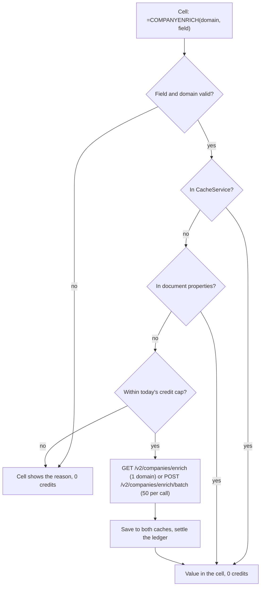

# CompanyEnrich for Google Sheets

Look up company data with a formula and run bulk enrichment, lookalikes and people searches from a sidebar, without paying twice for the same company.

This is a container-bound Google Apps Script for sales, RevOps and analysts who work in spreadsheets. Custom functions (`=COMPANYENRICH`, `=COMPANYENRICH_ROW`, `=COMPANYENRICH_COUNT`) handle single lookups and free counts. A sidebar handles the paid and bulk actions, each with a cost estimate and an explicit confirm. Every company is cached in CacheService and in the spreadsheet's document properties, so recalculation and reopening never re-bill, and a per-spreadsheet daily credit cap stops runaway formulas. It shows how to call the CompanyEnrich v2 API from Apps Script with `UrlFetchApp` (the JavaScript SDK needs `fetch` and Promises, which Apps Script lacks), how to keep spending predictable in an environment that recalculates on its own schedule, and how to test Apps Script code in Node.

> **What was and was not tested.** The Google Sheets UI itself was not tested here: no Google account was available, so the menu, the sidebar, authorization prompts and real recalculation behaviour have not been run in a spreadsheet. The script files were tested in Node, unchanged, with mocked Google services (121 unit tests) and with live smoke tests against the real CompanyEnrich API. See [Testing](#testing).

## Example output

Real values from `npm run smoke`, shown as the formulas you would type into a sheet:

| Formula | Result |
| --- | --- |
| `=COMPANYENRICH("stripe.com", "name")` | `Stripe` |
| `=COMPANYENRICH("https://www.figma.com/pricing", "name")` | `Figma` |
| `=COMPANYENRICH(A2:A4, "employees")` with stripe.com, figma.com, hubspot.com in A2:A4 | `over-10K`, `1K-5K`, `5K-10K` (one per row) |
| `=COMPANYENRICH_ROW("stripe.com", "name,industry,employees,country,foundedYear")` | `Stripe` \| `Finance` \| `over-10K` \| `United States` \| `2010` |
| `=COMPANYENRICH_COUNT("Germany", "51-200", "saas")` | `1029` |
| `=COMPANYENRICH_COUNT("US", "", "")` | `7200003` |
| `=COMPANYENRICH("no-such-company-0x7f3a.com", "name")` | `Not found` |
| `=COMPANYENRICH("stripe.com", "headcount")` | error: `Unknown field "headcount". Try name, domain, industry, employees, revenue, foundedYear, country, city or linkedin.` |

The first run billed 3 credits; the second run, with a fresh CacheService but the saved document properties, billed 0 (trimmed):

```text
$ npm run smoke -- --reset
1. =COMPANYENRICH(domain, "name") for 3 domains
  stripe.com                         "Stripe"
  https://www.figma.com/pricing      "Figma"
  hubspot.com                        "HubSpot"
  API calls: GET /v2/companies/enrich 200, GET /v2/companies/enrich 200, GET /v2/companies/enrich 200; credits billed: 3

2. The same 3 formulas again, as a recalculation would
  API calls: none; credits billed: 0

8. Error messages a cell would show
  missing key                        "No CompanyEnrich API key. Use the CompanyEnrich menu > Set API key."
  invalid key                        "CompanyEnrich rejected the API key (401). Set a valid key with CompanyEnrich > Set API key."

Summary
  Credits billed this run (from the responses): 3
  Companies saved in document properties: 3

$ npm run smoke
1. =COMPANYENRICH(domain, "name") for 3 domains
  stripe.com                         "Stripe"
  API calls: none; credits billed: 0
...
  Credits billed this run (from the responses): 0
```

The sidebar's server functions, run by `npm run smoke:sidebar` against the real API and an in-memory sheet (names and LinkedIn URLs of people replaced with placeholders):

```text
Enrich selected column (Accounts!A1:A4, 4 fields)
  estimate: 3 domains, 3 cached, up to 0 credits
  | Website | Name | Industry | Employees | Country |
  | stripe.com | Stripe | Finance | over-10K | United States |
  | https://www.figma.com/pricing | Figma | Software | 1K-5K | United States |
  | hubspot.com | HubSpot | Software | 5K-10K | United States |

Find lookalikes for stripe.com (2 results)
  estimate: 14140 available, 2 results, up to 10 credits
  wrote 2 rows to "Lookalikes - stripe.com" for 10 credits
  | Rank | Score | Name | Domain | Industry | Employees | Country | LinkedIn |
  | 1 | 1.005 | Flutterwave | flutterwave.com | Finance | 501-1K | United States | https://www.linkedin.com/company/flutterwave |
  | 2 | 1.004 | Moov | moov.io | Finance | 51-200 | United States | https://www.linkedin.com/company/moov-io |

Find people at the 3 domains (c-suite, 1 per company)
  stripe.com: 44 match, taking 1
  figma.com: 14 match, taking 1
  hubspot.com: 21 match, taking 1
  estimate: 3 people, up to 6 credits
  wrote 3 rows to "People - 3 companies" for 6 credits
  | Name | Title | Seniority | Department | Company | Domain | Country | LinkedIn |
  | <CEO> | <CEO title> | founder | c-suite/founder | Stripe | stripe.com | United States | <linkedin> |
  | <CPO> | Chief Product Officer at Figma | c-suite | c-suite | Figma | figma.com | United States | <linkedin> |
  | <CEO> | Chief Executive Officer at HubSpot | c-suite | c-suite/executive | HubSpot | hubspot.com | United States | <linkedin> |
```

## How it works

1. **Set the key.** CompanyEnrich > Set API key checks the key with the free `GET /v2/me` and stores it in `PropertiesService.getUserProperties()`. It never touches a cell.
2. **Validate first.** A formula resolves the field name (`"Country"` becomes `location.country.name`) and normalizes the domain (`https://www.Figma.com/pricing` becomes `figma.com`) before any call, so a typo never costs a credit.
3. **Read the caches.** CacheService (6 hours) first, then document properties (saved with the spreadsheet). Each entry stores the domain it was looked up with and is ignored unless that matches.
4. **Claim, then reserve.** Sheets runs many cells at once, so under the document lock the script reads the cache again, skips domains another cell is already fetching (it waits for those instead), marks the rest in flight, and reserves their worst-case cost in a per-spreadsheet, per-day ledger. Over the cap, the cell shows an error and nothing is spent.
5. **Fetch only what is new, within 20 seconds.** One new domain uses `GET /v2/companies/enrich`; several use `POST /v2/companies/enrich/batch`, 50 per call. Each chunk is cached and released as soon as it is paid for, and the ledger is settled to what was actually billed. A formula starts no new call after 20 seconds (lock waits and retries count), so it always returns inside Google's 30-second limit; the rest show `Pending: too many new domains for one formula. Recalculate, or use the sidebar`.
6. **Sidebar actions estimate, then run.** The estimate uses only free calls (cache reads, counts, `/v2/me`). The run does not trust what the browser sends back: it requires `confirmed: true`, re-validates every value and limit, rebuilds the API query itself (never with paid expansions), recomputes the cost and refuses to spend more than the confirmed amount.



The code, in `apps-script/`:

| File | What it holds |
| --- | --- |
| `Functions.js` | The three custom functions |
| `Lookup.js` | Cache-first lookups, single vs batch enrichment |
| `Cache.js` | CacheService and document-properties layers, eviction when the store is full |
| `Budget.js` | The daily credit cap: reserve, settle, document lock |
| `Api.js` | The `UrlFetchApp` client: requests, retries, readable errors |
| `Inputs.js`, `Fields.js` | Domain normalization, field paths, enums, country names |
| `Menu.js` | The CompanyEnrich menu: sidebar, API key, daily cap, clear cache |
| `Sidebar.js`, `Sidebar.html` | Sidebar server functions and UI |
| `Config.js` | Constants: costs, limits, field list, enums |

## CompanyEnrich endpoints used

The Apps Script functions mirror these SDK methods with `UrlFetchApp`, using the same request shapes and Bearer auth.

| Apps Script function (SDK method) | Endpoint | Why | Cost |
| --- | --- | --- | --- |
| `ceEnrich_` (`companies.enrich`) | `GET /v2/companies/enrich` | One new domain | 1 credit when found, 0 when not found |
| `ceEnrichBatch_` (`companies.enrichBatch`) | `POST /v2/companies/enrich/batch` | Ranges and the sidebar column, 50 domains per call | 1 credit per company found |
| `ceCountCompanies_` (`companies.count`) | `POST /v2/companies/search/count` | `COMPANYENRICH_COUNT`, lookalike estimate | Free |
| `ceSearchCompanies_` (`companies.search` with `lookalike`) | `POST /v2/companies/search` | Find lookalikes | 5 credits per result; an empty result bills one |
| `cePostAllFree_` (`people.count`) | `POST /v2/people/search/count` | People estimate, one count per domain | Free |
| `ceSearchPeople_` (`people.search`) | `POST /v2/people/search` | Find people | 2 credits per person; an empty result bills one |
| `ceSearchCountries_` (`geo.searchCountries`) | `POST /v2/geo/countries` | Country names to codes | Free |
| `ceMe_` (`me`) | `GET /v2/me` | Key check, balance | Free |

API reference: https://docs.companyenrich.com

## Quickstart

You need a CompanyEnrich API key from https://companyenrich.com/dashboard.

### Install in a spreadsheet (copy and paste)

1. Open a Google Sheet and choose **Extensions > Apps Script**.
2. In **Project Settings** (gear icon), tick **Show "appsscript.json" manifest file in editor**. Back in the editor, replace the contents of `appsscript.json` with [`apps-script/appsscript.json`](apps-script/appsscript.json).
3. For each `.js` file in [`apps-script/`](apps-script), click **+ > Script**, give it the same name without the extension (Apps Script adds `.gs`), and paste the contents. Delete the empty `Code.gs`.
4. Click **+ > HTML**, name it exactly `Sidebar`, and paste [`apps-script/Sidebar.html`](apps-script/Sidebar.html).
5. Save, reload the spreadsheet, and choose **CompanyEnrich > Set API key**. Google asks you to approve the three scopes once; then paste your key. Anyone you give edit access to can read this key (see [Limitations](#limitations)).

### Install with clasp

```sh
npm ci
npm run clasp -- login                 # once; needs the Apps Script API enabled at https://script.google.com/home/usersettings
cp .clasp.json.example .clasp.json     # then paste your Script ID (Apps Script > Project Settings)
npm run push                           # uploads apps-script/ to the bound project
```

If clasp asks whether to overwrite the manifest, answer yes. Then reload the sheet and set the key as in step 5.

### Run the tests and the live smoke test locally (Node 22.12+)

```sh
npm ci
npm run typecheck && npm test
COMPANYENRICH_API_KEY=your-key npm run smoke           # about 3 credits the first time, 0 after
COMPANYENRICH_API_KEY=your-key npm run smoke:sidebar   # about 16 credits: 2 lookalikes, up to 3 people
```

Instead of the inline variable you can copy `.env.example` to `.env`; only the smoke scripts read it.

## Configuration

### Environment variables (Node tooling only)

| Name | Required | Purpose |
| --- | --- | --- |
| `COMPANYENRICH_API_KEY` | For `npm run smoke` and `npm run smoke:sidebar` | API key for the live smoke tests. In Sheets, the key lives in your user properties instead. |

### Functions

| Function | Arguments | Notes |
| --- | --- | --- |
| `=COMPANYENRICH(domain, field)` | A domain, URL or email, or a range of them; one field | Returns a value, or a column for a range |
| `=COMPANYENRICH_ROW(domain, fields)` | A domain or a single column of domains; `"name,industry,employees"` or a range of field names | One row per domain |
| `=COMPANYENRICH_COUNT(country, employees, categories)` | Codes or names (`"US"`, `"Germany"`), employee ranges (`51-200`, `1K-5K`, `over-10K`), categories (`saas`, `b2b`, ...). Empty to skip; comma-separate several | Returns `total`, the full matching population. Several categories must all match |

Fields: `name`, `domain`, `website`, `industry`, `industries`, `categories`, `employees`, `revenue`, `foundedYear`, `type`, `description`, `legalName`, `location.country.name`, `location.country.code`, `location.state.name`, `location.city.name`, `location.address`, `location.postalCode`, `location.phone`, `socials.linkedinUrl` (and the other `socials.*` URLs), `logoUrl`, `id`, `updatedAt`. Names are case-insensitive; `country`, `countryCode`, `state`, `city`, `linkedin` and `founded` are accepted as short forms. Paid expansions (`technologies`, `financial`, `workforce`, ...) are refused, because formulas never request them.

### Menu and sidebar

| Control | What it does |
| --- | --- |
| CompanyEnrich > Open sidebar | Balance, today's spend against the cap, and the three bulk actions |
| CompanyEnrich > Set API key | Checks the key with `/v2/me` and saves it in your user properties. Formulas use the owner's key; editors can get at it, so see [Limitations](#limitations) before sharing edit access |
| CompanyEnrich > Set daily credit cap | Most credits this spreadsheet may spend per UTC day, formulas and sidebar together. Default 500; 0 blocks paid lookups |
| CompanyEnrich > Clear cached companies | Forgets saved companies (they will be billed again on the next lookup) |
| Sidebar: Enrich selected column | Select a column of domains (a header cell is fine), pick fields, estimate, confirm. Inserts one column per field to the right |
| Sidebar: Find lookalikes | Click one domain cell; choose 1-25 results and an optional country. Writes a new sheet |
| Sidebar: Find people | Select up to 25 domains; choose seniorities, a department, title keywords and 1-10 people per company. Writes a new sheet |

Limits and costs are constants at the top of [`apps-script/Config.js`](apps-script/Config.js) and [`apps-script/Budget.js`](apps-script/Budget.js).

## Credits

| Step | Cost |
| --- | --- |
| `COMPANYENRICH` / `COMPANYENRICH_ROW`, new domain | 1 credit if found, 0 if not found |
| Any formula on a cached domain, any recalculation | 0 |
| `COMPANYENRICH_COUNT`, country lookup, balance, all estimates | 0 |
| Enrich selected column | 1 credit per new domain found (cached domains are free) |
| Find lookalikes | 5 credits per result |
| Find people | 2 credits per person |

Demo totals from this build: `npm run smoke` billed 3 credits on the first run and 0 on the second; `npm run smoke:sidebar` billed 16 (10 for 2 lookalikes, 6 for 3 people; the column enrichment came from the cache).

Ways spending is capped:

- Every sidebar action shows its worst-case cost and the confirm button names it; the button is disabled when the cost exceeds your balance or what is left of today's cap, and an estimate is discarded (even one still loading) as soon as an input changes. On the server, the run recomputes the cost from validated inputs and refuses anything unconfirmed or above the confirmed amount.
- Two cells asking for the same new domain at the same time pay once: the second waits for the first.
- The daily credit cap per spreadsheet (default 500, change it from the menu) applies to formulas and the sidebar together. A paid call reserves its worst case first and is settled to the real cost.
- Estimates use free counts, so a lookalike or people search with no matches is never run (an empty paid search would still bill one result).
- Paid calls (GET or POST) are retried only after a 429, never after a server error or a network failure, because the first attempt may already have been charged.

## Testing

| What | How | Result |
| --- | --- | --- |
| All script logic: field paths, domain normalization, both cache layers (no second fetch), document-properties eviction, range handling, 50-per-call batching, error messages for 401/402/403/404/422/429/5xx and network failures, retries, the daily cap, per-domain claims between interleaved cells, the 20-second time guard (with a fake clock), server-side validation of tampered sidebar plans, menu and key handling, every sidebar server function | `npm test`: the files in `apps-script/` load unchanged into a Node `vm` context with in-memory fakes of `UrlFetchApp`, `CacheService`, `PropertiesService`, `LockService`, `SpreadsheetApp`, `HtmlService`, `Utilities` and `Date` | 121 tests pass, no network |
| Apps Script code against Google's service typings | `npm run typecheck` checks `apps-script/*.js` with `@types/google-apps-script` (JSDoc types, `checkJs`) | Passes |
| Custom functions against the real API | `npm run smoke`, twice, with document properties saved to a temp file between runs | 3 credits, then 0 |
| Sidebar server functions against the real API | `npm run smoke:sidebar` with an in-memory spreadsheet | 16 credits |
| `npm run push` | Ran up to clasp's "No credentials found" (no Google account here) | Command wiring only |
| Google Sheets itself | Not tested: menu, sidebar rendering, authorization prompts, custom function timing, recalculation, real CacheService/PropertiesService/LockService quotas | Not run |

## Limitations

- **Untested in a real spreadsheet.** See [Testing](#testing). Google documents Cache, Lock, Properties and URL Fetch as available in custom functions (only user properties are restricted, see below), which is what the cache, the claims and the daily cap rely on, but none of it has run in Sheets here.
- **Anyone with edit access can get the owner's key.** Editors can open Extensions > Apps Script and change the code, and custom functions run with the spreadsheet owner's user properties, so an editor could make a formula reveal the owner's API key. Only give edit access to a sheet with this script to people you would trust with the key. For a team, publish the script as a separate Editor add-on (its code is not editable from the sheet) or keep the key on a small server that the script calls instead of CompanyEnrich directly. Viewers and commenters cannot run scripts.
- **Who pays.** Formulas always use the spreadsheet owner's key, because inside a custom function `getUserProperties()` returns the owner's properties ([Google docs](https://developers.google.com/apps-script/guides/sheets/functions)); an editor who triggers a recalculation spends the owner's credits. The menu and the sidebar run as the person using them, with the key they saved; an editor without a key cannot use the sidebar. The daily cap is per spreadsheet and counts both.
- **30 seconds per custom function call.** Ranges use the batch endpoint with `waitForEnrichment: false` to stay fast: companies CompanyEnrich has not stored yet show `Pending: recalculate later` and are enriched in the background. A formula stops starting new paid calls after 20 seconds and shows the rest as pending, so a range of a few hundred new domains may need several recalculations; use the sidebar's Enrich selected column for big lists. It writes plain values and processes 50 rows per call.
- **Recalculation is up to Sheets.** A formula recalculates when its arguments or the formula change, and sometimes on reopen; to retry a `Pending` cell, edit it. Not-found answers are cached for 6 hours only, so a company added later is found on a later lookup.
- **Cache capacity.** Document properties hold 500 KB per spreadsheet. A compacted company is about 1.6 KB, so roughly 300 companies persist; past that, the oldest quarter is dropped and those domains are billed again if a formula needs them after the 6-hour CacheService copy expires. Sidebar results are written as values and do not depend on the cache.
- **Quotas.** `UrlFetchApp` allows 20,000 calls per day on consumer accounts and 100,000 on Google Workspace; one batch call covers 50 domains. CompanyEnrich rate-limits each key (300 requests per window on the account used here); a 429 is retried twice, waiting up to 8 seconds.
- **The daily cap guards against accidents, not people.** Anyone who can edit the spreadsheet can raise it, and it does not limit API usage outside this spreadsheet.
- **Data caveats.** `COMPANYENRICH_COUNT` returns `total`, the full matching population; your plan may cap how many of those a search can return (`count`). Lookalike scores are ranking scores, not probabilities.

## Ideas to extend it

- Offer paid expansions (technologies, funding, workforce) in the sidebar's column enrichment, with their extra credit per company in the estimate.
- Add a "Refresh stale rows" action that re-enriches companies whose `updatedAt` is older than a chosen date.
- Store the persistent cache in a hidden sheet written by the sidebar, to hold thousands of companies instead of about 300.
- Add `COMPANYENRICH_PEOPLE_COUNT(domain, seniority)`, a free headcount-by-role formula built on `/v2/people/search/count`.
- Publish it as an Editor add-on so a team installs it once instead of pasting files into every sheet.
