# Talent Map

Size a talent pool for free, see which companies hold it and how their teams are trending, and get a shortlist of profiles, from one command.

`talent-map` is a TypeScript CLI for recruiters and talent teams. You describe the role you are hiring for and the kind of company the best candidates work at. The app tells you how many people fit, how the pool narrows with each filter, which companies hold the most of them, whether those teams are growing or shrinking, and who to look at first. It writes a self-contained HTML report and a CSV. It shows how to get most of the answer from free CompanyEnrich endpoints (`people.count`, `companies.count`, autocomplete) and spend credits only on the part that needs real profiles, under a hard cap.

## Example output

A real run, trimmed only by removing the npm banner. It costs 22 credits.

```text
$ npm start -- --role "data engineer" --company "fintech and payments companies" --country US \
    --employees 201-500,501-1K,1K-5K --seniority senior,director --min-tenure-years 2 --people 10 --trend-top 2

1. Role (free)
  "data engineer": known title; similar titles include Data Engineer, Senior Data Engineer, Big Data Engineer, Lead Data Engineer -> engineering-technical/data-science
  Department engineering-technical/data-science keeps 96% of the 320,596 people with these titles
  308,763 people in this role across all companies
2. Company environment (free)
  Environment: "fintech and payments companies" · HQ in US · 201-500 or 501-1K or 1K-5K employees
  54,000 companies in the semantic candidate pool; people search uses the 1,000 best matches
3. Pool size (free)
  In the environment: 3,401 (owner 1, vp 8, director 4, manager 12, senior 1,802, entry 121, intern 20, no level listed 1,433)
  At senior, director level: 1,806
  Joined their company on or before 2024-11-11: 1,392
Credit estimate (upper bound):
  shortlist: 10 profiles x 2 .....   20
  team trends: 2 companies x 1 ...    2
  total ..........................   22  (cap 50)
4. Shortlist (paid, up to 10 profiles)
  10 profiles across 10 companies
5. Team trends (paid, 2 companies)

Shortlist pool: 1,392 (3,401 in this environment, 308,763 across all companies)
Top companies (5 of 10 in the shortlist):
  1. Altimetrik: 159 matching, 1 shortlisted, engineering-technical team ▶ −40 (−1%) since Dec 2025: 3,996 → 3,956
  2. SoFi: 23 matching, 1 shortlisted, engineering-technical team ▲ +74 (+7%) since Dec 2025: 1,137 → 1,211
  3. Block: 22 matching, 1 shortlisted
  4. WEX: 13 matching, 1 shortlisted
  5. Blankfactor: 8 matching, 1 shortlisted
Wrote report.html, run.json, people.csv to output/20261111-154919-data-engineer
22 credits charged by this run (account balance 49,138 -> 49,116)
```

`report.html` opens in any browser with no network access. It has four headline numbers (shortlist pool, people in the environment, people in the role anywhere, companies searched), a table of how the pool narrows at each filter, a seniority bar chart with the chosen levels highlighted, and these two tables. From the same run, with people's names, profile links and time at company replaced by placeholders, and the location column left out:

| Company | Matching people | Shortlisted | Team now | 12-month change |
| --- | ---: | ---: | ---: | --- |
| Altimetrik | 159 | 1 | 3,956 | ▶ −40 (−1%) since Dec 2025: 3,996 → 3,956 |
| SoFi | 23 | 1 | 1,211 | ▲ +74 (+7%) since Dec 2025: 1,137 → 1,211 |
| Block | 22 | 1 | | |
| WEX | 13 | 1 | | |
| Blankfactor | 8 | 1 | | |
| ...5 more | | | | |

| Name | Title | Seniority | Company | Time at company |
| --- | --- | --- | --- | ---: |
| `<Data Engineer>` (LinkedIn link) | Data Engineer | senior | Blankfactor | `<tenure>` |
| `<Staff Data Engineer>` (LinkedIn link) | Staff Data Engineer | senior | SoFi | `<tenure>` |
| `<Senior Data Engineer>` (LinkedIn link) | Senior Data Engineer | senior | Block | `<tenure>` |
| ...7 more | | | | |

`people.csv` has one row per person: name, title, headline, seniority, department, company, company domain, date they joined the company, years at the company, location and LinkedIn URL. `run.json` holds everything above plus the exact queries and a credit ledger.

## How it works

1. **Role (free).** Each `--role` phrase is checked with `positions.autocomplete`, which shows whether it is a real title and lists similar ones. A small table in [`src/lib/roles.ts`](src/lib/roles.ts) maps words in the title to the v2 people `department` taxonomy (`data engineer` → `engineering-technical/data-science`, `account executive` → `sales`, and so on). Two free `people.count` calls check that the department keeps at least half of the people with that title; otherwise the department filter is dropped, so a wrong mapping can't hide most of the pool.
2. **Company environment (free).** `--company` becomes a `semantic` query and `--technologies`, `--employees` and `--country` become a `filter` (technologies as `{ all: [...] }`, so every one is required). Technologies are checked with `technologies.autocomplete` first: a name the API doesn't know, such as `dbt`, stops the run with an error naming it, before anything is spent (dropping it would quietly widen the search). `companies.count` sizes the environment and shows any filters it inferred from the description.
3. **Pool size (free).** `people.count` runs for the role inside the environment, once per seniority level (11 levels, 4 at a time), and once with the seniority and tenure filters. Tenure becomes `currentCompanyStartDate: { before: today minus N years }`. If nobody matches, the run stops here and spends nothing.
4. **Budget check.** The paid steps are priced as an upper bound and checked against `--max-credits` before any paid call. `--dry-run` stops here and still writes the report.
5. **Shortlist (paid).** One `people.search` with the same filters and `pageSize = --people`. Profiles are grouped by current company, and a free `people.count` per company (`companyId` plus the same filters) ranks the companies by how many matching people they hold.
6. **Team trends (paid).** `companies.workforce` for the top `--trend-top` companies. The trend compares today's headcount for the role's top-level department with the oldest point in the 12-month history (history is returned newest first).

```mermaid
flowchart TD
    R["--role, --seniority, --min-tenure-years"] --> PA["positions.autocomplete<br/>validate titles, map department"]
    PA --> CC["people.count x2<br/>department coverage check"]
    E["--company, --technologies, --employees, --country"] --> TA["technologies.autocomplete<br/>reject unknown names"]
    TA --> CO["companies.count<br/>environment size"]
    CC --> PC["people.count x13<br/>pool, seniority, tenure"]
    CO --> PC
    PC -->|nobody matches| NM["report, 0 credits"]
    PC -->|--dry-run| DR["report + estimate, 0 credits"]
    PC --> BG{"estimate within<br/>--max-credits?"}
    BG -->|no| ST["stop before spending,<br/>save free sizing"]
    BG -->|yes| PS["people.search<br/>2 credits per person"]
    PS --> RK["people.count per company<br/>free ranking"]
    RK --> WF["companies.workforce<br/>1 credit per top company"]
    WF --> OUT["report.html, people.csv, run.json"]
```

7. **Output.** `output/<run-id>/report.html`, `people.csv` and `run.json`. If a paid step fails, everything already paid for is written before the error is shown, and a failed closing balance check never stops the files being written.



## CompanyEnrich endpoints used

| SDK method | Endpoint | Why | Cost |
| --- | --- | --- | --- |
| `me()` | `GET /v2/me` | Check the key and show the balance before and after | Free |
| `positions.autocomplete(q)` | `GET /v2/positions/autocomplete` | Validate title phrases and suggest similar titles | Free |
| `technologies.autocomplete(q)` | `GET /v2/technologies/autocomplete` | Reject technology names the API doesn't know | Free |
| `companies.count(query)` | `POST /v2/companies/search/count` | Size the company environment, show inferred filters | Free |
| `people.count(query)` | `POST /v2/people/search/count` | Department coverage, market size, environment pool, seniority breakdown, tenure, per-company pools | Free |
| `people.search(params)` | `POST /v2/people/search` | The shortlist, with a `company` query for the environment | 2 credits per person returned (1 result's price if empty) |
| `companies.workforce({ id })` | `GET /v2/companies/workforce` | Department headcount today and over the last 12 months | 1 credit per company found, 0 if not found |

The previews (`people.preview`, `companies.preview`) are not used: every number here comes from free counts. API reference: [docs.companyenrich.com](https://docs.companyenrich.com).

## Quickstart

Requires Node.js 22.12 or newer and an API key from your [CompanyEnrich dashboard](https://companyenrich.com/dashboard).

```sh
cd talent-map
npm ci
export COMPANYENRICH_API_KEY=your-api-key
npm start -- --role "data engineer" --company "fintech and payments companies" --country US --employees 201-500,501-1K,1K-5K --seniority senior,director --min-tenure-years 2 --dry-run
npm start -- --role "data engineer" --company "fintech and payments companies" --country US --employees 201-500,501-1K,1K-5K --seniority senior,director --min-tenure-years 2 --people 10 --trend-top 2
```

The dry run spends nothing: it prints the pool size and the estimate for the paid steps, and writes a sizing-only report. The second command spends up to 22 credits; open `report.html` in the folder it prints. Instead of exporting the key you can copy `.env.example` to `.env` and fill it in. `npm test` and `npm run typecheck` need no key and no network.

## Configuration

| Environment variable | Required | Purpose |
| --- | --- | --- |
| `COMPANYENRICH_API_KEY` | Yes | Your API key. Read from the shell, or from a `.env` file in this folder (the shell wins). |

| Flag | Default | Meaning |
| --- | --- | --- |
| `--role <titles>` | required | Title phrase(s), comma-separated. A person matches if their current title contains any of them. |
| `--seniority <levels>` | all | Comma-separated: `owner, founder, c-suite, partner, vp, head, director, manager, senior, entry, intern`. |
| `--company <text>` | none | Plain-English description of the companies to source from (semantic query). |
| `--technologies <names>` | none | Comma-separated; a company must use every one. An unknown name stops the run before anything is spent. |
| `--employees <ranges>` | any | Comma-separated: `1-10, 11-50, 51-200, 201-500, 501-1K, 1K-5K, 5K-10K, over-10K`. |
| `--country <code>` | any | Company headquarters country, two letters (for example `US`). Not the candidate's location. |
| `--min-tenure-years <n>` | none | Only people who joined their current company at least this long ago. Fractions round to months (`1.5` = 18 months). |
| `--people <n>` | 20 | Profiles to shortlist, 1 to 100, 2 credits each. |
| `--trend-top <n>` | 3 | Top companies to fetch team trends for, 0 to 10, 1 credit each. |
| `--max-credits <n>` | 50 | The run stops before any paid step that would take it past this. |
| `--dry-run` | off | Free sizing only. |
| `--out <dir>` | `output` | Output folder. Each run writes to `<dir>/<run-id>/`. Checked for write access before anything is spent. |

## Credits

| Step | Cost | Quickstart run | Defaults (`--people 20 --trend-top 3`) |
| --- | --- | ---: | ---: |
| Key check, title and technology checks | Free | 0 | 0 |
| Market, environment, seniority and tenure counts (about 15 calls) | Free | 0 | 0 |
| Shortlist (`people.search`) | 2 per person returned | 20 | 40 |
| Company ranking (one count per shortlisted company) | Free | 0 | 0 |
| Team trends (`companies.workforce`) | 1 per company | 2 | 3 |
| **Total** | | **22** (0 with `--dry-run`) | **43** |

How spend is capped:

- `--max-credits` (default 50) is checked against the whole paid plan before the first paid call, and again before the trend step with what was actually spent.
- The search's page size is the smaller of `--people` and the free count, so it can't return or bill more than the estimate, and the trend step never looks up more companies than the shortlist can contain.
- The paid search runs only after a free count above zero.
- `companies.workforce` is a paid GET, so it is called with `{ maxRetries: 0 }`: the SDK would otherwise repeat it after a 5xx or a dropped connection, when the first attempt may already have been billed. The app retries it only after a 429, which is never billed.
- `run.json` records the estimate and the charge for every paid call. The balance printed at the end comes from `me()` and includes anything else using the same key at the same time.

## Responsible use

Use this for sourcing outreach. Respect opt-outs, your candidates' preferences and local privacy law such as the GDPR; keep only what you need and delete the output folder when you are done with it. Time at company is shown as context for a conversation, not as a prediction that someone will leave. The report and CSV contain personal data, which is why `output/` is in `.gitignore`.

## Limitations

- **Titles are phrase matches.** `data engineer` also matches "Big Data Engineer" and "Data Engineer Intern", but not "Data Engineering Manager". Use `--seniority` to narrow, or pass several phrases.
- **The department table is hand-written.** It covers common roles; anything else falls back to the autocomplete suggestions or to no department. The coverage check stops a wrong mapping from hiding most of the pool.
- **Trends are for the whole top-level department.** Workforce headcount is only broken down by top-level department, so a data engineer search shows the trend of the company's whole engineering-technical team, not its data team.
- **`--country` is the company's headquarters.** People at those companies can live anywhere: in the example run, 6 of the 10 shortlisted people were located outside the US.
- **Semantic company queries are ranked, not exact.** People search with `--company` looks at the 1,000 best-matching companies, and the company count it reports is a semantic candidate pool (54,000 above), not a strict count.
- **Top companies come from the shortlist.** Companies are ranked by a free count, but only companies that appear in the shortlist are considered. A larger `--people` samples more of them.
- **`--seniority` keeps only profiles with that level.** Compare with a run without it to see everyone in the role.
- **Tenure is approximate.** It starts at the earliest listed role at the current company, with month precision; someone who left and came back counts from their first stint.
- **Observed data.** Workforce numbers are observed profiles, not official headcount. Shortlist rows with the same person id, or the same name, company and start date, are merged.
- **Re-runs buy profiles again.** People search can't exclude people you already have, and results vary between runs. To avoid paying twice, narrow the filters (a different tenure window or seniority) rather than re-running the same query.

What was tested live: the dry run and paid run above, a bad key, a missing key, an unknown role, an unknown technology, the budget stop and a query with no matches. Failure paths that are hard to trigger on demand (workforce 404, 429 and 500 responses, duplicate profiles, hostile HTML in profile fields) are covered by the test suite with a fake `fetch` injected into the SDK.

## Ideas to extend it

- Add a candidate-location flag that maps to the people `country` filter, alongside the company HQ filter.
- Rank companies across the whole environment rather than the shortlist sample, using `companies.search` with a `workforceSize` filter on the role's department.
- Re-run the free counts on a schedule and chart how the pool and each company's team change over time.
- Use `pastExperience` to find people who used to work at a target company, or `education` for alumni of a school.
- Write the shortlist in your ATS's import format (Greenhouse, Lever, Ashby).
