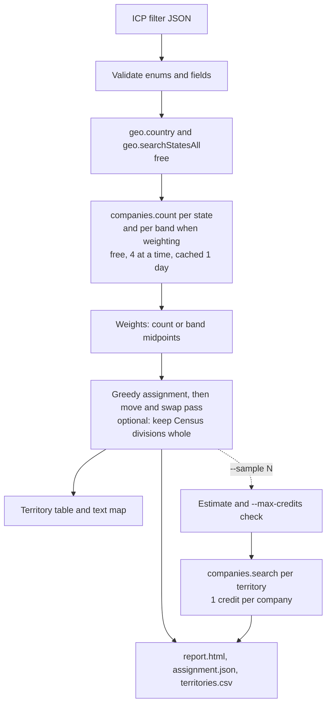

# Territory Planner

Split a country into sales territories with a balanced number of ICP companies, using only free CompanyEnrich company counts.

Territory Planner is a TypeScript CLI for RevOps and sales leaders. You give it your ideal customer profile (ICP) as a company search filter. It counts matching companies in every state or province with the free count endpoint, then assigns states to N territories so each rep gets a similar share of the market. You get a territory table in the terminal, a self-contained HTML report with a US tile map (or bar charts for other countries), an `assignment.json` to load into a routing tool, and a `territories.csv`. It shows how far the free `companies.count` endpoint goes on its own: one count per state, plus one per state per size or revenue band if you weight the split. No LLM is involved.

**The default run costs 0 credits.** Only the optional `--sample` step spends credits, and it shows the estimate and enforces a cap before it starts.

## Example output

A real run with the shipped ICP (B2B SaaS companies with 51-500 employees), four US territories and four reps. It cost 0 credits (the counts came from the one-day cache of an earlier identical run, which made the same 67 free requests):

```text
$ npm start -- --icp examples/icp.json --reps "Ana,Ben,Chen,Dee"
Planning 4 territories in United States. This run uses only free endpoints: 0 credits.
Counting ICP companies in 66 United States states: 66 x 1 count, plus 1 country total = 67 free count requests (67 cached), 4 at a time. Cost: 0 credits.
  counted 67/67
Note: California alone holds 25.4% of ICP companies, more than an even share (25.0%), so its territory is the largest whatever the split. Use fewer territories, or split California further by hand.

#  Rep   States  ICP companies  Share  vs even  Largest states
1  Ana        1          1,593  25.4%    +1.7%  CA 1,593
2  Ben       19          1,558  24.9%    -0.6%  TX 499, IL 216, NJ 167 +14 more
3  Chen      29          1,559  24.9%    -0.5%  NY 706, DE 183, PA 151 +14 more
4  Dee       17          1,558  24.9%    -0.6%  FL 354, MA 343, GA 214 +14 more

Balance on ICP companies: max/min 1.022, std dev 15 (1.0% of the mean).

AK 3                                                        ME 4
                                                      VT 4  NH 2
WA 3  ID 2  MT 3  ND 2  MN 4  IL 2  WI 4  MI 2  NY 3  RI 3  MA 4
OR 3  NV 3  WY 4  SD 2  IA 4  IN 3  OH 2  PA 3  NJ 2  CT 4
CA 1  UT 4  CO 4  NE 2  MO 2  KY 2  WV 4  VA 2  MD 4  DE 3
      AZ 3  NM 3  KS 3  AR 3  TN 2  NC 2  SC 4  DC 3
                  OK 2  LA 4  MS 4  AL 3  GA 4
HI 3              TX 2                          FL 4        PR 2

Not on the grid: 14 areas with no ICP companies

Credits spent: 0 (free counts only).
Report:     output/20261111-154758-us-4t/report.html
Assignment: output/20261111-154758-us-4t/assignment.json
CSV:        output/20261111-154758-us-4t/territories.csv
```

The text map is the US tile grid: each state code is followed by its territory number. The HTML report draws the same grid as colored tiles with counts, plus a stacked bar per territory, the territory table, every state with its CompanyEnrich state id, and notes on how the plan was built. The 14 areas off the grid are US minor outlying islands and territories such as Guam, all with no ICP companies here; they still get an owner (the territory of the nearest state) so routing never falls through.

The unconstrained plan balances counts but scatters states. With `--keep-regions`, US Census divisions stay whole where balance allows. Here only Pacific had to be split, because California alone is more than a quarter of the market. This run also fetched 2 sample accounts per territory, for 8 credits:

```text
$ npm start -- --icp examples/icp.json --reps "Ana,Ben,Chen,Dee" --keep-regions --sample 2
Planning 4 territories in United States. Counts are free; --sample 2 spends up to 8 credits (cap 20).
...
Fetching 2 sample accounts per territory with paid searches: 8 credits (cap 20, balance 49,189).

#  Rep   States  ICP companies  Share  vs even  Largest states
1  Ana        1          1,593  25.4%    +1.7%  CA 1,593
2  Ben       29          1,538  24.5%    -1.9%  NY 706, NJ 167, PA 151 +12 more
3  Chen      15          1,549  24.7%    -1.1%  TX 499, MA 343, IL 216 +12 more
4  Dee       21          1,588  25.3%    +1.3%  FL 354, GA 214, DE 183 +18 more

Balance on ICP companies: max/min 1.036, std dev 23.9 (1.5% of the mean).

AK 2                                                        ME 3
                                                      VT 3  NH 3
WA 4  ID 2  MT 2  ND 4  MN 4  IL 3  WI 3  MI 3  NY 2  RI 3  MA 3
OR 2  NV 2  WY 2  SD 4  IA 4  IN 3  OH 3  PA 2  NJ 2  CT 3
CA 1  UT 2  CO 2  NE 4  MO 4  KY 4  WV 4  VA 4  MD 4  DE 4
      AZ 2  NM 2  KS 4  AR 3  TN 4  NC 4  SC 4  DC 4
                  OK 3  LA 3  MS 4  AL 4  GA 4
HI 2              TX 3                          FL 4        PR 2

Sample accounts:
1  WordPress.com (wordpress.com): San Francisco, CA, 51-200 employees
1  Brave Software (brave.com): San Francisco, CA, 51-200 employees
2  Bitly (bit.ly): NY, 201-500 employees
2  Peatix (peatix.com): NY, 51-200 employees
3  Basecamp (basecamp.com): Chicago, IL, 51-200 employees
3  Wistia (wistia.com): Cambridge, MA, 51-200 employees
4  Calendly (calendly.com): Atlanta, GA, 201-500 employees
4  Givebutter (givebutter.com): Wilmington, DE, 51-200 employees

Credits spent: 8.
```

Weighting by estimated headcount (`--weight-by employees`, still free, 199 count requests) and a non-US country (`--country DE --territories 3`, 17 requests):

```text
#  Rep   States  ICP companies  Est. employees  Share  vs even  Largest states
1  Ana        1          1,593          290.4K  25.8%    +3.2%  CA 290.4K
2  Ben       19          1,574          278.3K  24.7%    -1.1%  TX 83.8K, GA 39.5K, IL 38.1K +14 more
3  Chen      29          1,595          278.2K  24.7%    -1.1%  NY 124.2K, NJ 31.8K, DE 27K +14 more
4  Dee       17          1,506          278.3K  24.7%    -1.1%  MA 66K, FL 60.2K, PA 29.5K +14 more

Balance on estimated employees: max/min 1.044, std dev 5.2K (1.9% of the mean).
```

```text
#  Rep  States  ICP companies  Share  vs even  Largest states
1  -         6            303  33.4%    +0.1%  NW 166, HH 50, NI 46 +3 more
2  -         4            302  33.3%    -0.2%  BY 161, BW 121, TH 13 +1 more
3  -         6            303  33.4%    +0.1%  BE 163, HE 75, RP 26 +3 more

Balance on ICP companies: max/min 1.003, std dev 0.5 (0.2% of the mean).

1  ################################      303  NW, HH, NI, SN, MV, BB
2  ################################      302  BY, BW, TH, ST
3  ################################      303  BE, HE, RP, SH, HB, SL
```

## How it works

1. **Load the ICP.** `examples/icp.json` is a v2 `CompanySearchFilter`. The CLI checks every enum value (employee and revenue bands, categories, company types, funding rounds) and rejects unknown fields and geography fields before it makes any request.
2. **List the states.** The free `geo.country` call validates the country code, and `geo.searchStatesAll` pages through its states with their CompanyEnrich ids and coordinates.
3. **Count, for free.** One `companies.count` per state with `{ ...icp, country, state }`, plus one for the whole country, at most 4 in flight. With `--weight-by`, each state is also counted once per employee or revenue band. Counts are cached in `output/.cache/` for a day.
4. **Weight (optional).** A state's weight is the sum of band count x band midpoint. Companies with no band on file count at the country-wide average midpoint.
5. **Partition.** Greedy longest-processing-time assignment (heaviest state to the lightest territory), then a local search that moves or swaps single states between territory pairs, largest gap first, while that narrows the gap. With `--keep-regions`, each Census division starts as one block and the heaviest is split only while the plan is uneven.
6. **Render.** Territories are numbered west to east and matched to `--reps` in that order. The CLI writes `report.html`, `assignment.json` and `territories.csv` to `output/<run-id>/`.
7. **Sample (optional, paid).** `--sample N` runs one `companies.search` per territory for N example accounts, after printing the estimate and checking `--max-credits`. Each result is saved to `output/.cache/samples.json` as soon as it arrives, keyed by the exact request (ICP, country, the territory's state ids and page size), so a later run with the same request reuses it instead of paying again.



## CompanyEnrich endpoints used

| SDK method | Endpoint | Why | Cost |
| --- | --- | --- | --- |
| `geo.country(code)` | `GET /v2/geo/countries/{countryCode}` | Validate `--country` and get its name | Free |
| `geo.searchStatesAll(...)` | `POST /v2/geo/states` | List states with ids (for the `state` filter) and coordinates | Free |
| `companies.count(...)` | `POST /v2/companies/search/count` | ICP companies per state, per band, and for the whole country | Free |
| `me()` | `GET /v2/me` | Show the balance before `--sample` | Free |
| `companies.search(...)` | `POST /v2/companies/search` | `--sample` example accounts per territory | 1 credit per company returned; an empty page costs 1 |

The app uses `total` from the count response, the full matching population, rather than `count`, which is capped at the plan's search limit. Full API docs: https://docs.companyenrich.com.

## Quickstart

Requires Node.js 22.12 or newer and a CompanyEnrich API key from https://companyenrich.com/dashboard.

```sh
cd territory-planner
npm ci
export COMPANYENRICH_API_KEY="your-api-key"
npm start -- --icp examples/icp.json --reps "Ana,Ben,Chen,Dee"
```

Open the `report.html` path the CLI prints (on macOS, `open output/<run-id>/report.html`). Instead of exporting the key, you can copy `.env.example` to `.env` and fill it in.

To check everything without network or a key: `npm run typecheck && npm test`.

## Configuration

| Environment variable | Required | Purpose |
| --- | --- | --- |
| `COMPANYENRICH_API_KEY` | Yes | Your API key. Read from the shell or from a `.env` file in this folder. |

| Flag | Default | What it does |
| --- | --- | --- |
| `--icp <file>` | required | ICP filter as JSON, a v2 `CompanySearchFilter`. See below. |
| `--country <code>` | `US` | Two-letter country code. |
| `--territories <n>` | `4`, or one per rep | Number of territories, 2 to 8. |
| `--reps "<a,b,...>"` | none | Rep names, one per territory, assigned west to east. |
| `--weight-by <mode>` | `none` | `none` balances company counts. `employees` or `revenue` balances estimated headcount or revenue (more free requests). |
| `--keep-regions` | off | US only. Keep each Census division in one territory where balance allows. |
| `--sample <n>` | `0` | Fetch n example accounts per territory with paid searches, 0 to 25. |
| `--max-credits <n>` | `20` | Refuse a `--sample` whose worst case (n x territories) is above this, before any request. |
| `--dry-run` | off | Free calls only. With `--sample`, prints what it would cost instead of fetching. |
| `--refresh` | off | Ignore cached counts and count again. Saved paid samples are still reused. |
| `--out <dir>` | `output` | Where runs, the count cache and saved samples are written. |

**The ICP file.** Any v2 company filter field works except geography (`country`, `state`, `city`, `region`), which the planner sets itself. Values can be a single value, an array, or `{ "in": [...], "notIn": [...] }`. The CLI checks every key against the SDK's `CompanySearchFilter` type before any request, including keys inside advanced objects and workforce filters, and suggests the right field (`employee` becomes "did you mean employees?", and `industry` points to `naicsCodes` or `categories`). For example:

```json
{
  "categories": ["b2b", "saas"],
  "employees": ["51-200", "201-500"]
}
```

`categories` requires every listed category, so this means "B2B and SaaS". v2 has no plain `industry` filter: use `naicsCodes` with codes from the free `industries.list()`.

**Weighting.** Band midpoints are (low + high) / 2, and 1.5 x the lower bound for the open-ended top band:

| Employees | 1-10 | 11-50 | 51-200 | 201-500 | 501-1K | 1K-5K | 5K-10K | over-10K |
| --- | --- | --- | --- | --- | --- | --- | --- | --- |
| Midpoint | 5.5 | 30.5 | 125.5 | 350.5 | 750.5 | 3,000 | 7,500 | 15,000 |

| Revenue | under-1m | 1m-10m | 10m-50m | 50m-100m | 100m-200m | 200m-1b | over-1b |
| --- | --- | --- | --- | --- | --- | --- | --- |
| Midpoint (USD M) | 0.5 | 5.5 | 30 | 75 | 150 | 600 | 1,500 |

Only the bands your ICP allows are counted. Companies with no band on file (common for revenue) are weighted at the country-wide average midpoint of the companies that have one.

**Outputs** in `output/<run-id>/`:

- `report.html`: self-contained report, no scripts or external assets, light and dark themes.
- `assignment.json`: territory, rep, totals and share, then each state with its CompanyEnrich `id`, code, name, ICP company count and weight. Also the ICP, balance stats, coverage and credits spent.
- `territories.csv`: one row per state (`territory,rep,state_id,state_code,state_name,icp_companies,weight`) for spreadsheets and CRM territory rules.

## Credits

| Step | Requests | Credits |
| --- | --- | --- |
| Country lookup and state list | 2 (US) | 0 |
| ICP count per state, plus the country total | 67 (US), 17 (DE) | 0 |
| `--weight-by employees` with the example ICP (2 bands) | 1 + 66 x 3 = 199 (US) | 0 |
| `--weight-by revenue` (7 bands) | 1 + 66 x 8 = 529 (US) | 0 |
| `--sample N` | 1 search per territory | up to N x territories (8 for `--sample 2` with 4 territories) |

The default demo costs **0 credits**. Building and testing this app used 16 credits in total: two `--sample 2` runs of 8 credits each, both matching the estimate exactly as measured with `me()` before and after. Every other run, including the weighted and German ones, left the balance unchanged.

To cap spend, `--max-credits` (default 20) stops a sample before the first request if its worst case is higher. `--dry-run` prints the sample estimate and spends nothing. Territories with no ICP companies are never searched, and a small territory only asks for as many accounts as it has.

If a paid search fails partway, the territories already fetched are saved in `output/.cache/samples.json` (kept for 7 days) and written to the outputs with the credits actually spent. The CLI exits with an error and prints the command to resume: the same command without `--refresh`. Running it re-plans from the cached counts, reuses the saved territories at no cost, and buys only the ones still missing. A different ICP, sample size or territory split is a different request and is bought again. This was tested with a mocked API that fails partway, not by spending live credits.

## Limitations

- **States are the smallest unit.** A state bigger than an even share caps how even the plan can be. With this ICP, California holds 25.4% of the US market, so with 5 or more territories the max/min ratio climbs (1.36 at 5). The CLI warns when this happens. Real teams usually split such a state by city or give it two reps.
- **Territories are built from states.** Companies are placed by their headquarters state, and the report shows how many ICP companies were placed.
- **Territories are not contiguous.** The default plan optimizes balance only, so a territory can mix distant states. `--keep-regions` keeps Census divisions whole but can still pair divisions that do not touch (in the example, Mountain with Middle Atlantic).
- **Counts are a market proxy.** They come from the CompanyEnrich dataset, not your CRM, and they change as the data updates. Weighting uses band midpoints, so "est. employees" and "est. revenue" are rough sizes, not reported figures.
- **Up to 8 territories**, so each gets a distinct color in the report. Tiles also print the territory number, so the map does not rely on color alone.
- **Tested live and mocked.** Everything here was run live against the API (US default, `--keep-regions`, `--weight-by employees`, Germany, `--sample 2`, bad key, unknown country). The test suite runs offline with a fake `fetch` injected into the real SDK client, using fixtures captured from those live free counts.

## Ideas to extend it

- Split oversized states by city with `geo.searchCities` and the `city` filter, so a state like California can be shared between reps.
- Add a state adjacency graph and only allow moves that keep territories contiguous.
- Rebalance an existing assignment with as few state moves as possible, instead of planning from scratch.
- Exclude your current customers with `domain: { notIn: [...] }` so territories balance on open market only.
- Push `territories.csv` into your CRM's territory rules or a lead-routing tool.
